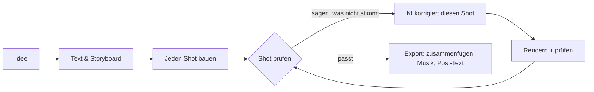

<h1 align="center">
  <br/>
  Shotloop
</h1>

<p align="center"><b>Kurze Erklärvideos aus Code, Shot für Shot.</b><br/>
Aus einer Idee werden Text, Storyboard und ein Film aus Shots. Jeder Shot hat seine eigene Schleife: Die KI schreibt ihn, Shotloop rendert ihn, du prüfst ihn, die KI korrigiert ihn. Eine Korrektur rendert nur diesen Shot neu, nicht den ganzen Film.</p>

<p align="center">
  
</p>

<p align="center">
  <a href="https://github.com/chihyungchang/Shotloop/releases/latest"><b>Für macOS herunterladen</b></a> ·
  <a href="https://github.com/chihyungchang/Shotloop/releases">Releases</a> ·
  <a href="#aus-dem-quellcode-bauen">Aus dem Quellcode bauen</a>
</p>

<p align="center">
  <a href="https://github.com/chihyungchang/Shotloop/releases/latest"></a>
  
  <a href="LICENSE"></a>
  
</p>

<p align="center"><a href="README.md">English</a> · <a href="README.zh-CN.md">简体中文</a> · <a href="README.zh-TW.md">繁體中文</a> · <a href="README.ja.md">日本語</a> · <a href="README.ko.md">한국어</a> · <a href="README.es.md">Español</a> · <a href="README.pt-BR.md">Português</a> · <a href="README.fr.md">Français</a> · <b>Deutsch</b> · <a href="README.it.md">Italiano</a> · <a href="README.ru.md">Русский</a> · <a href="README.tr.md">Türkçe</a> · <a href="README.vi.md">Tiếng Việt</a> · <a href="README.id.md">Bahasa Indonesia</a></p>

---

## Was ist Shotloop

Shotloop ist eine Desktop-App für kurze Videos, die mit Code gezeichnet werden: Produktvideos, Wissenschaftserklärungen, Datengeschichten und Animationen im Folienstil – in 2D (Webseiten, Bild für Bild gerendert) oder 3D (Blender-Szenen), in sieben visuellen Stilen.

Du beginnst mit einem Satz. Die KI wählt, wie er gezeigt wird (filmische Szene, Infografik, Karte, Interface-Demo, Blaupause, Kinetic Type oder 3D), und ein Theme – außer du wählst selbst. Sie schreibt Hook, Skript und Fakten mit Quellen und teilt alles in ein Storyboard auf. Du bearbeitest das Storyboard, die KI baut jeden Shot. Im Studio siehst du dir jeden Shot an und sagst in einfachen Worten, was nicht stimmt, etwa „die Schrift ist zu klein“ oder „zu statisch: bring etwas Bewegung rein“. Die KI ändert diesen Shot, rendert ihn, prüft ihn anhand der Notizen und zeigt dir einen Vorher-Nachher-Vergleich. Wenn der Film passt, fügt „Exportieren“ die Shots zusammen und legt Musik darunter. Die KI gestaltet ein Cover im Look des Films (oder füllt die Vorlage deiner Serie) und schreibt den Post für jede Plattform – alles in einem eigenen Ordner.

Die KI ist die, die du schon nutzt: Claude Code oder ein anderer Coding-Agent, bei dem du angemeldet bist, eine Modell-API mit eigenem Schlüssel oder ein lokales Modell.

Die App spricht 14 Sprachen: English, 简体中文, 繁體中文, 日本語, 한국어, Español, Português, Français, Deutsch, Italiano, Русский, Türkçe, Tiếng Việt und Bahasa Indonesia. Sie folgt der Sprache deines Macs; die KI antwortet und schreibt die Posts in der Sprache, die du wählst.

## Gemacht mit Shotloop

Jedes Bild unten hat Shotloop aus den mitgelieferten [Beispielen](examples/) gerendert.

<table>
<tr>
<td width="25%" valign="top"><br/><sub><b>3D</b>: ein Smartphone-Teardown in Blender.</sub></td>
<td width="25%" valign="top"><br/><sub><b>2D</b>: wie lange Sonnenlicht bis zur Erde braucht.</sub></td>
<td width="50%" valign="top"><br/><sub><b>2D-Daten</b>: jeden Tag 1 % besser, in Diagrammen (16:9).</sub></td>
</tr>
</table>

## Sieben Arten, eine Idee zu zeigen

Die KI wählt den Stil, der zum Thema passt, und begründet ihn; du kannst im Plan wechseln oder auf der Startseite selbst einen wählen. Jedes Bild ist ein Frame aus dem verlinkten Beispiel.

<table>
<tr>
<td width="25%" valign="top"><a href="examples/sunlight-en/"></a><br/><sub><b>Filmische Szene</b>: Licht, Tiefe und eine bewegte Kamera, für alles, was man filmen könnte: Weltall, Natur, Physik.</sub></td>
<td width="25%" valign="top"><a href="examples/solar-share-en/"></a><br/><sub><b>Infografik</b>: Diagramme und bewegte Zahlen, für Statistik, Vergleiche, Geld.</sub></td>
<td width="25%" valign="top"><a href="examples/coffee-map-en/"></a><br/><sub><b>Karte</b>: Weltkarte, Routen und aufleuchtende Länder, für Orte und Verbreitung.</sub></td>
<td width="25%" valign="top"><a href="examples/fake-parcel-text-en/"></a><br/><sub><b>Interface-Demo</b>: ein Smartphone oder Browser, Schritt für Schritt, für Apps, Einstellungen und Betrugsmaschen.</sub></td>
</tr>
<tr>
<td width="25%" valign="top"><a href="examples/zipper-blueprint-en/"></a><br/><sub><b>Blaupause</b>: Strichzeichnung auf Raster, Explosionsansichten und Beschriftungen, dafür, wie eine Maschine funktioniert.</sub></td>
<td width="25%" valign="top"><a href="examples/chinese-words-en/"></a><br/><sub><b>Kinetic Type</b>: riesige, bewegte Schrift, für Zitate, Wörter und Mythen.</sub></td>
<td width="25%" valign="top"><a href="examples/watch-3d-en/"></a><br/><sub><b>3D</b>: Blender-Szenen mit echtem Licht und einer Kamera, die durch den Raum fliegt.</sub></td>
</tr>
</table>

2D-Videos folgen festen Prinzipien: Bild zuerst, eine verdichtete Untertitelzeile pro Shot, jede Zeile lange genug sichtbar zum Lesen, jede Zahl in Bewegung, ehrlich in dem, was gezeigt wird, Quellen klein im Bild. Sie stehen in [engine/video/explainers/2d/README.md](engine/video/explainers/2d/README.md) und in jedem 2D-Prompt.

## Rundgang

<table>
<tr>
<td width="50%" valign="top">
<a href="docs/screenshots/home.jpg"></a><br/>
<sub><b>Start</b>: ein Satz. 2D oder 3D, Länge, Stil und Theme können auf „Auto“ bleiben. Oder starte mit einem Beispiel aus der Galerie.</sub>
</td>
<td width="50%" valign="top">
<a href="docs/screenshots/plan.jpg"></a><br/>
<sub><b>Text &amp; Storyboard</b>: Hook, Skript und Fakten mit Quellen sowie die Shots mit ihrem Inhalt – alles bearbeitbar, bevor etwas gerendert wird.</sub>
</td>
</tr>
<tr>
<td width="50%" valign="top">
<a href="docs/screenshots/studio.jpg"></a><br/>
<sub><b>Studio</b>: der Shot auf dunkler Bühne, der Filmstreifen sowie Notizen und Prüfungen zu jedem Shot.</sub>
</td>
<td width="50%" valign="top">
<a href="docs/screenshots/agent.jpg"></a><br/>
<sub><b>KI-Assistent</b>: sag, was nicht stimmt, und die KI korrigiert diesen Shot. Zieh den Trenner, um Vorher und Nachher zu vergleichen.</sub>
</td>
</tr>
<tr>
<td width="50%" valign="top">
<a href="docs/screenshots/export.jpg"></a><br/>
<sub><b>Exportieren</b>: Video (hoch, quer), Cover und Post-Text ankreuzen; Cover und Text vorher bearbeiten. Jeder Export landet in einem eigenen Ordner.</sub>
</td>
<td width="50%" valign="top">
<a href="docs/screenshots/settings.jpg"></a><br/>
<sub><b>Modelle und Anbieter</b>: ein CLI-Agent, bei dem du angemeldet bist, eine Modell-API mit deinem Schlüssel oder ein lokales Modell.</sub>
</td>
</tr>
</table>

## So funktioniert es



- **Shots statt eines langen Renders.** Ein Film ist eine Liste von Shots. Jeder Shot ist ein kleines Programm: `shot.js` für eine 2D-Seite, `shot.py` für eine Blender-Kamerafahrt. Jeder wird über einen Hash seiner Eingaben gecacht, sodass eine Korrektur einen Shot in Sekunden (2D) oder einer Minute (3D) neu rendert und der Export nur noch Clips zusammenfügt.
- **Korrekturen in einfachen Worten.** Die KI ändert nur den aktuellen Shot, außer die Korrektur betrifft die gemeinsame Welt. Sie rendert Standbilder, prüft sie anhand einer Checkliste (lesbar, nichts verdeckt, außerhalb der Untertitelzone usw.) und berichtet, was sie geändert hat.
- **Sieben visuelle Stile.** Filmische Szene, Infografik, Karte, Interface-Demo, Blaupause, Kinetic Type oder 3D, jeder mit eigenem Kit und Referenzbildern, die die KI ansieht, bevor sie wählt und baut ([`engine/shotloop/styles.mjs`](engine/shotloop/styles.mjs)). Ein Theme legt nur Hintergrund und Schrift fest; Bilder und Daten behalten die Farben, die ihr Thema braucht.
- **Regeln, an denen ein Plan gemessen wird.** Untertitel werden auf Länge und Standzeit geprüft, bevor etwas gebaut wird. Ein Bild, das in mehreren Shots vorkommt, wird einmal gezeichnet und geteilt, damit es überall gleich aussieht.
- **Fakten mit Quellen.** Der Text hält jede Tatsache neben ihrer Quelle, und der Post-Text darf nur Fakten aus dem Text verwenden.
- **Cover.** Die KI gestaltet ein Cover im Look des Films und prüft ihre eigenen Renders. Speichere eines als Vorlage, damit eine Serie einheitlich bleibt, oder lade ein Cover hoch, das dir gefällt, und die KI folgt seinem Design.
- **Musik passend zum Schnitt.** Der synthetisierte Klangteppich ist so abgestimmt, dass die Schnitte auf seine Beats fallen; er läuft bis zum letzten Frame und blendet aus.
- **Schnell beim Bearbeiten, volle Qualität beim Export.** 3D zeigt beim Bearbeiten schnelle Vorschauen und rendert erst beim Export in voller Qualität. 2D arbeitet durchgehend in voller Qualität.
- **Asset-Bibliothek für 3D.** Suche CC0-Modelle auf [Poly Pizza](https://poly.pizza) und [Smithsonian Open Access](https://www.si.edu/openaccess) mit deinem eigenen Schlüssel. Jedes Modell wird einmal geladen und lässt sich in jedes 3D-Projekt einfügen.

## Die KI dahinter

| Modus | Was du brauchst |
| --- | --- |
| **Lokaler CLI-Agent** | [Claude Code](https://docs.anthropic.com/en/docs/claude-code), auf diesem Mac angemeldet (Codex CLI und Gemini CLI sind experimentell). Läuft headless mit abgeschalteten eigenen Tools und arbeitet nur über die Tools von Shotloop. |
| **Modell-API** | Dein eigener Schlüssel. Voreinstellungen für Anthropic, OpenAI, Google Gemini, OpenRouter, xAI, Mistral, Together, DeepSeek, Qwen, Kimi, GLM, MiniMax, Doubao und SiliconFlow oder jeden Anthropic- bzw. OpenAI-kompatiblen Endpunkt. Schlüssel bleiben auf deinem Mac. |
| **Lokales Modell** | Ollama, LM Studio, vLLM, llama.cpp oder ein beliebiger OpenAI-kompatibler Server. |

Das Modell braucht Tool-Calling, für Prüfungen eines, das Bilder sehen kann. Der Agent arbeitet mit einem schmalen Satz an Tools: Er kann die Dateien des Shots lesen und schreiben, Standbilder rendern und Prüfungen melden. Shell-Befehle kann er nicht ausführen.

## Installation

1. Lade `Shotloop_<version>_aarch64.dmg` vom [neuesten Release](https://github.com/chihyungchang/Shotloop/releases/latest), öffne es und zieh Shotloop in „Programme“.
2. Installiere **Google Chrome** (2D-Shots werden darin gerendert). Für 3D-Projekte fragt Shotloop beim ersten Mal nach **Blender**.
3. Wähle die KI unter Einstellungen → Modelle und Anbieter. Ist Claude Code schon auf deinem Mac, wird es automatisch gewählt.

> **Erster Start:** Shotloop ist noch nicht von Apple notarisiert, daher meldet macOS, dass der Entwickler nicht überprüft werden kann. Öffne die App einmal über **Systemeinstellungen → Datenschutz & Sicherheit → Dennoch öffnen** oder führe im Terminal `xattr -dr com.apple.quarantine /Applications/Shotloop.app` aus. Danach öffnet sie sich normal, und Updates installieren sich ohne erneute Nachfrage.

Node.js und ffmpeg sind in der App enthalten. Shotloop sucht auf GitHub nach Updates und installiert sie direkt. Läuft auf Macs mit Apple Silicon (M1 und neuer).

## Aus dem Quellcode bauen

```bash
nvm use                      # Node 22.18+ (der Agent führt TypeScript direkt aus)
corepack enable              # einmalig: liefert das festgelegte pnpm
pnpm install
pnpm app                     # tauri dev; braucht die Rust-Toolchain
pnpm app:build               # Shotloop.app und ein dmg, mit Node und ffmpeg darin
```

`pnpm app` nutzt Node und ffmpeg deines Macs und führt alles direkt aus dem Checkout aus. Releases werden für den Updater signiert und mit [`app/scripts/release.mjs`](app/scripts/release.mjs) veröffentlicht.

<details>
<summary><b>Die Engine im Terminal</b></summary>

```bash
pnpm shotloop status   fixtures/hello-3d
pnpm shotloop render   fixtures/hello-3d --shot 02-close --stills   # Start/Mitte/Ende
pnpm shotloop render   fixtures/hello-3d --shot 02-close            # ein Clip in Editor-Qualität
pnpm shotloop export   fixtures/hello-3d                            # nur geänderte Shots werden gerendert
pnpm shotloop new      my-short --idea "Warum altert dein Handy-Akku?" --track auto --duration auto
pnpm shotloop new      coffee --idea "Woher kommt Kaffee?" --track 2d --style map --duration 30
pnpm shotloop export   fixtures/hello-3d --to ~/Movies/Shotloop --name "Hello"   # in einen neuen Ordner dort
pnpm shotloop covers   list                                         # Cover-Vorlagen
pnpm shotloop doctor
```

Mit `--json` gibt es zeilenweise Events (das liest die App). Der Agent läuft genauso:

```bash
node agent/src/main.ts detect                                         # CLI-Agenten und lokale Server auf diesem Mac
SHOTLOOP_PROVIDER=cli SHOTLOOP_CLI=claude node agent/src/main.ts check fixtures/hello-3d --shot 01-wide
pnpm test                                                             # jedes Backend gegen gescriptete Platzhalter
```

</details>

<details>
<summary><b>Projektformat</b></summary>

```
my-video/
  shotloop.json        Titel, Track (2d|3d), Stil, Größe, fps, Shots [{ id, title, duration }]
  storyboard.json      der Plan: Text (Hook, Skript, Fakten mit Quellen) und Shots
  world/               3D: world.py (+ screen.html); 2D: page.html (Kit des Stils), parts.js (wiederkehrende
                       Bilder, einmal gezeichnet), geo.data.js (Länder des Kartenstils)
  shots/<id>/          shot.py | shot.js, notes.md (muss zeigen, im Bild, Bewegung)
  assets/<id>/         3D-Modelle aus der Asset-Bibliothek
  copy.md  script.md  captions.html  music.json  thumb.html  publish.json
  .shotloop/           Cache: pro Shot und Eingabe-Hash, Takes, Prüfungen, Korrekturen
  out/                 Exporte der Engine (mit Zeitstempel); die App kopiert jeden in einen neuen Ordner deiner Wahl
```

- **3D**: `world.py` baut die gemeinsame Welt mit `kit` ([`engine/video/explainers/3d/lib/kit.py`](engine/video/explainers/3d/lib/kit.py)). `shot.py` läuft im Namespace der Welt und erzeugt eine Kamera; `at(t)` bildet Shot-lokale Sekunden auf die Filmzeit ab.
- **2D**: `shot.js` exportiert standardmäßig `render(t, ctx)`, das `world/page.html` zur Shot-lokalen Zeit `t` zeichnet.
- **Cache**: Der Schlüssel eines Shots hasht Welt, Code, Untertitel, Assets, Renderer und Einstellungen. Unveränderte Shots werden wiederverwendet.

</details>

<details>
<summary><b>Aufbau des Repositorys</b></summary>

| Pfad | Inhalt |
| --- | --- |
| [`app/`](app/) | Die Desktop-App: eine Tauri-2-Shell (Rust) mit Render-Warteschlange, Updater und Prozessüberwachung sowie die UI in React + TypeScript. |
| [`engine/shotloop/`](engine/shotloop/) | Die Shot-Engine: Projektformat, Render-Cache pro Shot, 2D- (Chrome) und 3D-Renders (Blender), Filmmontage, MP4-Export, Musik, Asset-Bibliothek. Eine CLI, die die App aufruft. |
| [`agent/`](agent/) | Der Agent: Planung, Aufbau, Korrekturen in einfachen Worten, Prüfung anhand der Checkliste, Post-Text. Unterstützt API, CLI (über MCP) und lokale Modelle. |
| [`examples/`](examples/) | Die Beispiele auf der Startseite, auf Englisch: mindestens eines pro visuellem Stil (2D und 3D, 9:16 und 16:9). |
| [`fixtures/`](fixtures/) | Projekte für die Tests und Terminal-Walkthroughs. |

</details>

## Lizenz

[Apache License 2.0](LICENSE); siehe [NOTICE](NOTICE). Modelle aus der Asset-Bibliothek behalten ihre eigenen Lizenzen (CC0 oder CC-BY, mit Namensnennung im Projekt).
