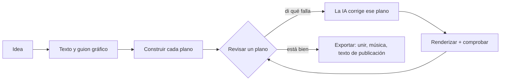

<h1 align="center">
  <br/>
  Shotloop
</h1>

<p align="center"><b>Videos explicativos cortos hechos con código, plano a plano.</b><br/>
Una idea se convierte en texto, guion gráfico y una película hecha de planos. Cada plano tiene su propio ciclo: la IA lo escribe, Shotloop lo renderiza, tú lo revisas y la IA lo corrige. Una corrección vuelve a renderizar solo ese plano, no la película entera.</p>

<p align="center">
  
</p>

<p align="center">
  <a href="https://github.com/chihyungchang/Shotloop/releases/latest"><b>Descargar para macOS</b></a> ·
  <a href="https://github.com/chihyungchang/Shotloop/releases">Versiones</a> ·
  <a href="#compilar-desde-el-código-fuente">Compilar desde el código fuente</a>
</p>

<p align="center">
  <a href="https://github.com/chihyungchang/Shotloop/releases/latest"></a>
  
  <a href="LICENSE"></a>
  
</p>

<p align="center"><a href="README.md">English</a> · <a href="README.zh-CN.md">简体中文</a> · <a href="README.zh-TW.md">繁體中文</a> · <a href="README.ja.md">日本語</a> · <a href="README.ko.md">한국어</a> · <b>Español</b> · <a href="README.pt-BR.md">Português</a> · <a href="README.fr.md">Français</a> · <a href="README.de.md">Deutsch</a> · <a href="README.it.md">Italiano</a> · <a href="README.ru.md">Русский</a> · <a href="README.tr.md">Türkçe</a> · <a href="README.vi.md">Tiếng Việt</a> · <a href="README.id.md">Bahasa Indonesia</a></p>

---

## Qué es Shotloop

Shotloop es una app de escritorio para videos cortos dibujados con código: promos de producto, divulgación científica, historias con datos y animaciones tipo diapositiva, en 2D (páginas web renderizadas fotograma a fotograma) o 3D (escenas de Blender), con siete estilos visuales.

Empiezas con una frase. La IA elige cómo mostrarla (escena cinematográfica, infografía, mapa, demo de interfaz, plano técnico, tipografía cinética o 3D) y un tema, salvo que los elijas tú. Escribe el gancho, el guion y los datos con sus fuentes, y luego los divide en un guion gráfico. Tú editas el guion gráfico y la IA construye cada plano. En el editor revisas cada plano y dices qué falla con palabras normales, como "el texto es muy pequeño" o "está muy quieto: añade algo de movimiento". La IA cambia ese plano, lo renderiza, lo comprueba con las notas y te muestra un antes/después. Cuando la película funciona, Exportar une los planos y añade música; la IA diseña una portada con el estilo de la película (o rellena la plantilla de tu serie) y escribe la publicación para cada plataforma, todo en una carpeta propia.

La IA es la que ya usas: Claude Code u otro agente de código con tu sesión iniciada, una API de modelos con tu propia clave o un modelo local.

La app está en 14 idiomas: English, 简体中文, 繁體中文, 日本語, 한국어, Español, Português, Français, Deutsch, Italiano, Русский, Türkçe, Tiếng Việt y Bahasa Indonesia. Sigue el idioma de tu Mac, y la IA responde y escribe las publicaciones en el que elijas.

## Hecho con Shotloop

Cada fotograma de abajo lo renderizó Shotloop a partir de los [ejemplos](examples/) que incluye.

<table>
<tr>
<td width="25%" valign="top"><br/><sub><b>3D</b>: el desmontaje de un teléfono en Blender.</sub></td>
<td width="25%" valign="top"><br/><sub><b>2D</b>: cuánto tarda la luz del Sol en llegar a la Tierra.</sub></td>
<td width="50%" valign="top"><br/><sub><b>Datos 2D</b>: un 1 % mejor cada día, en gráficos (16:9).</sub></td>
</tr>
</table>

## Siete formas de mostrar una idea

La IA elige el estilo que encaja con el tema y te explica por qué; puedes cambiarlo en el plan o elegir uno en Inicio. Cada imagen es un fotograma del ejemplo al que enlaza.

<table>
<tr>
<td width="25%" valign="top"><a href="examples/sunlight-en/"></a><br/><sub><b>Escena cinematográfica</b>: luz, profundidad y cámara en movimiento, para cosas que podrías filmar: espacio, naturaleza, física.</sub></td>
<td width="25%" valign="top"><a href="examples/solar-share-en/"></a><br/><sub><b>Infografía</b>: gráficos y números en movimiento, para estadísticas, comparaciones, dinero.</sub></td>
<td width="25%" valign="top"><a href="examples/coffee-map-en/"></a><br/><sub><b>Mapa</b>: el mapa del mundo, rutas y países que se iluminan, para lugares y cómo se extienden las cosas.</sub></td>
<td width="25%" valign="top"><a href="examples/fake-parcel-text-en/"></a><br/><sub><b>Demo de interfaz</b>: un teléfono o un navegador, paso a paso, para apps, ajustes y estafas.</sub></td>
</tr>
<tr>
<td width="25%" valign="top"><a href="examples/zipper-blueprint-en/"></a><br/><sub><b>Plano técnico</b>: dibujo lineal sobre cuadrícula, vistas explosionadas y anotaciones, para explicar cómo funciona una máquina.</sub></td>
<td width="25%" valign="top"><a href="examples/chinese-words-en/"></a><br/><sub><b>Tipografía cinética</b>: letras enormes que se mueven, para citas, palabras y mitos.</sub></td>
<td width="25%" valign="top"><a href="examples/watch-3d-en/"></a><br/><sub><b>3D</b>: escenas de Blender con luz real y una cámara que recorre el espacio.</sub></td>
</tr>
</table>

Los videos 2D siguen un conjunto fijo de principios: lo visual primero, un subtítulo condensado por plano, cada línea en pantalla el tiempo suficiente para leerla, cada número en movimiento, honestidad sobre lo que se muestra y las fuentes en pequeño en pantalla. Están en [engine/video/explainers/2d/README.md](engine/video/explainers/2d/README.md) y en cada prompt 2D.

## Recorrido por la app

<table>
<tr>
<td width="50%" valign="top">
<a href="docs/screenshots/home.jpg"></a><br/>
<sub><b>Inicio</b>: una frase. 2D o 3D, la duración, el estilo y el tema pueden quedarse en Auto. O empieza con un ejemplo de la galería.</sub>
</td>
<td width="50%" valign="top">
<a href="docs/screenshots/plan.jpg"></a><br/>
<sub><b>Texto y guion gráfico</b>: el gancho, el guion y los datos con fuentes, y los planos con lo que muestra cada uno, todo editable antes de renderizar nada.</sub>
</td>
</tr>
<tr>
<td width="50%" valign="top">
<a href="docs/screenshots/studio.jpg"></a><br/>
<sub><b>Editor</b>: el plano sobre un escenario oscuro, la tira de planos y las notas y comprobaciones de cada plano.</sub>
</td>
<td width="50%" valign="top">
<a href="docs/screenshots/agent.jpg"></a><br/>
<sub><b>Asistente de IA</b>: di qué falla y la IA corrige ese plano. Arrastra el divisor para comparar el antes y el después.</sub>
</td>
</tr>
<tr>
<td width="50%" valign="top">
<a href="docs/screenshots/export.jpg"></a><br/>
<sub><b>Exportar</b>: marca el video (vertical, horizontal), la portada y el texto de publicación; antes puedes editar la portada y el texto. Cada exportación va a su propia carpeta.</sub>
</td>
<td width="50%" valign="top">
<a href="docs/screenshots/settings.jpg"></a><br/>
<sub><b>Modelos y proveedores</b>: un agente CLI con tu sesión iniciada, una API de modelos con tu clave o un modelo local.</sub>
</td>
</tr>
</table>

## Cómo funciona



- **Planos, no un render largo.** Una película es una lista de planos. Cada plano es un pequeño programa: `shot.js` para una página 2D, `shot.py` para un movimiento de cámara en Blender. Cada uno se guarda en caché según un hash de sus entradas, así que una corrección vuelve a renderizar un plano en segundos (2D) o en un minuto (3D), y Exportar solo une clips.
- **Correcciones en lenguaje normal.** La IA solo toca el plano en el que estás, salvo que la corrección necesite el mundo compartido. Renderiza fotogramas, los comprueba con una lista (legible, nada tapado, fuera de la zona de subtítulos, etc.) e informa de lo que cambió.
- **Siete estilos visuales.** Escena cinematográfica, infografía, mapa, demo de interfaz, plano técnico, tipografía cinética o 3D, cada uno con su propio kit y fotogramas de referencia que la IA mira antes de elegir y construir ([`engine/shotloop/styles.mjs`](engine/shotloop/styles.mjs)). Un tema solo define el fondo y la tipografía; las imágenes y los datos mantienen los colores que su tema necesita.
- **Reglas para medir un plan.** Antes de construir nada se comprueba la longitud de los subtítulos y el tiempo que permanecen en pantalla. Una imagen que se repite entre planos se dibuja una vez y se comparte, para que se vea igual en todos.
- **Datos con fuentes.** El texto guarda cada dato junto a su fuente, y el texto de publicación solo puede usar datos del texto.
- **Portadas.** La IA diseña una portada con el estilo de la película y revisa sus propios renders. Guarda una como plantilla para que una serie sea coherente, o sube una portada que te guste y la IA sigue su diseño.
- **Música a la medida del montaje.** La base sintetizada se ajusta para que los cortes caigan en sus tiempos, dura hasta el último fotograma y termina con un fundido.
- **Rápido al editar, máxima calidad al exportar.** El 3D muestra vistas previas rápidas mientras editas y renderiza fotogramas en calidad completa solo al exportar. El 2D trabaja siempre en calidad completa.
- **Biblioteca de recursos para 3D.** Busca modelos CC0 en [Poly Pizza](https://poly.pizza) y [Smithsonian Open Access](https://www.si.edu/openaccess) con tu propia clave. Cada modelo se descarga una vez y se puede añadir a cualquier proyecto 3D.

## La IA que lo mueve

| Modo | Qué necesitas |
| --- | --- |
| **Agente CLI local** | [Claude Code](https://docs.anthropic.com/en/docs/claude-code), con la sesión iniciada en este Mac (Codex CLI y Gemini CLI son experimentales). Se ejecuta sin interfaz, con sus propias herramientas desactivadas, y solo trabaja con las herramientas de Shotloop. |
| **API de modelos** | Tu propia clave. Ajustes predefinidos para Anthropic, OpenAI, Google Gemini, OpenRouter, xAI, Mistral, Together, DeepSeek, Qwen, Kimi, GLM, MiniMax, Doubao y SiliconFlow, o cualquier endpoint compatible con Anthropic u OpenAI. Las claves se quedan en tu Mac. |
| **Modelo local** | Ollama, LM Studio, vLLM, llama.cpp o cualquier servidor compatible con OpenAI. |

El modelo necesita llamadas a herramientas, y las comprobaciones necesitan uno que pueda ver imágenes. El agente trabaja con un conjunto reducido de herramientas: puede leer y escribir los archivos del plano, renderizar fotogramas e informar de las comprobaciones. No puede ejecutar comandos de shell.

## Instalación

1. Descarga `Shotloop_<version>_aarch64.dmg` de la [última versión](https://github.com/chihyungchang/Shotloop/releases/latest), ábrelo y arrastra Shotloop a Aplicaciones.
2. Ten **Google Chrome** instalado (los planos 2D se renderizan en él). Para proyectos 3D, Shotloop te pide **Blender** la primera vez que creas uno.
3. Elige la IA en Ajustes → Modelos y proveedores. Si Claude Code ya está en tu Mac, se elige solo.

> **Primer arranque:** Shotloop aún no está notarizado por Apple, así que macOS dice que no puede verificar al desarrollador. Ábrelo una vez desde **Ajustes del Sistema → Privacidad y seguridad → Abrir igualmente**, o ejecuta `xattr -dr com.apple.quarantine /Applications/Shotloop.app` en Terminal. Después se abre con normalidad y las actualizaciones se instalan sin volver a preguntar.

Node.js y ffmpeg vienen dentro de la app. Shotloop busca actualizaciones en GitHub y las instala en su sitio. Funciona en Macs con Apple silicon (M1 y posteriores).

## Compilar desde el código fuente

```bash
nvm use                      # Node 22.18+ (el agente ejecuta TypeScript directamente)
corepack enable              # una vez: proporciona el pnpm fijado
pnpm install
pnpm app                     # tauri dev; necesita la toolchain de Rust
pnpm app:build               # Shotloop.app y un dmg, con Node y ffmpeg dentro
```

`pnpm app` usa el Node y el ffmpeg de tu Mac y ejecuta todo desde el repositorio clonado. Las versiones se firman para el actualizador y se publican con [`app/scripts/release.mjs`](app/scripts/release.mjs).

<details>
<summary><b>El motor desde una terminal</b></summary>

```bash
pnpm shotloop status   fixtures/hello-3d
pnpm shotloop render   fixtures/hello-3d --shot 02-close --stills   # inicio/mitad/final
pnpm shotloop render   fixtures/hello-3d --shot 02-close            # un clip, con la calidad del editor
pnpm shotloop export   fixtures/hello-3d                            # solo se renderizan los planos cambiados
pnpm shotloop new      my-short --idea "¿Por qué envejece la batería de tu teléfono?" --track auto --duration auto
pnpm shotloop new      coffee --idea "¿De dónde viene el café?" --track 2d --style map --duration 30
pnpm shotloop export   fixtures/hello-3d --to ~/Movies/Shotloop --name "Hello"   # en una carpeta nueva allí
pnpm shotloop covers   list                                         # plantillas de portada
pnpm shotloop doctor
```

Añade `--json` para recibir eventos línea a línea (lo que lee la app). El agente se ejecuta igual:

```bash
node agent/src/main.ts detect                                         # agentes CLI y servidores locales en este Mac
SHOTLOOP_PROVIDER=cli SHOTLOOP_CLI=claude node agent/src/main.ts check fixtures/hello-3d --shot 01-wide
pnpm test                                                             # cada backend contra sustitutos guionizados
```

</details>

<details>
<summary><b>Formato del proyecto</b></summary>

```
my-video/
  shotloop.json        título, track (2d|3d), estilo, tamaño, fps, planos [{ id, title, duration }]
  storyboard.json      el plan: texto (gancho, guion, datos con fuentes) y planos
  world/               3D: world.py (+ screen.html); 2D: page.html (el kit del estilo), parts.js (imágenes
                       que se repiten, dibujadas una vez), geo.data.js (los países del estilo mapa)
  shots/<id>/          shot.py | shot.js, notes.md (qué debe mostrar, texto en pantalla, movimiento)
  assets/<id>/         modelos 3D de la biblioteca de recursos
  copy.md  script.md  captions.html  music.json  thumb.html  publish.json
  .shotloop/           caché: por plano y hash de entradas, tomas, comprobaciones, correcciones
  out/                 las exportaciones del motor (con marca de tiempo); la app copia cada una a una carpeta nueva donde elijas
```

- **3D**: `world.py` construye el mundo compartido con `kit` ([`engine/video/explainers/3d/lib/kit.py`](engine/video/explainers/3d/lib/kit.py)). `shot.py` se ejecuta en el espacio de nombres del mundo y crea una cámara; `at(t)` convierte los segundos locales del plano en tiempo de la película.
- **2D**: `shot.js` exporta por defecto `render(t, ctx)`, que dibuja `world/page.html` en el tiempo local del plano `t`.
- **Caché**: la clave de un plano es un hash del mundo, su código, los subtítulos, los recursos, el renderizador y los ajustes. Los planos sin cambios se reutilizan.

</details>

<details>
<summary><b>Estructura del repositorio</b></summary>

| Ruta | Qué es |
| --- | --- |
| [`app/`](app/) | La app de escritorio: un contenedor Tauri 2 (Rust) con la cola de renderizado, el actualizador y la supervisión de procesos, y la interfaz en React + TypeScript. |
| [`engine/shotloop/`](engine/shotloop/) | El motor de planos: formato de proyecto, caché de renderizado por plano, renders 2D (Chrome) y 3D (Blender), montaje de la película, exportación a MP4, música, biblioteca de recursos. Una CLI a la que llama la app. |
| [`agent/`](agent/) | El agente: planificación, construcción, correcciones en lenguaje normal, comprobaciones con la lista, texto de publicación. Admite API, CLI (a través de MCP) y modelos locales. |
| [`examples/`](examples/) | Los ejemplos que ofrece Inicio, en inglés: al menos uno por estilo visual (2D y 3D, 9:16 y 16:9). |
| [`fixtures/`](fixtures/) | Proyectos para las pruebas y los recorridos por terminal. |

</details>

## Licencia

[Apache License 2.0](LICENSE); consulta [NOTICE](NOTICE). Los modelos de la biblioteca de recursos mantienen sus propias licencias (CC0 o CC-BY, con el crédito escrito en el proyecto).
