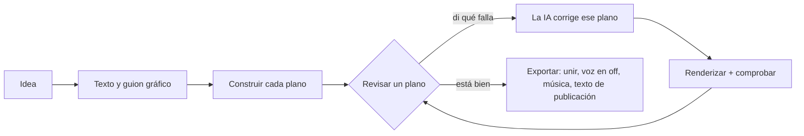

<h1 align="center">
  <br/>
  Shotloop
</h1>

<p align="center"><b>Videos cortos con IA. Corrige un plano, no toda la película.</b><br/>
Una idea se convierte en texto, guion gráfico y una película hecha de planos. Cada plano tiene su propio ciclo: la IA lo escribe, Shotloop lo renderiza, tú lo revisas y la IA lo corrige. Una corrección vuelve a renderizar solo ese plano, no la película entera.</p>

<p align="center">
  
</p>

<p align="center">
  <a href="https://github.com/chihyungchang/Shotloop/releases/latest"><b>Descargar para macOS</b></a> ·
  <a href="https://github.com/chihyungchang/Shotloop/releases">Versiones</a> ·
  <a href="#compilar-desde-el-código-fuente">Compilar desde el código fuente</a>
</p>

<p align="center">
  <a href="https://github.com/chihyungchang/Shotloop/releases/latest"></a>
  
  <a href="LICENSE"></a>
  
</p>

<p align="center"><a href="README.md">English</a> · <a href="README.zh-CN.md">简体中文</a> · <a href="README.zh-TW.md">繁體中文</a> · <a href="README.ja.md">日本語</a> · <a href="README.ko.md">한국어</a> · <b>Español</b> · <a href="README.pt-BR.md">Português</a> · <a href="README.fr.md">Français</a> · <a href="README.de.md">Deutsch</a> · <a href="README.it.md">Italiano</a> · <a href="README.ru.md">Русский</a> · <a href="README.tr.md">Türkçe</a> · <a href="README.vi.md">Tiếng Việt</a> · <a href="README.id.md">Bahasa Indonesia</a></p>

---

## Qué es Shotloop

Shotloop es una app de escritorio para videos cortos dibujados con código: promos de producto, divulgación científica, historias con datos y animaciones tipo diapositiva, en 2D (páginas web renderizadas fotograma a fotograma) o 3D (mundos de three.js renderizados como con un renderizador offline), con ocho estilos visuales.

Empiezas con una frase. La IA elige cómo mostrarla (escena cinematográfica, infografía, mapa, demo de interfaz, plano técnico, tipografía cinética, relato informativo o 3D) y un tema, salvo que los elijas tú. Escribe el gancho, el guion y los datos con sus fuentes, y luego los divide en un guion gráfico, con la frase que dice la voz en off sobre cada plano. Tú editas el guion gráfico y la IA construye cada plano. En el editor revisas cada plano y dices qué falla con palabras normales, como "el texto es muy pequeño" o "está muy quieto: añade algo de movimiento". La IA mira primero y te ofrece unas cuantas formas de cambiar ese plano; eliges una (o dices la tuya), y la IA cambia el plano y te muestra un antes/después. Cuando la película funciona, Exportar une los planos y coloca la voz en off con sus subtítulos y la música por debajo; la IA diseña una portada con el estilo de la película (o rellena la plantilla de tu serie) y escribe la publicación para cada plataforma, todo en una carpeta propia.

La IA es la que ya usas: Claude Code u otro agente de código con tu sesión iniciada, una API de modelos con tu propia clave o un modelo local.

La app está en 14 idiomas: English, 简体中文, 繁體中文, 日本語, 한국어, Español, Português, Français, Deutsch, Italiano, Русский, Türkçe, Tiếng Việt y Bahasa Indonesia. Sigue el idioma de tu Mac, y la IA responde y escribe las publicaciones en el que elijas.

## Hecho con Shotloop

Cada fotograma de abajo lo renderizó Shotloop a partir de los [ejemplos](examples/) que incluye.

<table>
<tr>
<td width="25%" valign="top"><br/><sub><b>3D</b>: un reloj mecánico en WebGL.</sub></td>
<td width="25%" valign="top"><br/><sub><b>2D</b>: cuánto tarda la luz del Sol en llegar a la Tierra.</sub></td>
<td width="50%" valign="top"><br/><sub><b>Datos 2D</b>: un 1 % mejor cada día, en gráficos (16:9).</sub></td>
</tr>
</table>

## Ocho formas de mostrar una idea

La IA elige el estilo que encaja con el tema y te explica por qué; puedes cambiarlo en el plan o elegir uno en Inicio. Cada imagen es un fotograma del ejemplo al que enlaza.

<table>
<tr>
<td width="25%" valign="top"><a href="examples/sunlight-en/"></a><br/><sub><b>Escena cinematográfica</b>: luz, profundidad y cámara en movimiento, para cosas que podrías filmar: espacio, naturaleza, física.</sub></td>
<td width="25%" valign="top"><a href="examples/solar-share-en/"></a><br/><sub><b>Infografía</b>: gráficos y números en movimiento, para estadísticas, comparaciones, dinero.</sub></td>
<td width="25%" valign="top"><a href="examples/coffee-map-en/"></a><br/><sub><b>Mapa</b>: el mapa del mundo, rutas y países que se iluminan, para lugares y cómo se extienden las cosas.</sub></td>
<td width="25%" valign="top"><a href="examples/fake-parcel-text-en/"></a><br/><sub><b>Demo de interfaz</b>: un teléfono o un navegador, paso a paso, para apps, ajustes y estafas.</sub></td>
</tr>
<tr>
<td width="25%" valign="top"><a href="examples/zipper-blueprint-en/"></a><br/><sub><b>Plano técnico</b>: dibujo lineal sobre cuadrícula, vistas explosionadas y anotaciones, para explicar cómo funciona una máquina.</sub></td>
<td width="25%" valign="top"><a href="examples/chinese-words-en/"></a><br/><sub><b>Tipografía cinética</b>: letras enormes que se mueven, para citas, palabras y mitos.</sub></td>
<td width="25%" valign="top"><a href="examples/bybit-heist-en/"></a><br/><sub><b>Relato informativo</b>: sucesos de última hora contados con tensión: un reloj en marcha, el rastro del dinero, la cronología, quién dijo qué.</sub></td>
<td width="25%" valign="top"><a href="examples/watch-3d-en/"></a><br/><sub><b>3D</b>: mundos de three.js con luz de estudio, sombras suaves y una cámara que recorre el espacio.</sub></td>
</tr>
</table>

Los vídeos 2D siguen un conjunto de reglas: unas fijas que mantienen limpio cada fotograma y fiel el vídeo (nada tapado, sin fotogramas rotos, tiempo para leer cada línea, honestidad, fuentes citadas) y un gusto de la casa que puedes reescribir, desactivar o ampliar en Ajustes → Reglas, junto con una caja de herramientas de recursos de animación que puedes ampliar con los tuyos. Están en [engine/shotloop/rules.mjs](engine/shotloop/rules.mjs) y llegan a cada prompt 2D. "Comprobar" revisa un plano con ellas, y cada comprobación fallida enlaza con su regla.

## Recorrido por la app

<table>
<tr>
<td width="50%" valign="top">
<a href="docs/screenshots/home.jpg"></a><br/>
<sub><b>Inicio</b>: una frase. 2D o 3D, la duración, el estilo y el tema pueden quedarse en Auto. O empieza con un ejemplo de la galería.</sub>
</td>
<td width="50%" valign="top">
<a href="docs/screenshots/plan.jpg"></a><br/>
<sub><b>Texto y guion gráfico</b>: el gancho, el guion y los datos con fuentes, y los planos con lo que muestra cada uno, todo editable antes de renderizar nada.</sub>
</td>
</tr>
<tr>
<td width="50%" valign="top">
<a href="docs/screenshots/studio.jpg"></a><br/>
<sub><b>Editor</b>: el plano sobre un escenario oscuro, la tira de planos con las pistas de sonido debajo, y las notas y comprobaciones de cada plano.</sub>
</td>
<td width="50%" valign="top">
<a href="docs/screenshots/agent.jpg"></a><br/>
<sub><b>Asistente IA de planos</b>: di qué falla, elige una de las formas que propone la IA (o di la tuya) y corrige ese plano. Arrastra el divisor para comparar el antes y el después.</sub>
</td>
</tr>
<tr>
<td width="50%" valign="top">
<a href="docs/screenshots/export.jpg"></a><br/>
<sub><b>Exportar</b>: marca el video (vertical, horizontal), la portada y el texto de publicación; antes puedes editar la portada y el texto. Cada exportación va a su propia carpeta.</sub>
</td>
<td width="50%" valign="top">
<a href="docs/screenshots/settings.jpg"></a><br/>
<sub><b>Modelos y proveedores</b>: un agente CLI con tu sesión iniciada, una API de modelos con tu clave o un modelo local.</sub>
</td>
</tr>
</table>

## Cómo funciona



- **Planos, no un render largo.** Una película es una lista de planos. Cada plano es un pequeño programa, `shot.js`, que dibuja su página en un instante t: una página 2D o un mundo de three.js para el 3D. Cada uno se guarda en caché según un hash de sus entradas, así que una corrección vuelve a renderizar un plano en segundos, y Exportar solo une clips.
- **Correcciones en lenguaje normal.** La IA solo toca el plano en el que estás, salvo que la corrección necesite el mundo compartido. Primero te ofrece unas cuantas formas concretas de hacer tu cambio; la que eliges (o la tuya) es la corrección, lista en bastante menos de un minuto, y el clip del plano se renderiza justo después para que se reproduzca al instante. "Comprobar" revisa el plano con la lista (legible, nada tapado, fuera de la zona de subtítulos, etc.) sin cambiar nada, y corrige lo que encontró con un clic.
- **Ocho estilos visuales.** Escena cinematográfica, infografía, mapa, demo de interfaz, plano técnico, tipografía cinética, relato informativo o 3D, cada uno con su propio kit y fotogramas de referencia que la IA mira antes de elegir y construir ([`engine/shotloop/styles.mjs`](engine/shotloop/styles.mjs)). Un tema solo define el fondo y la tipografía; las imágenes y los datos mantienen los colores que su tema necesita.
- **Reglas para medir un plan.** Antes de construir nada se comprueba la longitud de los subtítulos y el tiempo que permanecen en pantalla. Una imagen que se repite entre planos se dibuja una vez y se comparte, para que se vea igual en todos.
- **Datos con fuentes.** El texto guarda cada dato junto a su fuente, y el texto de publicación solo puede usar datos del texto.
- **Portadas.** La IA diseña una portada con el estilo de la película y revisa sus propios renders. Guarda una como plantilla para que una serie sea coherente, o sube una portada que te guste y la IA sigue su diseño.
- **Una voz en off, generada en tu Mac, cuando la quieras.** Desactivada por defecto: la imagen marca el ritmo, con rótulos en pantalla. Actívala y cada plano tiene una frase que marca el montaje: un plano dura lo que dura su frase, y la imagen cae sobre las palabras. O añade una narración cuando los planos estén terminados: las frases se escriben a la medida de los planos, que conservan su duración, y una frase un poco larga sigue sonando sobre el corte. Kokoro habla inglés, CosyVoice 2 chino y Supertonic los demás idiomas, todo sin conexión. Los subtítulos de lo que se dice se añaden automáticamente, y una comprobación enumera todo lo que taparían (el texto y el sujeto marcado), así que nunca se exporta una película tapada.
- **El sonido, cuando la imagen ya está bien.** El sonido va bajo la tira de planos en pistas de colores, cada una con su forma de onda: voz, música, ambiente y efectos. Reproduce desde cualquier punto y la imagen te sigue. El volumen de cada pista está en su cabecera y se oye al instante mientras arrastras; sus ajustes se abren al lado, y cualquier efecto se desactiva con un clic. "Sonido IA" pregunta qué partes crear (efectos en los tiempos de la imagen, leídos del código de cada plano, un ambiente y una narración cuando no hay voz en off) y recorre toda la película de una vez.
- **Música a la medida del montaje.** La base sintetizada se ajusta para que los cortes caigan en sus tiempos, dura hasta el último fotograma y termina con un fundido. Bajo una voz en off suena más baja y se atenúa mientras se dice una frase.
- **3D que se renderiza como con un renderizador offline, en minutos.** Cada fotograma 3D promedia varios subfotogramas (antialiasing, sombras suaves, oclusión ambiental, profundidad de campo, desenfoque de movimiento) en aproximadamente medio segundo, así que una película de 30 segundos se renderiza en pocos minutos, sin nada que instalar.
- **Biblioteca de recursos: modelos y sonidos.** Busca modelos CC0 en [Poly Pizza](https://poly.pizza) y [Smithsonian Open Access](https://www.si.edu/openaccess) con tu propia clave, y efectos de sonido, ambientes y música en [Openverse](https://openverse.org) (Freesound, Wikimedia, Jamendo) sin clave; escúchalos antes de descargarlos. Cada recurso se descarga una vez y se puede añadir a cualquier proyecto: un modelo a un mundo 3D, un sonido a un momento de la imagen o como ambiente bajo toda la película. Las descargas esperan tu aprobación en la "Cola".

## La IA que lo mueve

| Modo | Qué necesitas |
| --- | --- |
| **Agente CLI local** | [Claude Code](https://docs.anthropic.com/en/docs/claude-code), con la sesión iniciada en este Mac (Codex CLI y Gemini CLI son experimentales). Se ejecuta sin interfaz, con sus propias herramientas desactivadas, y solo trabaja con las herramientas de Shotloop. |
| **API de modelos** | Tu propia clave. Ajustes predefinidos para Anthropic, OpenAI, Google Gemini, OpenRouter, xAI, Mistral, Together, DeepSeek, Qwen, Kimi, GLM, MiniMax, Doubao y SiliconFlow, o cualquier endpoint compatible con Anthropic u OpenAI. Las claves se quedan en tu Mac. |
| **Modelo local** | Ollama, LM Studio, vLLM, llama.cpp o cualquier servidor compatible con OpenAI. |

El modelo necesita llamadas a herramientas, y las comprobaciones necesitan uno que pueda ver imágenes. El agente trabaja con un conjunto reducido de herramientas: puede leer y escribir los archivos del plano, renderizar fotogramas e informar de las comprobaciones. No puede ejecutar comandos de shell.

## Instalación

1. Descarga `Shotloop_<version>_aarch64.dmg` de la [última versión](https://github.com/chihyungchang/Shotloop/releases/latest), ábrelo y arrastra Shotloop a Aplicaciones.
2. Ten **Google Chrome** instalado (los planos 2D se renderizan en él).
3. Elige la IA en Ajustes → Modelos y proveedores. Si Claude Code ya está en tu Mac, se elige solo.

> **Primer arranque:** Shotloop aún no está notarizado por Apple, así que macOS dice que no puede verificar al desarrollador. Ábrelo una vez desde **Ajustes del Sistema → Privacidad y seguridad → Abrir igualmente**, o ejecuta `xattr -dr com.apple.quarantine /Applications/Shotloop.app` en Terminal. Después se abre con normalidad y las actualizaciones se instalan sin volver a preguntar.

Node.js, ffmpeg y los motores de voz de la voz en off vienen dentro de la app. Los modelos de voz no: cada uno se descarga la primera vez que una película habla sus idiomas (Kokoro para inglés 132 MB; CosyVoice 2 para chino unos 5 GB, con el Python en el que se ejecuta; Supertonic para los demás idiomas 400 MB), con una barra de progreso, o por adelantado en Ajustes → Dependencias. Ajustes → Acerca de enumera cada componente de terceros con su licencia. Shotloop busca actualizaciones en GitHub y las instala en su sitio. Funciona en Macs con Apple silicon (M1 y posteriores).

## Compilar desde el código fuente

```bash
nvm use                      # Node 22.18+ (el agente ejecuta TypeScript directamente)
corepack enable              # una vez: proporciona el pnpm fijado
pnpm install
pnpm app                     # tauri dev; necesita la toolchain de Rust
pnpm app:build               # Shotloop.app y un dmg, con Node y ffmpeg dentro
```

`pnpm app` usa el Node y el ffmpeg de tu Mac y ejecuta todo desde el repositorio clonado. Las versiones se firman para el actualizador y se publican con [`app/scripts/release.mjs`](app/scripts/release.mjs).

<details>
<summary><b>El motor desde una terminal</b></summary>

```bash
pnpm shotloop status   fixtures/ep01-password-crack-time
pnpm shotloop render   fixtures/ep01-password-crack-time --shot 02-stack-16-gpu --stills   # inicio/mitad/final
pnpm shotloop render   fixtures/ep01-password-crack-time --shot 02-stack-16-gpu            # un clip
pnpm shotloop export   fixtures/ep01-password-crack-time                                   # solo se renderizan los planos cambiados
pnpm shotloop new      my-short --idea "¿Por qué envejece la batería de tu teléfono?" --track auto --duration auto
pnpm shotloop new      coffee --idea "¿De dónde viene el café?" --track 2d --style map --duration 30
pnpm shotloop export   fixtures/ep01-password-crack-time --to ~/Movies/Shotloop --name "Hello"   # en una carpeta nueva allí
pnpm shotloop covers   list                                         # plantillas de portada
pnpm shotloop voice    my-short --on --voice af_heart --fit        # la voz en off: dice las frases y ajusta los planos
pnpm shotloop check-subtitles my-short                              # qué taparían los subtítulos (falla si tapan algo)
pnpm shotloop voice-models --download kokoro-en                     # un modelo de voz, por adelantado
pnpm shotloop doctor
```

Añade `--json` para recibir eventos línea a línea (lo que lee la app). El agente se ejecuta igual:

```bash
node agent/src/main.ts detect                                         # agentes CLI y servidores locales en este Mac
SHOTLOOP_PROVIDER=cli SHOTLOOP_CLI=claude node agent/src/main.ts check fixtures/ep01-password-crack-time --shot 01-password-field-dots
pnpm test                                                             # cada backend contra sustitutos guionizados
```

</details>

<details>
<summary><b>Formato del proyecto</b></summary>

```
my-video/
  shotloop.json        título, track (2d|3d), estilo, tamaño, fps, lang, voice { on, voice, speed },
                       planos [{ id, title, duration, say (la frase hablada), cues (los tiempos de sus oraciones) }]
  storyboard.json      el plan: texto (gancho, guion, datos con fuentes) y planos
  world/               page.html (2D: el kit del estilo; 3D: el kit WebGL), 2D: parts.js (imágenes
                       que se repiten, dibujadas una vez), geo.data.js (los países del estilo mapa); 3D: *.js (decorados, máquinas)
  shots/<id>/          shot.js, notes.md (qué debe mostrar, texto en pantalla, movimiento, sonido), sounds.json (sus efectos de sonido)
  assets/<id>/         modelos y sonidos de la biblioteca de recursos
  copy.md  script.md  music.json  thumb.html  publish.json
  .shotloop/           caché: por plano y hash de entradas, tomas, comprobaciones, correcciones; voice/: frases habladas, subtítulos
  out/                 las exportaciones del motor (con marca de tiempo); la app copia cada una a una carpeta nueva donde elijas
```

- **3D**: `world/page.html` es el kit WebGL del motor ([`engine/shotloop/webgl.mjs`](engine/shotloop/webgl.mjs)): un escenario de three.js con luz de estudio, materiales, formas, modelos glTF, cámaras basadas en objetivos y texto por encima. Los decorados y máquinas que comparten los planos viven en `world/*.js`; un plano construye lo que muestra en `setup(ctx)` y lo coloca para `t` en `render(t)`.
- **2D**: `shot.js` exporta por defecto `render(t, ctx)`, que dibuja `world/page.html` en el tiempo local del plano `t`. `ctx.voice` contiene las oraciones habladas del plano con sus tiempos, para que la imagen caiga sobre las palabras; marca el sujeto con `data-keep` (o `subtitles.keep()` en un canvas) para que la comprobación de subtítulos lo deje despejado.
- **Caché**: la clave de un plano es un hash del mundo, su código, sus modelos, el renderizador y los ajustes. Los planos sin cambios se reutilizan.

</details>

<details>
<summary><b>Estructura del repositorio</b></summary>

| Ruta | Qué es |
| --- | --- |
| [`app/`](app/) | La app de escritorio: un contenedor Tauri 2 (Rust) con la cola de renderizado, el actualizador y la supervisión de procesos, y la interfaz en React + TypeScript. |
| [`engine/shotloop/`](engine/shotloop/) | El motor de planos: formato de proyecto, caché de renderizado por plano, renders 2D y 3D (three.js) en Chrome, montaje de la película, exportación a MP4, sincronización de la voz en off, subtítulos y su comprobación, música, biblioteca de recursos. Una CLI a la que llama la app. |
| [`voice/`](voice/) | La síntesis de voz de la voz en off, en este Mac: Kokoro a través de sherpa-onnx, Supertonic sobre ONNX Runtime y CosyVoice 2 en un servidor Python local, con las descargas de los modelos. |
| [`agent/`](agent/) | El agente: planificación, construcción, correcciones en lenguaje normal, comprobaciones con la lista, texto de publicación. Admite API, CLI (a través de MCP) y modelos locales. |
| [`examples/`](examples/) | Los ejemplos que ofrece Inicio, en inglés: al menos uno por estilo visual (2D y 3D, 9:16 y 16:9). |
| [`fixtures/`](fixtures/) | Proyectos para las pruebas y los recorridos por terminal. |

</details>

## Agradecimientos

Shotloop se apoya en trabajo de código abierto. Gracias a las personas detrás de:

- **La voz en off:** [Kokoro](https://huggingface.co/hexgrad/Kokoro-82M) de hexgrad y [sherpa-onnx](https://github.com/k2-fsa/sherpa-onnx) (inglés); [CosyVoice 2](https://github.com/FunAudioLLM/CosyVoice) de FunAudioLLM con [Matcha-TTS](https://github.com/shivammehta25/Matcha-TTS), [WeTextProcessing](https://github.com/wenet-e2e/WeTextProcessing), [Whisper](https://github.com/openai/whisper), [PyTorch](https://pytorch.org) y [Transformers](https://github.com/huggingface/transformers) (chino); [Supertonic](https://huggingface.co/Supertone/supertonic-3) de Supertone (los demás idiomas); [ONNX Runtime](https://onnxruntime.ai); [uv](https://github.com/astral-sh/uv) y [Python](https://www.python.org), que ejecutan la voz en chino.
- **El render y la película:** [FFmpeg](https://ffmpeg.org), [Google Chrome](https://www.google.com/chrome/) a través del protocolo DevTools, [three.js](https://threejs.org) y [Node.js](https://nodejs.org).
- **La app:** [Tauri](https://tauri.app), [React](https://react.dev), el [Anthropic SDK](https://github.com/anthropics/anthropic-sdk-typescript) y el [Model Context Protocol SDK](https://github.com/modelcontextprotocol/typescript-sdk).
- **Recursos y datos:** [Kenney](https://kenney.nl), [Poly Haven](https://polyhaven.com), [Quaternius](https://quaternius.com), [Poly Pizza](https://poly.pizza), [Smithsonian Open Access](https://www.si.edu/openaccess), [Openverse](https://openverse.org) y [Natural Earth](https://www.naturalearthdata.com) a través de [world-atlas](https://github.com/topojson/world-atlas).

Ajustes → Acerca de enumera cada componente con su versión y su licencia, y [NOTICE](NOTICE) tiene los detalles.

## Privacidad

Una vez al día, Shotloop envía a su autor recuentos anónimos: la versión, el chip, el idioma de la interfaz y cuántos vídeos se planificaron, crearon, corrigieron y exportaron (las exportaciones por estilo visual), con un ID de instalación aleatorio. Nunca tus proyectos, sus nombres o textos, tus archivos ni tus claves de API, y no se guarda ninguna dirección IP. El primer arranque lo avisa; se desactiva en **Ajustes → General**. Las compilaciones desde el código fuente nunca envían nada ([`app/src-tauri/src/telemetry.rs`](app/src-tauri/src/telemetry.rs)). El [aviso de privacidad](https://oliverz.dev/es/products/shotloop/privacy) completo detalla todo lo que Shotloop guarda y envía.

## Licencia

[Apache License 2.0](LICENSE); consulta [NOTICE](NOTICE). Los modelos y sonidos de la biblioteca de recursos mantienen sus propias licencias (CC0 o CC-BY, con el crédito escrito en el proyecto), y también los modelos de voz (Kokoro y CosyVoice 2: Apache-2.0; Supertonic: OpenRAIL-M).
