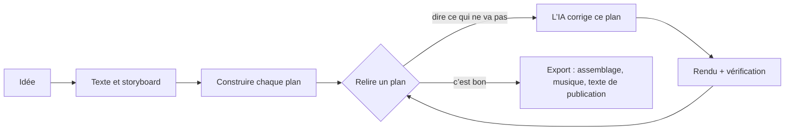

<h1 align="center">
  <br/>
  Shotloop
</h1>

<p align="center"><b>Des vidéos explicatives courtes faites avec du code, un plan à la fois.</b><br/>
Une idée devient un texte, un storyboard et un film composé de plans. Chaque plan a sa propre boucle : l’IA l’écrit, Shotloop en fait le rendu, vous le relisez et l’IA le corrige. Une correction ne refait le rendu que de ce plan, pas du film entier.</p>

<p align="center">
  
</p>

<p align="center">
  <a href="https://github.com/chihyungchang/Shotloop/releases/latest"><b>Télécharger pour macOS</b></a> ·
  <a href="https://github.com/chihyungchang/Shotloop/releases">Versions</a> ·
  <a href="#compiler-depuis-les-sources">Compiler depuis les sources</a>
</p>

<p align="center">
  <a href="https://github.com/chihyungchang/Shotloop/releases/latest"></a>
  
  <a href="LICENSE"></a>
  
</p>

<p align="center"><a href="README.md">English</a> · <a href="README.zh-CN.md">简体中文</a> · <a href="README.zh-TW.md">繁體中文</a> · <a href="README.ja.md">日本語</a> · <a href="README.ko.md">한국어</a> · <a href="README.es.md">Español</a> · <a href="README.pt-BR.md">Português</a> · <b>Français</b> · <a href="README.de.md">Deutsch</a> · <a href="README.it.md">Italiano</a> · <a href="README.ru.md">Русский</a> · <a href="README.tr.md">Türkçe</a> · <a href="README.vi.md">Tiếng Việt</a> · <a href="README.id.md">Bahasa Indonesia</a></p>

---

## Qu’est-ce que Shotloop

Shotloop est une application de bureau pour les vidéos courtes dessinées avec du code : promos produit, vulgarisation scientifique, récits de données et animations façon diapos, en 2D (des pages web rendues image par image) ou en 3D (des scènes Blender), dans sept styles visuels.

Vous partez d’une phrase. L’IA choisit comment la montrer (scène cinématique, infographie, carte, démo d’interface, plan technique, typo animée ou 3D) et un thème, sauf si vous les choisissez. Elle écrit l’accroche, le script et les faits avec leurs sources, puis les découpe en storyboard. Vous modifiez le storyboard, et l’IA construit chaque plan. Dans le Studio, vous regardez chaque plan et dites ce qui ne va pas avec vos mots, par exemple « le texte est trop petit » ou « c’est trop statique : ajoute du mouvement ». L’IA modifie ce plan, en fait le rendu, le vérifie par rapport aux notes et vous montre un avant/après. Quand le film tient la route, l’Export assemble les plans et ajoute la musique ; l’IA conçoit une couverture dans le style du film (ou remplit le modèle de votre série) et rédige le post pour chaque plateforme, le tout dans un dossier dédié.

L’IA est celle que vous utilisez déjà : Claude Code ou un autre agent de code auquel vous êtes connecté, une API de modèle avec votre propre clé, ou un modèle local.

L’application parle 14 langues : English, 简体中文, 繁體中文, 日本語, 한국어, Español, Português, Français, Deutsch, Italiano, Русский, Türkçe, Tiếng Việt et Bahasa Indonesia. Elle suit la langue de votre Mac, et l’IA répond et rédige les posts de publication dans celle que vous choisissez.

## Fait avec Shotloop

Chaque image ci-dessous a été rendue par Shotloop à partir des [exemples](examples/) fournis avec l’application.

<table>
<tr>
<td width="25%" valign="top"><br/><sub><b>3D</b> : un démontage de téléphone dans Blender.</sub></td>
<td width="25%" valign="top"><br/><sub><b>2D</b> : combien de temps la lumière du Soleil met pour atteindre la Terre.</sub></td>
<td width="50%" valign="top"><br/><sub><b>Données 2D</b> : 1 % de mieux chaque jour, en graphiques (16:9).</sub></td>
</tr>
</table>

## Sept façons de montrer une idée

L’IA choisit le style adapté au sujet et vous explique pourquoi ; vous pouvez en changer sur le plan, ou en choisir un sur l’Accueil. Chaque image est tirée de l’exemple vers lequel elle pointe.

<table>
<tr>
<td width="25%" valign="top"><a href="examples/sunlight-en/"></a><br/><sub><b>Scène cinématique</b> : lumière, profondeur et caméra en mouvement, pour ce qu’on pourrait filmer : l’espace, la nature, la physique.</sub></td>
<td width="25%" valign="top"><a href="examples/solar-share-en/"></a><br/><sub><b>Infographie</b> : graphiques et chiffres animés, pour les statistiques, les comparaisons, l’argent.</sub></td>
<td width="25%" valign="top"><a href="examples/coffee-map-en/"></a><br/><sub><b>Carte</b> : la carte du monde, des itinéraires et des pays qui s’allument, pour les lieux et la façon dont les choses se répandent.</sub></td>
<td width="25%" valign="top"><a href="examples/fake-parcel-text-en/"></a><br/><sub><b>Démo d’interface</b> : un téléphone ou un navigateur, étape par étape, pour les applis, les réglages et les arnaques.</sub></td>
</tr>
<tr>
<td width="25%" valign="top"><a href="examples/zipper-blueprint-en/"></a><br/><sub><b>Plan technique</b> : dessin au trait sur une grille, vues éclatées et légendes, pour le fonctionnement d’une machine.</sub></td>
<td width="25%" valign="top"><a href="examples/chinese-words-en/"></a><br/><sub><b>Typo animée</b> : d’énormes caractères en mouvement, pour les citations, les mots et les idées reçues.</sub></td>
<td width="25%" valign="top"><a href="examples/watch-3d-en/"></a><br/><sub><b>3D</b> : des scènes Blender avec une vraie lumière et une caméra qui traverse l’espace.</sub></td>
</tr>
</table>

Les vidéos 2D suivent un ensemble fixe de principes : le visuel d’abord, une légende condensée par plan, chaque ligne affichée assez longtemps pour être lue, chaque chiffre en mouvement, honnêteté sur ce qui est montré, sources en petit à l’écran. Ils sont décrits dans [engine/video/explainers/2d/README.md](engine/video/explainers/2d/README.md) et repris dans chaque prompt 2D.

## Visite guidée

<table>
<tr>
<td width="50%" valign="top">
<a href="docs/screenshots/home.jpg"></a><br/>
<sub><b>Accueil</b> : une phrase. 2D ou 3D, la durée, le style et le thème peuvent rester sur Auto. Ou partez d’un exemple de la galerie.</sub>
</td>
<td width="50%" valign="top">
<a href="docs/screenshots/plan.jpg"></a><br/>
<sub><b>Texte et storyboard</b> : l’accroche, le script et les faits sourcés, et les plans avec ce que chacun montre, tout modifiable avant le moindre rendu.</sub>
</td>
</tr>
<tr>
<td width="50%" valign="top">
<a href="docs/screenshots/studio.jpg"></a><br/>
<sub><b>Studio</b> : le plan sur une scène sombre, la pellicule, et les notes et vérifications de chaque plan.</sub>
</td>
<td width="50%" valign="top">
<a href="docs/screenshots/agent.jpg"></a><br/>
<sub><b>Assistant IA</b> : dites ce qui ne va pas et l’IA corrige ce plan. Faites glisser le séparateur pour comparer avant et après.</sub>
</td>
</tr>
<tr>
<td width="50%" valign="top">
<a href="docs/screenshots/export.jpg"></a><br/>
<sub><b>Export</b> : cochez la vidéo (verticale, horizontale), la couverture et le texte de publication ; modifiez d’abord la couverture et le texte. Chaque export va dans son propre dossier.</sub>
</td>
<td width="50%" valign="top">
<a href="docs/screenshots/settings.jpg"></a><br/>
<sub><b>Modèles et fournisseurs</b> : un agent CLI auquel vous êtes connecté, une API de modèle avec votre clé, ou un modèle local.</sub>
</td>
</tr>
</table>

## Comment ça marche



- **Des plans, pas un seul long rendu.** Un film est une liste de plans. Chaque plan est un petit programme : `shot.js` pour une page 2D, `shot.py` pour un mouvement de caméra Blender. Chacun est mis en cache selon un hash de ses entrées, si bien qu’une correction refait le rendu d’un seul plan en quelques secondes (2D) ou une minute (3D), et l’Export ne fait qu’assembler les clips.
- **Des corrections en langage courant.** L’IA ne touche qu’au plan sur lequel vous êtes, sauf si la correction exige de modifier le monde partagé. Elle rend des images fixes, les vérifie selon une checklist (lisible, rien de masqué, hors de la zone des légendes, etc.) et indique ce qu’elle a changé.
- **Sept styles visuels.** Scène cinématique, infographie, carte, démo d’interface, plan technique, typo animée ou 3D, chacun avec son kit et ses images de référence, que l’IA consulte avant de choisir et de construire ([`engine/shotloop/styles.mjs`](engine/shotloop/styles.mjs)). Un thème ne définit que le fond et la typo ; les images et les données gardent les couleurs que leur sujet exige.
- **Des règles pour évaluer un plan.** La longueur des légendes et leur durée d’affichage sont vérifiées avant toute construction. Une image qui revient dans plusieurs plans est dessinée une seule fois et partagée, pour rester identique partout.
- **Des faits sourcés.** Le texte garde chaque fait à côté de sa source, et le texte de publication ne peut utiliser que les faits du texte.
- **Couvertures.** L’IA conçoit une couverture dans le style du film et vérifie ses propres rendus. Enregistrez-en une comme modèle pour garder une série cohérente, ou importez une couverture qui vous plaît et l’IA suit sa mise en page.
- **Une musique calée sur le montage.** La nappe synthétisée est réglée pour que les coupes tombent sur ses temps ; elle dure jusqu’à la dernière image puis s’estompe.
- **Rapide en édition, pleine qualité à l’export.** La 3D affiche des aperçus rapides pendant l’édition et ne rend les images en pleine qualité qu’à l’export. La 2D reste en pleine qualité tout du long.
- **Bibliothèque d’assets 3D.** Cherchez des modèles CC0 sur [Poly Pizza](https://poly.pizza) et [Smithsonian Open Access](https://www.si.edu/openaccess) avec votre propre clé. Chaque modèle n’est téléchargé qu’une fois et peut être ajouté à n’importe quel projet 3D.

## L’IA aux commandes

| Mode | Ce qu’il faut |
| --- | --- |
| **Agent CLI local** | [Claude Code](https://docs.anthropic.com/en/docs/claude-code), connecté sur ce Mac (Codex CLI et Gemini CLI sont expérimentaux). Il tourne sans interface, avec ses propres outils désactivés, et n’agit que par les outils de Shotloop. |
| **API de modèle** | Votre propre clé. Préréglages pour Anthropic, OpenAI, Google Gemini, OpenRouter, xAI, Mistral, Together, DeepSeek, Qwen, Kimi, GLM, MiniMax, Doubao et SiliconFlow, ou tout endpoint compatible Anthropic ou OpenAI. Les clés restent sur votre Mac. |
| **Modèle local** | Ollama, LM Studio, vLLM, llama.cpp ou tout serveur compatible OpenAI. |

Le modèle doit gérer l’appel d’outils, et les vérifications demandent un modèle qui voit les images. L’agent travaille avec un jeu d’outils restreint : il peut lire et écrire les fichiers du plan, rendre des images fixes et rapporter les vérifications. Il ne peut pas lancer de commandes shell.

## Installation

1. Téléchargez `Shotloop_<version>_aarch64.dmg` depuis la [dernière version](https://github.com/chihyungchang/Shotloop/releases/latest), ouvrez-le et glissez Shotloop dans Applications.
2. Installez **Google Chrome** (les plans 2D y sont rendus). Pour les projets 3D, Shotloop vous demande **Blender** la première fois que vous en créez un.
3. Choisissez l’IA dans Réglages → Modèles et fournisseurs. Claude Code est sélectionné d’office s’il est déjà sur votre Mac.

> **Premier lancement :** Shotloop n’est pas encore notarié par Apple, donc macOS indique qu’il ne peut pas vérifier le développeur. Ouvrez-le une fois via **Réglages Système → Confidentialité et sécurité → Ouvrir quand même**, ou lancez `xattr -dr com.apple.quarantine /Applications/Shotloop.app` dans le Terminal. Ensuite, il s’ouvre normalement et les mises à jour s’installent sans redemander.

Node.js et ffmpeg sont inclus dans l’application. Shotloop cherche les mises à jour sur GitHub et les installe sur place. Il fonctionne sur les Mac avec puce Apple (M1 et suivants).

## Compiler depuis les sources

```bash
nvm use                      # Node 22.18+ (l’agent exécute directement le TypeScript)
corepack enable              # une seule fois : fournit la version épinglée de pnpm
pnpm install
pnpm app                     # tauri dev ; nécessite la chaîne d’outils Rust
pnpm app:build               # Shotloop.app et un dmg, avec Node et ffmpeg inclus
```

`pnpm app` utilise le Node et le ffmpeg de votre Mac et exécute tout depuis le dépôt cloné. Les versions sont signées pour le système de mise à jour et publiées avec [`app/scripts/release.mjs`](app/scripts/release.mjs).

<details>
<summary><b>Le moteur depuis un terminal</b></summary>

```bash
pnpm shotloop status   fixtures/hello-3d
pnpm shotloop render   fixtures/hello-3d --shot 02-close --stills   # début/milieu/fin
pnpm shotloop render   fixtures/hello-3d --shot 02-close            # un clip, en qualité d’édition
pnpm shotloop export   fixtures/hello-3d                            # seuls les plans modifiés sont rendus
pnpm shotloop new      my-short --idea "Pourquoi la batterie de votre téléphone vieillit-elle ?" --track auto --duration auto
pnpm shotloop new      coffee --idea "D’où vient le café ?" --track 2d --style map --duration 30
pnpm shotloop export   fixtures/hello-3d --to ~/Movies/Shotloop --name "Hello"   # dans un nouveau dossier à cet endroit
pnpm shotloop covers   list                                         # modèles de couverture
pnpm shotloop doctor
```

Ajoutez `--json` pour obtenir des événements ligne par ligne (ce que lit l’application). L’agent se lance de la même façon :

```bash
node agent/src/main.ts detect                                         # agents CLI et serveurs locaux sur ce Mac
SHOTLOOP_PROVIDER=cli SHOTLOOP_CLI=claude node agent/src/main.ts check fixtures/hello-3d --shot 01-wide
pnpm test                                                             # chaque backend face à des doublures scriptées
```

</details>

<details>
<summary><b>Format de projet</b></summary>

```
my-video/
  shotloop.json        titre, piste (2d|3d), style, taille, fps, plans [{ id, title, duration }]
  storyboard.json      le plan : texte (accroche, script, faits sourcés) et plans
  world/               3D : world.py (+ screen.html) ; 2D : page.html (le kit du style), parts.js (images
                       récurrentes, dessinées une fois), geo.data.js (les pays du style carte)
  shots/<id>/          shot.py | shot.js, notes.md (à montrer, à l’écran, mouvement)
  assets/<id>/         modèles 3D de la bibliothèque d’assets
  copy.md  script.md  captions.html  music.json  thumb.html  publish.json
  .shotloop/           cache : par plan et hash d’entrée, prises, vérifications, corrections
  out/                 les exports du moteur (horodatés) ; l’application copie chacun dans un nouveau dossier à l’endroit choisi
```

- **3D** : `world.py` construit le monde partagé avec `kit` ([`engine/video/explainers/3d/lib/kit.py`](engine/video/explainers/3d/lib/kit.py)). `shot.py` s’exécute dans l’espace de noms du monde et crée une caméra ; `at(t)` convertit les secondes locales du plan en temps du film.
- **2D** : `shot.js` exporte par défaut `render(t, ctx)`, qui dessine `world/page.html` au temps local `t` du plan.
- **Cache** : la clé d’un plan est un hash du monde, de son code, des légendes, des assets, du moteur de rendu et des réglages. Les plans inchangés sont réutilisés.

</details>

<details>
<summary><b>Structure du dépôt</b></summary>

| Chemin | Contenu |
| --- | --- |
| [`app/`](app/) | L’application de bureau : un shell Tauri 2 (Rust) avec la file de rendu, le système de mise à jour et la supervision des processus, et l’interface React + TypeScript. |
| [`engine/shotloop/`](engine/shotloop/) | Le moteur de plans : format de projet, cache de rendu par plan, rendus 2D (Chrome) et 3D (Blender), assemblage du film, export MP4, musique, bibliothèque d’assets. Une CLI appelée par l’application. |
| [`agent/`](agent/) | L’agent : planification, construction, corrections en langage courant, vérifications selon la checklist, texte de publication. Il prend en charge les API, les CLI (via MCP) et les modèles locaux. |
| [`examples/`](examples/) | Les exemples proposés sur l’Accueil, en anglais : au moins un par style visuel (2D et 3D, 9:16 et 16:9). |
| [`fixtures/`](fixtures/) | Des projets pour les tests et les démonstrations en terminal. |

</details>

## Licence

[Apache License 2.0](LICENSE) ; voir [NOTICE](NOTICE). Les modèles de la bibliothèque d’assets gardent leur propre licence (CC0 ou CC-BY, avec le crédit inscrit dans le projet).
