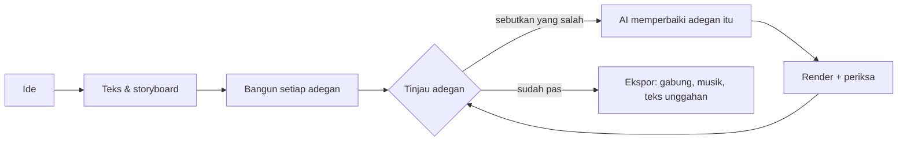

<h1 align="center">
  <br/>
  Shotloop
</h1>

<p align="center"><b>Buat video penjelasan singkat dari kode, satu adegan demi satu adegan.</b><br/>
Sebuah ide menjadi teks, storyboard, lalu film yang tersusun dari adegan. Setiap adegan punya loop sendiri: AI menulisnya, Shotloop merendernya, Anda meninjaunya, dan AI memperbaikinya. Perbaikan hanya merender ulang adegan itu, bukan seluruh film.</p>

<p align="center">
  
</p>

<p align="center">
  <a href="https://github.com/chihyungchang/Shotloop/releases/latest"><b>Unduh untuk macOS</b></a> ·
  <a href="https://github.com/chihyungchang/Shotloop/releases">Rilis</a> ·
  <a href="#build-dari-kode-sumber">Build dari kode sumber</a>
</p>

<p align="center">
  <a href="https://github.com/chihyungchang/Shotloop/releases/latest"></a>
  
  <a href="LICENSE"></a>
  
</p>

<p align="center"><a href="README.md">English</a> · <a href="README.zh-CN.md">简体中文</a> · <a href="README.zh-TW.md">繁體中文</a> · <a href="README.ja.md">日本語</a> · <a href="README.ko.md">한국어</a> · <a href="README.es.md">Español</a> · <a href="README.pt-BR.md">Português</a> · <a href="README.fr.md">Français</a> · <a href="README.de.md">Deutsch</a> · <a href="README.it.md">Italiano</a> · <a href="README.ru.md">Русский</a> · <a href="README.tr.md">Türkçe</a> · <a href="README.vi.md">Tiếng Việt</a> · <b>Bahasa Indonesia</b></p>

---

## Apa itu Shotloop

Shotloop adalah aplikasi desktop untuk video pendek yang digambar dengan kode: promo produk, penjelasan sains, cerita data, dan animasi ala slide. Bisa 2D (halaman web yang dirender bingkai demi bingkai) atau 3D (adegan Blender), dalam tujuh gaya visual.

Anda mulai dengan satu kalimat. AI memilih cara menampilkannya (adegan sinematik, infografik, peta, demo antarmuka, cetak biru, tipografi kinetik, atau 3D) beserta temanya, kecuali Anda memilihnya sendiri. AI menulis hook, naskah, dan fakta beserta sumbernya, lalu membaginya menjadi storyboard. Anda menyunting storyboard, dan AI membangun setiap adegan. Di Studio Anda melihat tiap adegan dan menyebutkan apa yang salah dengan bahasa sehari-hari, misalnya "teksnya terlalu kecil" atau "terlalu diam: tambahkan gerakan". AI mengubah adegan itu, merendernya, memeriksanya terhadap catatan, dan menampilkan perbandingan sebelum/sesudah. Saat film sudah pas, Ekspor menggabungkan adegan dan menambahkan musik; AI mendesain sampul sesuai tampilan film (atau mengisi template seri Anda) dan menulis teks unggahan untuk tiap platform. Semuanya masuk ke foldernya sendiri.

AI-nya adalah yang sudah Anda pakai: Claude Code atau agen coding lain yang sudah Anda masuki, API model dengan kunci Anda sendiri, atau model lokal.

Aplikasi ini tersedia dalam 14 bahasa: English, 简体中文, 繁體中文, 日本語, 한국어, Español, Português, Français, Deutsch, Italiano, Русский, Türkçe, Tiếng Việt, dan Bahasa Indonesia. Bahasanya mengikuti bahasa Mac Anda, dan AI membalas serta menulis teks unggahan dalam bahasa yang Anda pilih.

## Dibuat dengan Shotloop

Setiap bingkai di bawah dirender oleh Shotloop dari [contoh](examples/) yang disertakan.

<table>
<tr>
<td width="25%" valign="top"><br/><sub><b>3D</b>: bongkaran ponsel di Blender.</sub></td>
<td width="25%" valign="top"><br/><sub><b>2D</b>: berapa lama cahaya Matahari sampai ke Bumi.</sub></td>
<td width="50%" valign="top"><br/><sub><b>Data 2D</b>: 1% lebih baik setiap hari, dalam grafik (16:9).</sub></td>
</tr>
</table>

## Tujuh cara menampilkan ide

AI memilih gaya yang cocok dengan topiknya dan menjelaskan alasannya; Anda bisa menggantinya di rencana, atau memilihnya di Beranda. Setiap gambar adalah bingkai dari contoh yang ditautkannya.

<table>
<tr>
<td width="25%" valign="top"><a href="examples/sunlight-en/"></a><br/><sub><b>Adegan sinematik</b>: cahaya, kedalaman, dan kamera yang bergerak, untuk hal yang bisa difilmkan: luar angkasa, alam, fisika.</sub></td>
<td width="25%" valign="top"><a href="examples/solar-share-en/"></a><br/><sub><b>Infografik</b>: grafik dan angka yang bergerak, untuk statistik, perbandingan, uang.</sub></td>
<td width="25%" valign="top"><a href="examples/coffee-map-en/"></a><br/><sub><b>Peta</b>: peta dunia, rute, dan negara yang menyala, untuk tempat dan cara sesuatu menyebar.</sub></td>
<td width="25%" valign="top"><a href="examples/fake-parcel-text-en/"></a><br/><sub><b>Demo antarmuka</b>: ponsel atau browser, langkah demi langkah, untuk aplikasi, pengaturan, dan penipuan.</sub></td>
</tr>
<tr>
<td width="25%" valign="top"><a href="examples/zipper-blueprint-en/"></a><br/><sub><b>Cetak biru</b>: gambar garis di atas grid, tampilan urai, dan keterangan, untuk cara kerja mesin.</sub></td>
<td width="25%" valign="top"><a href="examples/chinese-words-en/"></a><br/><sub><b>Tipografi kinetik</b>: huruf besar yang bergerak, untuk kutipan, kata, dan mitos.</sub></td>
<td width="25%" valign="top"><a href="examples/watch-3d-en/"></a><br/><sub><b>3D</b>: adegan Blender dengan cahaya nyata dan kamera yang melintasi ruang.</sub></td>
</tr>
</table>

Video 2D mengikuti prinsip yang tetap: visual dulu, satu teks ringkas per adegan, setiap baris tampil cukup lama untuk dibaca, setiap angka bergerak, jujur tentang apa yang ditampilkan, sumber ditulis kecil di layar. Prinsip ini ada di [engine/video/explainers/2d/README.md](engine/video/explainers/2d/README.md) dan di setiap prompt 2D.

## Tur produk

<table>
<tr>
<td width="50%" valign="top">
<a href="docs/screenshots/home.jpg"></a><br/>
<sub><b>Beranda</b>: satu kalimat. 2D atau 3D, durasi, gaya, dan tema bisa dibiarkan Otomatis. Atau mulai dari contoh di galeri.</sub>
</td>
<td width="50%" valign="top">
<a href="docs/screenshots/plan.jpg"></a><br/>
<sub><b>Teks &amp; storyboard</b>: hook, naskah, fakta bersumber, dan adegan beserta isinya, semua bisa disunting sebelum apa pun dirender.</sub>
</td>
</tr>
<tr>
<td width="50%" valign="top">
<a href="docs/screenshots/studio.jpg"></a><br/>
<sub><b>Studio</b>: adegan di panggung gelap, filmstrip, serta catatan dan pemeriksaan tiap adegan.</sub>
</td>
<td width="50%" valign="top">
<a href="docs/screenshots/agent.jpg"></a><br/>
<sub><b>Asisten AI</b>: sebutkan apa yang salah, AI memperbaiki adegan itu. Geser pembatas untuk membandingkan sebelum dan sesudah.</sub>
</td>
</tr>
<tr>
<td width="50%" valign="top">
<a href="docs/screenshots/export.jpg"></a><br/>
<sub><b>Ekspor</b>: centang video (vertikal, horizontal), sampul, dan teks unggahan; sunting sampul dan teksnya lebih dulu. Setiap ekspor masuk ke foldernya sendiri.</sub>
</td>
<td width="50%" valign="top">
<a href="docs/screenshots/settings.jpg"></a><br/>
<sub><b>Model dan penyedia</b>: agen CLI yang sudah Anda masuki, API model dengan kunci Anda, atau model lokal.</sub>
</td>
</tr>
</table>

## Cara kerjanya



- **Adegan, bukan satu render panjang.** Film adalah daftar adegan. Setiap adegan adalah program kecil: `shot.js` untuk halaman 2D, `shot.py` untuk gerakan kamera Blender. Masing-masing di-cache menurut hash inputnya, sehingga perbaikan merender ulang satu adegan dalam hitungan detik (2D) atau satu menit (3D), dan Ekspor hanya menggabungkan klip.
- **Perbaikan dengan bahasa sehari-hari.** AI hanya menyentuh adegan yang sedang Anda buka, kecuali perbaikannya butuh dunia bersama. AI merender bingkai diam, memeriksanya terhadap daftar periksa (terbaca, tidak ada yang tertutup, di luar area teks, dan sebagainya), lalu melaporkan apa yang diubah.
- **Tujuh gaya visual.** Adegan sinematik, infografik, peta, demo antarmuka, cetak biru, tipografi kinetik, atau 3D, masing-masing dengan kit dan bingkai referensinya sendiri yang dilihat AI sebelum memilih dan membangun ([`engine/shotloop/styles.mjs`](engine/shotloop/styles.mjs)). Tema hanya mengatur latar dan huruf; gambar dan data tetap memakai warna yang dibutuhkan topiknya.
- **Aturan untuk mengukur rencana.** Panjang teks dan lamanya tampil di layar diperiksa sebelum apa pun dibangun. Gambar yang muncul di beberapa adegan digambar sekali lalu dipakai bersama, jadi tampak sama di setiap adegan.
- **Fakta dengan sumber.** Teks menyimpan setiap fakta di samping sumbernya, dan teks unggahan hanya boleh memakai fakta dari teks itu.
- **Sampul.** AI mendesain sampul sesuai tampilan film dan memeriksa hasil rendernya sendiri. Simpan satu sebagai template agar seri tetap konsisten, atau unggah sampul yang Anda suka dan AI mengikuti desainnya.
- **Musik yang pas dengan potongan.** Musik latar sintetis disetel agar potongan jatuh tepat di ketukannya, berjalan sampai bingkai terakhir, lalu memudar.
- **Cepat saat menyunting, kualitas penuh saat ekspor.** 3D menampilkan pratinjau cepat saat Anda menyunting dan merender bingkai kualitas penuh hanya saat ekspor. 2D selalu bekerja dalam kualitas penuh.
- **Pustaka aset untuk 3D.** Cari model CC0 di [Poly Pizza](https://poly.pizza) dan [Smithsonian Open Access](https://www.si.edu/openaccess) dengan kunci Anda sendiri. Setiap model diunduh sekali dan bisa ditambahkan ke proyek 3D mana pun.

## AI yang menjalankannya

| Mode | Yang Anda butuhkan |
| --- | --- |
| **Agen CLI lokal** | [Claude Code](https://docs.anthropic.com/en/docs/claude-code) yang sudah masuk di Mac ini (Codex CLI dan Gemini CLI masih eksperimental). Berjalan tanpa antarmuka dengan alat bawaannya dimatikan, dan hanya bekerja lewat alat Shotloop. |
| **API model** | Kunci Anda sendiri. Preset untuk Anthropic, OpenAI, Google Gemini, OpenRouter, xAI, Mistral, Together, DeepSeek, Qwen, Kimi, GLM, MiniMax, Doubao, dan SiliconFlow, atau endpoint apa pun yang kompatibel dengan Anthropic atau OpenAI. Kunci tetap di Mac Anda. |
| **Model lokal** | Ollama, LM Studio, vLLM, llama.cpp, atau server apa pun yang kompatibel dengan OpenAI. |

Modelnya harus mendukung pemanggilan alat (tool calling), dan untuk pemeriksaan butuh model yang bisa melihat gambar. Agen bekerja lewat sekumpulan alat yang terbatas: membaca dan menulis file adegan, merender bingkai diam, dan melaporkan hasil pemeriksaan. Agen tidak bisa menjalankan perintah shell.

## Instalasi

1. Unduh `Shotloop_<version>_aarch64.dmg` dari [rilis terbaru](https://github.com/chihyungchang/Shotloop/releases/latest), buka, lalu seret Shotloop ke Applications.
2. Pastikan **Google Chrome** terpasang (adegan 2D dirender di dalamnya). Untuk proyek 3D, Shotloop meminta **Blender** saat pertama kali Anda membuatnya.
3. Pilih AI di Pengaturan → Model dan penyedia. Claude Code otomatis dipilih jika sudah ada di Mac Anda.

> **Pembukaan pertama:** Shotloop belum dinotarisasi oleh Apple, jadi macOS menyatakan tidak dapat memverifikasi pengembangnya. Buka sekali lewat **Pengaturan Sistem → Privasi & Keamanan → Tetap Buka**, atau jalankan `xattr -dr com.apple.quarantine /Applications/Shotloop.app` di Terminal. Setelah itu aplikasi terbuka seperti biasa, dan pembaruan terpasang tanpa bertanya lagi.

Node.js dan ffmpeg sudah ada di dalam aplikasi. Shotloop memeriksa pembaruan di GitHub dan memasangnya di tempat. Berjalan di Mac dengan Apple silicon (M1 dan yang lebih baru).

## Build dari kode sumber

```bash
nvm use                      # Node 22.18+ (agen menjalankan TypeScript secara langsung)
corepack enable              # sekali saja: menyediakan pnpm dengan versi terkunci
pnpm install
pnpm app                     # tauri dev; butuh toolchain Rust
pnpm app:build               # Shotloop.app dan dmg, dengan Node dan ffmpeg di dalamnya
```

`pnpm app` memakai Node dan ffmpeg di Mac Anda dan menjalankan semuanya dari checkout. Rilis ditandatangani untuk updater dan dipublikasikan dengan [`app/scripts/release.mjs`](app/scripts/release.mjs).

<details>
<summary><b>Engine dari terminal</b></summary>

```bash
pnpm shotloop status   fixtures/hello-3d
pnpm shotloop render   fixtures/hello-3d --shot 02-close --stills   # awal/tengah/akhir
pnpm shotloop render   fixtures/hello-3d --shot 02-close            # klip, dengan kualitas editor
pnpm shotloop export   fixtures/hello-3d                            # hanya adegan yang berubah yang dirender
pnpm shotloop new      my-short --idea "Kenapa baterai ponsel menua?" --track auto --duration auto
pnpm shotloop new      coffee --idea "Dari mana kopi berasal?" --track 2d --style map --duration 30
pnpm shotloop export   fixtures/hello-3d --to ~/Movies/Shotloop --name "Hello"   # ke folder baru di sana
pnpm shotloop covers   list                                         # template sampul
pnpm shotloop doctor
```

Tambahkan `--json` untuk event per baris (yang dibaca aplikasi). Agen berjalan dengan cara yang sama:

```bash
node agent/src/main.ts detect                                         # agen CLI dan server lokal di Mac ini
SHOTLOOP_PROVIDER=cli SHOTLOOP_CLI=claude node agent/src/main.ts check fixtures/hello-3d --shot 01-wide
pnpm test                                                             # setiap backend terhadap pengganti bernaskah
```

</details>

<details>
<summary><b>Format proyek</b></summary>

```
my-video/
  shotloop.json        judul, track (2d|3d), gaya, ukuran, fps, adegan [{ id, title, duration }]
  storyboard.json      rencana: teks (hook, naskah, fakta bersumber) dan adegan
  world/               3D: world.py (+ screen.html); 2D: page.html (kit gaya), parts.js (gambar
                       yang berulang, digambar sekali), geo.data.js (negara untuk gaya peta)
  shots/<id>/          shot.py | shot.js, notes.md (wajib tampil, teks layar, gerakan)
  assets/<id>/         model 3D dari pustaka aset
  copy.md  script.md  captions.html  music.json  thumb.html  publish.json
  .shotloop/           cache: per adegan dan hash input; take, pemeriksaan, perbaikan
  out/                 ekspor engine (bercap waktu); aplikasi menyalin tiap ekspor ke folder baru di tempat pilihan Anda
```

- **3D**: `world.py` membangun dunia bersama dengan `kit` ([`engine/video/explainers/3d/lib/kit.py`](engine/video/explainers/3d/lib/kit.py)). `shot.py` berjalan di namespace dunia dan membuat satu kamera; `at(t)` memetakan detik lokal adegan ke waktu film.
- **2D**: `shot.js` mengekspor default `render(t, ctx)`, yang menggambar `world/page.html` pada waktu lokal adegan `t`.
- **Cache**: kunci sebuah adegan adalah hash dari dunia, kodenya, teks, aset, renderer, dan pengaturan. Adegan yang tidak berubah dipakai ulang.

</details>

<details>
<summary><b>Struktur repositori</b></summary>

| Path | Isi |
| --- | --- |
| [`app/`](app/) | Aplikasi desktop: shell Tauri 2 (Rust) dengan antrean render, updater, dan pengawasan proses, serta UI React + TypeScript. |
| [`engine/shotloop/`](engine/shotloop/) | Engine adegan: format proyek, cache render per adegan, render 2D (Chrome) dan 3D (Blender), perakitan film, ekspor MP4, musik, pustaka aset. CLI yang dipanggil aplikasi. |
| [`agent/`](agent/) | Agen: perencanaan, pembangunan, perbaikan dengan bahasa sehari-hari, pemeriksaan terhadap daftar periksa, teks unggahan. Mendukung API, CLI (lewat MCP), dan model lokal. |
| [`examples/`](examples/) | Contoh yang ditawarkan Beranda, dalam bahasa Inggris: minimal satu untuk setiap gaya visual (2D dan 3D, 9:16 dan 16:9). |
| [`fixtures/`](fixtures/) | Proyek untuk pengujian dan panduan terminal. |

</details>

## Lisensi

[Apache License 2.0](LICENSE); lihat [NOTICE](NOTICE). Model dari pustaka aset tetap memakai lisensinya sendiri (CC0 atau CC-BY, dengan kredit dicatat di proyek).
