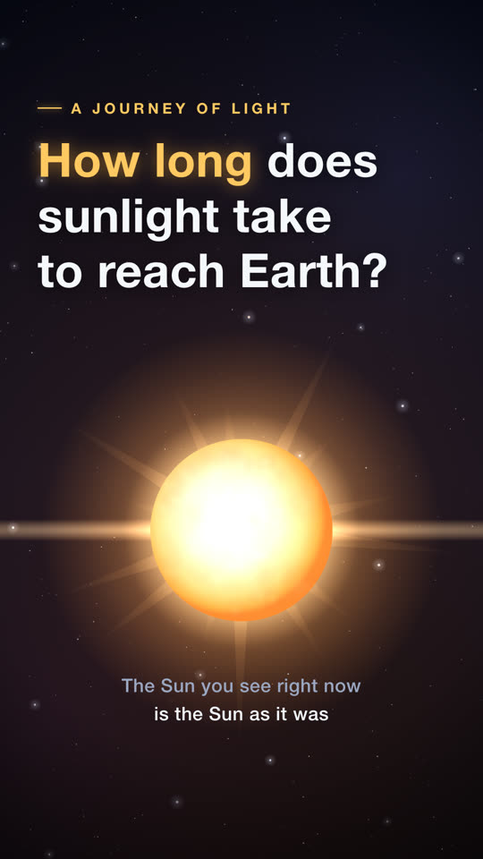
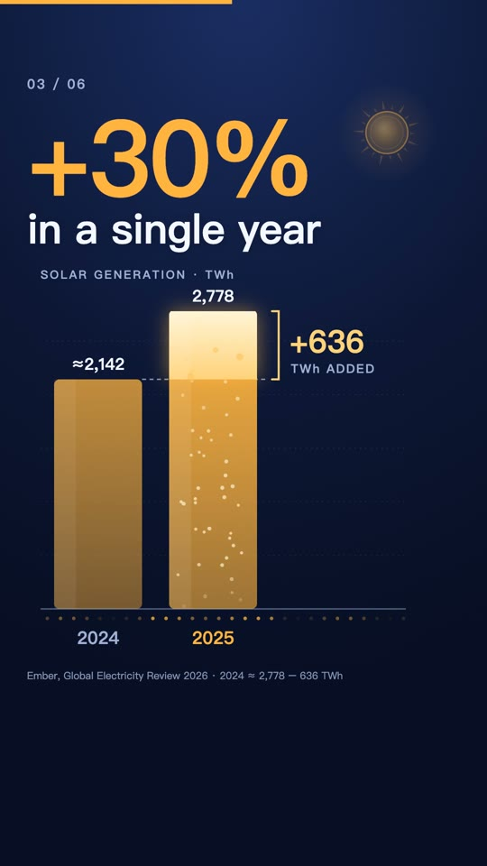
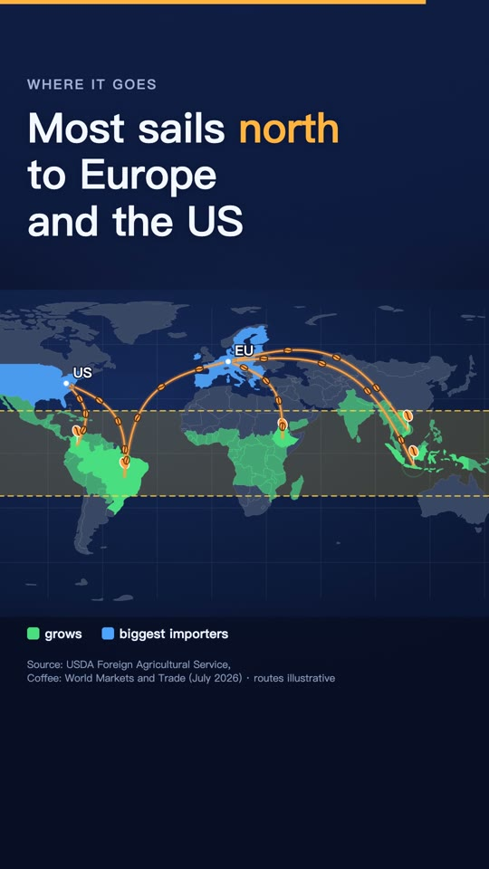
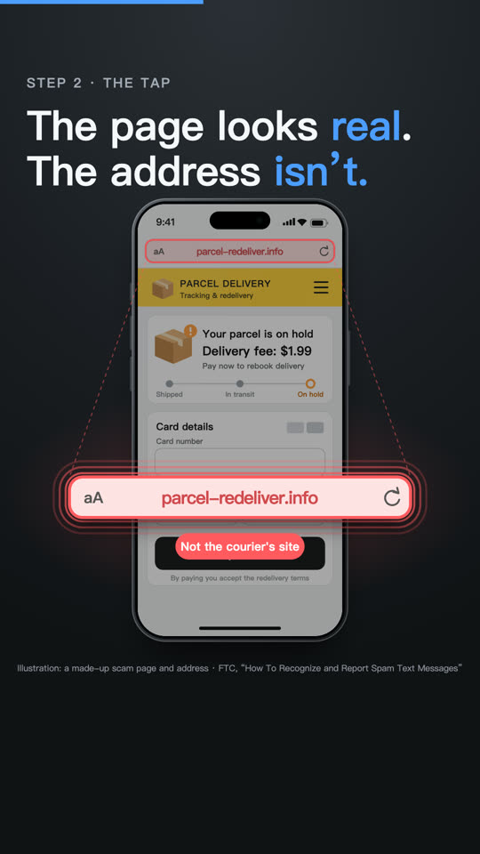
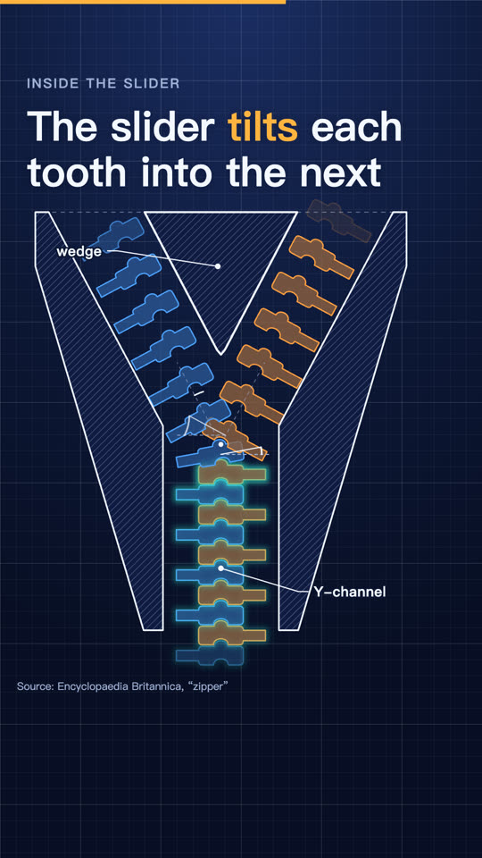
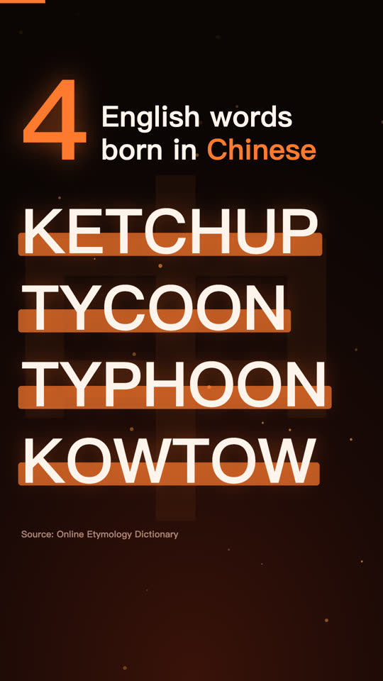
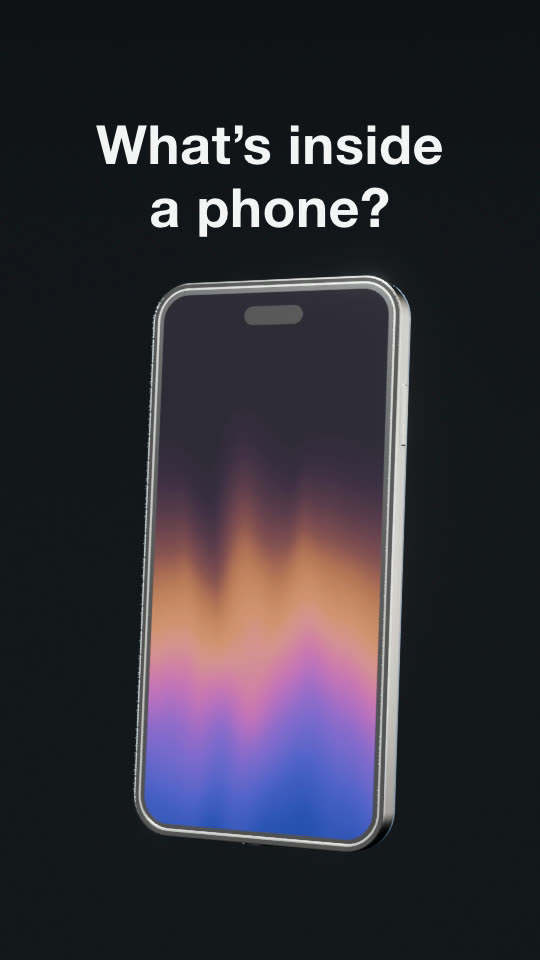
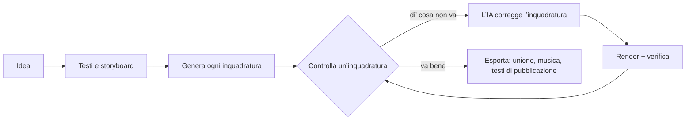

<h1 align="center">
  <br/>
  Shotloop
</h1>

<p align="center"><b>Brevi video esplicativi fatti con il codice, un’inquadratura alla volta.</b><br/>
Un’idea diventa testi, uno storyboard e un video fatto di inquadrature. Ogni inquadratura ha il suo ciclo: l’IA la scrive, Shotloop la renderizza, tu la controlli e l’IA la corregge. Una correzione renderizza di nuovo solo quell’inquadratura, non l’intero video.</p>

<p align="center">
  
</p>

<p align="center">
  <a href="https://github.com/chihyungchang/Shotloop/releases/latest"><b>Scarica per macOS</b></a> ·
  <a href="https://github.com/chihyungchang/Shotloop/releases">Versioni</a> ·
  <a href="#compilare-dai-sorgenti">Compilare dai sorgenti</a>
</p>

<p align="center">
  <a href="https://github.com/chihyungchang/Shotloop/releases/latest"></a>
  
  <a href="LICENSE"></a>
  
</p>

<p align="center"><a href="README.md">English</a> · <a href="README.zh-CN.md">简体中文</a> · <a href="README.zh-TW.md">繁體中文</a> · <a href="README.ja.md">日本語</a> · <a href="README.ko.md">한국어</a> · <a href="README.es.md">Español</a> · <a href="README.pt-BR.md">Português</a> · <a href="README.fr.md">Français</a> · <a href="README.de.md">Deutsch</a> · <b>Italiano</b> · <a href="README.ru.md">Русский</a> · <a href="README.tr.md">Türkçe</a> · <a href="README.vi.md">Tiếng Việt</a> · <a href="README.id.md">Bahasa Indonesia</a></p>

---

## Cos’è Shotloop

Shotloop è un’app desktop per video brevi disegnati con il codice: promo di prodotto, divulgazione scientifica, storie con i dati e animazioni in stile slide, in 2D (pagine web renderizzate fotogramma per fotogramma) o in 3D (scene Blender), in sette stili visivi.

Si parte da una frase. L’IA sceglie come mostrarla (scena cinematografica, infografica, mappa, demo di interfaccia, disegno tecnico, tipografia animata o 3D) e un tema, a meno che non li scelga tu. Scrive il gancio, il copione e i fatti con le loro fonti, poi li divide in uno storyboard. Tu modifichi lo storyboard e l’IA genera ogni inquadratura. Nello Studio guardi ogni inquadratura e dici cosa non va con parole tue, come «il testo è troppo piccolo» o «è troppo statico: aggiungi un po’ di movimento». L’IA modifica quell’inquadratura, la renderizza, la verifica rispetto alle note e ti mostra un prima/dopo. Quando il video funziona, l’esportazione unisce le inquadrature e aggiunge la musica; l’IA progetta una copertina nello stile del video (o compila il modello della tua serie) e scrive il post per ogni piattaforma, tutto in una cartella dedicata.

L’IA è quella che usi già: Claude Code o un altro agente di programmazione a cui hai fatto l’accesso, un’API del modello con la tua chiave, o un modello locale.

L’app parla 14 lingue: English, 简体中文, 繁體中文, 日本語, 한국어, Español, Português, Français, Deutsch, Italiano, Русский, Türkçe, Tiếng Việt e Bahasa Indonesia. Segue la lingua del tuo Mac, e l’IA risponde e scrive i post di pubblicazione in quella che scegli.

## Fatto con Shotloop

Ogni fotogramma qui sotto è stato renderizzato da Shotloop a partire dagli [esempi](examples/) inclusi.

<table>
<tr>
<td width="25%" valign="top"><br/><sub><b>3D</b>: lo smontaggio di un telefono in Blender.</sub></td>
<td width="25%" valign="top"><br/><sub><b>2D</b>: quanto ci mette la luce del Sole ad arrivare sulla Terra.</sub></td>
<td width="50%" valign="top"><br/><sub><b>Dati 2D</b>: migliorare dell’1% ogni giorno, in grafici (16:9).</sub></td>
</tr>
</table>

## Sette modi per mostrare un’idea

L’IA sceglie lo stile adatto al tema e ti spiega perché; puoi cambiarlo nel piano, o sceglierne uno nella Home. Ogni immagine è un fotogramma dell’esempio a cui rimanda.

<table>
<tr>
<td width="25%" valign="top"><a href="examples/sunlight-en/"></a><br/><sub><b>Scena cinematografica</b>: luce, profondità e una camera in movimento, per ciò che si potrebbe filmare: spazio, natura, fisica.</sub></td>
<td width="25%" valign="top"><a href="examples/solar-share-en/"></a><br/><sub><b>Infografica</b>: grafici e numeri in movimento, per statistiche, confronti, soldi.</sub></td>
<td width="25%" valign="top"><a href="examples/coffee-map-en/"></a><br/><sub><b>Mappa</b>: la mappa del mondo, rotte e paesi che si illuminano, per luoghi e diffusioni.</sub></td>
<td width="25%" valign="top"><a href="examples/fake-parcel-text-en/"></a><br/><sub><b>Demo di interfaccia</b>: un telefono o un browser, passo dopo passo, per app, impostazioni e truffe.</sub></td>
</tr>
<tr>
<td width="25%" valign="top"><a href="examples/zipper-blueprint-en/"></a><br/><sub><b>Disegno tecnico</b>: linee su una griglia, esplosi e didascalie, per spiegare come funziona una macchina.</sub></td>
<td width="25%" valign="top"><a href="examples/chinese-words-en/"></a><br/><sub><b>Tipografia animata</b>: testo enorme che si muove, per citazioni, parole e falsi miti.</sub></td>
<td width="25%" valign="top"><a href="examples/watch-3d-en/"></a><br/><sub><b>3D</b>: scene Blender con luce reale e una camera che attraversa lo spazio.</sub></td>
</tr>
</table>

I video 2D seguono un insieme fisso di principi: prima le immagini, una didascalia condensata per inquadratura, ogni riga a schermo abbastanza a lungo da essere letta, ogni numero in movimento, onestà su ciò che si mostra, fonti in piccolo sullo schermo. Sono in [engine/video/explainers/2d/README.md](engine/video/explainers/2d/README.md) e in ogni prompt 2D.

## Tour del prodotto

<table>
<tr>
<td width="50%" valign="top">
<a href="docs/screenshots/home.jpg"></a><br/>
<sub><b>Home</b>: una frase. 2D o 3D, la durata, lo stile e il tema possono restare su Auto. Oppure parti da un esempio della galleria.</sub>
</td>
<td width="50%" valign="top">
<a href="docs/screenshots/plan.jpg"></a><br/>
<sub><b>Testi e storyboard</b>: il gancio, il copione e i fatti con fonte, e le inquadrature con ciò che ognuna mostra, tutto modificabile prima di qualsiasi render.</sub>
</td>
</tr>
<tr>
<td width="50%" valign="top">
<a href="docs/screenshots/studio.jpg"></a><br/>
<sub><b>Studio</b>: l’inquadratura su un palco scuro, la striscia delle inquadrature, e le note e verifiche di ognuna.</sub>
</td>
<td width="50%" valign="top">
<a href="docs/screenshots/agent.jpg"></a><br/>
<sub><b>Assistente IA</b>: di’ cosa non va e l’IA corregge quell’inquadratura. Trascina il divisore per confrontare prima e dopo.</sub>
</td>
</tr>
<tr>
<td width="50%" valign="top">
<a href="docs/screenshots/export.jpg"></a><br/>
<sub><b>Esporta</b>: spunta il video (verticale, orizzontale), la copertina e i testi di pubblicazione; prima puoi modificare copertina e testi. Ogni esportazione va nella sua cartella.</sub>
</td>
<td width="50%" valign="top">
<a href="docs/screenshots/settings.jpg"></a><br/>
<sub><b>Modelli e fornitori</b>: un agente CLI a cui hai fatto l’accesso, un’API del modello con la tua chiave, o un modello locale.</sub>
</td>
</tr>
</table>

## Come funziona



- **Inquadrature, non un unico lungo render.** Un video è una lista di inquadrature. Ognuna è un piccolo programma: `shot.js` per una pagina 2D, `shot.py` per un movimento di camera in Blender. Ognuna è in cache secondo un hash dei suoi input, quindi una correzione renderizza una sola inquadratura in pochi secondi (2D) o un minuto (3D), e l’esportazione si limita a unire le clip.
- **Correzioni a parole.** L’IA tocca solo l’inquadratura su cui ti trovi, a meno che la correzione non richieda di cambiare il mondo condiviso. Renderizza dei fotogrammi, li verifica con una checklist (leggibile, niente di coperto, fuori dalla zona delle didascalie e così via) e riferisce cosa ha cambiato.
- **Sette stili visivi.** Scena cinematografica, infografica, mappa, demo di interfaccia, disegno tecnico, tipografia animata o 3D, ognuno con il suo kit e i fotogrammi di riferimento che l’IA guarda prima di scegliere e generare ([`engine/shotloop/styles.mjs`](engine/shotloop/styles.mjs)). Un tema imposta solo lo sfondo e il carattere; immagini e dati mantengono i colori richiesti dal soggetto.
- **Regole con cui si misura un piano.** Lunghezza delle didascalie e tempo a schermo vengono verificati prima di generare qualsiasi cosa. Un’immagine che ricorre in più inquadrature viene disegnata una volta e condivisa, così è uguale in ognuna.
- **Fatti con fonte.** I testi tengono ogni fatto accanto alla sua fonte, e i testi di pubblicazione possono usare solo fatti presenti nei testi.
- **Copertine.** L’IA progetta una copertina nello stile del video e controlla i propri render. Salvane una come modello per mantenere coerente una serie, oppure carica una copertina che ti piace e l’IA ne segue il design.
- **Musica a tempo con il montaggio.** La base sintetizzata è regolata perché i tagli cadano sui suoi battiti, dura fino all’ultimo fotogramma e poi sfuma.
- **Veloce in modifica, qualità piena in esportazione.** Il 3D mostra anteprime rapide mentre modifichi e renderizza i fotogrammi in qualità piena solo all’esportazione. Il 2D lavora sempre in qualità piena.
- **Libreria di asset 3D.** Cerca modelli CC0 su [Poly Pizza](https://poly.pizza) e [Smithsonian Open Access](https://www.si.edu/openaccess) con la tua chiave. Ogni modello si scarica una volta sola e si può aggiungere a qualsiasi progetto 3D.

## L’IA che lo guida

| Modalità | Cosa serve |
| --- | --- |
| **Agente CLI locale** | [Claude Code](https://docs.anthropic.com/en/docs/claude-code), con l’accesso fatto su questo Mac (Codex CLI e Gemini CLI sono sperimentali). Gira senza interfaccia, con i suoi strumenti disattivati, e lavora solo tramite gli strumenti di Shotloop. |
| **API del modello** | La tua chiave. Preimpostazioni per Anthropic, OpenAI, Google Gemini, OpenRouter, xAI, Mistral, Together, DeepSeek, Qwen, Kimi, GLM, MiniMax, Doubao e SiliconFlow, o qualsiasi endpoint compatibile con Anthropic o OpenAI. Le chiavi restano sul tuo Mac. |
| **Modello locale** | Ollama, LM Studio, vLLM, llama.cpp o qualsiasi server compatibile con OpenAI. |

Il modello deve supportare le chiamate agli strumenti, e per le verifiche serve un modello che veda le immagini. L’agente lavora con un insieme ristretto di strumenti: può leggere e scrivere i file dell’inquadratura, renderizzare fotogrammi e riportare le verifiche. Non può eseguire comandi shell.

## Installazione

1. Scarica `Shotloop_<version>_aarch64.dmg` dall’[ultima versione](https://github.com/chihyungchang/Shotloop/releases/latest), aprilo e trascina Shotloop in Applicazioni.
2. Installa **Google Chrome** (le inquadrature 2D vengono renderizzate lì). Per i progetti 3D, Shotloop ti chiede **Blender** la prima volta che ne crei uno.
3. Scegli l’IA in Impostazioni → Modelli e fornitori. Se Claude Code è già sul tuo Mac, viene scelto in automatico.

> **Primo avvio:** Shotloop non è ancora notarizzato da Apple, quindi macOS dice di non poter verificare lo sviluppatore. Aprilo una volta da **Impostazioni di Sistema → Privacy e sicurezza → Apri comunque**, oppure esegui `xattr -dr com.apple.quarantine /Applications/Shotloop.app` nel Terminale. Dopo si apre normalmente, e gli aggiornamenti si installano senza chiedere di nuovo.

Node.js e ffmpeg sono inclusi nell’app. Shotloop controlla gli aggiornamenti su GitHub e li installa sul posto. Funziona sui Mac con chip Apple (M1 e successivi).

## Compilare dai sorgenti

```bash
nvm use                      # Node 22.18+ (l'agente esegue TypeScript direttamente)
corepack enable              # una volta: fornisce la versione fissata di pnpm
pnpm install
pnpm app                     # tauri dev; serve la toolchain Rust
pnpm app:build               # Shotloop.app e un dmg, con Node e ffmpeg inclusi
```

`pnpm app` usa il Node e il ffmpeg del tuo Mac ed esegue tutto dal repository clonato. Le versioni sono firmate per l’aggiornamento automatico e pubblicate con [`app/scripts/release.mjs`](app/scripts/release.mjs).

<details>
<summary><b>Il motore da terminale</b></summary>

```bash
pnpm shotloop status   fixtures/hello-3d
pnpm shotloop render   fixtures/hello-3d --shot 02-close --stills   # inizio/metà/fine
pnpm shotloop render   fixtures/hello-3d --shot 02-close            # una clip, nella qualità dell'editor
pnpm shotloop export   fixtures/hello-3d                            # renderizza solo le inquadrature cambiate
pnpm shotloop new      my-short --idea "Perché la batteria del telefono invecchia?" --track auto --duration auto
pnpm shotloop new      coffee --idea "Da dove viene il caffè?" --track 2d --style map --duration 30
pnpm shotloop export   fixtures/hello-3d --to ~/Movies/Shotloop --name "Hello"   # in una nuova cartella lì
pnpm shotloop covers   list                                         # modelli di copertina
pnpm shotloop doctor
```

Aggiungi `--json` per eventi riga per riga (ciò che legge l’app). L’agente si avvia allo stesso modo:

```bash
node agent/src/main.ts detect                                         # agenti CLI e server locali su questo Mac
SHOTLOOP_PROVIDER=cli SHOTLOOP_CLI=claude node agent/src/main.ts check fixtures/hello-3d --shot 01-wide
pnpm test                                                             # ogni backend contro sostituti scriptati
```

</details>

<details>
<summary><b>Formato del progetto</b></summary>

```
my-video/
  shotloop.json        titolo, traccia (2d|3d), stile, dimensioni, fps, inquadrature [{ id, title, duration }]
  storyboard.json      il piano: testi (gancio, copione, fatti con fonte) e inquadrature
  world/               3D: world.py (+ screen.html); 2D: page.html (il kit dello stile), parts.js (immagini
                       ricorrenti, disegnate una volta), geo.data.js (i paesi dello stile mappa)
  shots/<id>/          shot.py | shot.js, notes.md (da mostrare, a schermo, movimento)
  assets/<id>/         modelli 3D dalla libreria di asset
  copy.md  script.md  captions.html  music.json  thumb.html  publish.json
  .shotloop/           cache: per inquadratura e hash degli input, riprese, verifiche, correzioni
  out/                 le esportazioni del motore (con data e ora); l'app copia ognuna in una nuova cartella dove scegli
```

- **3D**: `world.py` costruisce il mondo condiviso con `kit` ([`engine/video/explainers/3d/lib/kit.py`](engine/video/explainers/3d/lib/kit.py)). `shot.py` gira nel namespace del mondo e crea una camera; `at(t)` converte i secondi locali dell’inquadratura nel tempo del video.
- **2D**: `shot.js` esporta di default `render(t, ctx)`, che disegna `world/page.html` al tempo locale `t` dell’inquadratura.
- **Cache**: la chiave di un’inquadratura è un hash del mondo, del suo codice, delle didascalie, degli asset, del renderer e delle impostazioni. Le inquadrature non modificate vengono riutilizzate.

</details>

<details>
<summary><b>Struttura del repository</b></summary>

| Percorso | Cosa contiene |
| --- | --- |
| [`app/`](app/) | L’app desktop: una shell Tauri 2 (Rust) con la coda di render, l’aggiornamento automatico e la supervisione dei processi, e l’interfaccia React + TypeScript. |
| [`engine/shotloop/`](engine/shotloop/) | Il motore delle inquadrature: formato del progetto, cache di render per inquadratura, render 2D (Chrome) e 3D (Blender), montaggio del video, esportazione MP4, musica, libreria di asset. Una CLI che l’app richiama. |
| [`agent/`](agent/) | L’agente: pianificazione, generazione, correzioni a parole, verifiche con la checklist, testi di pubblicazione. Supporta API, CLI (tramite MCP) e modelli locali. |
| [`examples/`](examples/) | Gli esempi offerti nella Home, in inglese: almeno uno per ogni stile visivo (2D e 3D, 9:16 e 16:9). |
| [`fixtures/`](fixtures/) | Progetti per i test e le dimostrazioni da terminale. |

</details>

## Licenza

[Apache License 2.0](LICENSE); vedi [NOTICE](NOTICE). I modelli della libreria di asset mantengono le proprie licenze (CC0 o CC-BY, con l’attribuzione scritta nel progetto).
