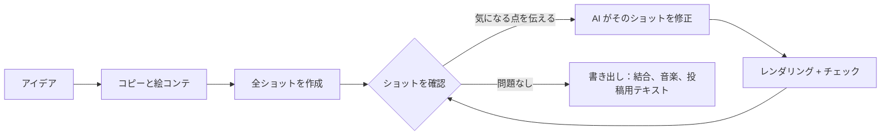

<h1 align="center">
  <br/>
  Shotloop
</h1>

<p align="center"><b>コードで短い解説動画を、ショットごとにつくる。</b><br/>
アイデアがコピーになり、絵コンテになり、ショットを並べた動画になります。ショットにはそれぞれのループがあります。AI が書き、Shotloop がレンダリングし、あなたが確認し、AI が直す。修正するとそのショットだけを再レンダリングし、動画全体はやり直しません。</p>

<p align="center">
  
</p>

<p align="center">
  <a href="https://github.com/chihyungchang/Shotloop/releases/latest"><b>macOS 版をダウンロード</b></a> ·
  <a href="https://github.com/chihyungchang/Shotloop/releases">リリース一覧</a> ·
  <a href="#ソースからビルド">ソースからビルド</a>
</p>

<p align="center">
  <a href="https://github.com/chihyungchang/Shotloop/releases/latest"></a>
  
  <a href="LICENSE"></a>
  
</p>

<p align="center"><a href="README.md">English</a> · <a href="README.zh-CN.md">简体中文</a> · <a href="README.zh-TW.md">繁體中文</a> · <b>日本語</b> · <a href="README.ko.md">한국어</a> · <a href="README.es.md">Español</a> · <a href="README.pt-BR.md">Português</a> · <a href="README.fr.md">Français</a> · <a href="README.de.md">Deutsch</a> · <a href="README.it.md">Italiano</a> · <a href="README.ru.md">Русский</a> · <a href="README.tr.md">Türkçe</a> · <a href="README.vi.md">Tiếng Việt</a> · <a href="README.id.md">Bahasa Indonesia</a></p>

---

## Shotloop とは

Shotloop は、コードで描く短い動画のためのデスクトップアプリです。製品紹介、科学の解説、データストーリー、スライド風アニメーションなどを、2D（1 フレームずつレンダリングする Web ページ）または 3D（Blender のシーン）で、7 つのビジュアルスタイルからつくれます。

始めるのは一文だけ。AI が見せ方（シネマティックなシーン、インフォグラフィック、地図、UI デモ、設計図、モーションタイポグラフィ、3D）とテーマを選びます。自分で選んでもかまいません。続いてフック、台本、出典付きの事実を書き、絵コンテに分割します。絵コンテを編集すると、AI が全ショットを作成します。エディタでショットを 1 つずつ見て、気になる点を普段の言葉で伝えます。たとえば「文字が小さすぎる」「動きがなさすぎる。もっと動かして」。AI はそのショットを修正してレンダリングし、メモと照らしてチェックしたうえで、変更前と変更後を見せます。動画全体がうまくまとまったら「書き出し」へ。ショットを結合して音楽を付け、AI が動画のルックに合わせてカバーをデザインし（シリーズのテンプレートに当てはめることも可能）、プラットフォームごとの投稿用テキストを書きます。すべて専用のフォルダにまとまります。

AI はいま使っているものをそのまま使えます。サインイン済みの Claude Code やほかのコーディングエージェント、自分のキーで使うモデル API、ローカルモデルのどれでも大丈夫です。

アプリは 14 言語に対応しています：English、简体中文、繁體中文、日本語、한국어、Español、Português、Français、Deutsch、Italiano、Русский、Türkçe、Tiếng Việt、Bahasa Indonesia。Mac の言語設定に従い、AI の返答と投稿用テキストも選んだ言語で書かれます。

## Shotloop でつくった作品

以下のフレームはすべて、同梱の[サンプル](examples/)から Shotloop がレンダリングしたものです。

<table>
<tr>
<td width="25%" valign="top"><br/><sub><b>3D</b>：Blender でつくったスマホの分解。</sub></td>
<td width="25%" valign="top"><br/><sub><b>2D</b>：太陽の光が地球に届くまでの時間。</sub></td>
<td width="50%" valign="top"><br/><sub><b>2D データ</b>：毎日 1% 良くなると、をグラフで（16:9）。</sub></td>
</tr>
</table>

## アイデアを見せる 7 つの方法

AI は題材に合うスタイルを選び、その理由を伝えます。プランの画面で切り替えることも、ホームで最初から指定することもできます。各画像はリンク先のサンプルの 1 フレームです。

<table>
<tr>
<td width="25%" valign="top"><a href="examples/sunlight-en/"></a><br/><sub><b>シネマティックなシーン</b>：光と奥行き、動くカメラ。宇宙、自然、物理など、撮影できそうなものに。</sub></td>
<td width="25%" valign="top"><a href="examples/solar-share-en/"></a><br/><sub><b>インフォグラフィック</b>：グラフと動く数字。統計、比較、お金の話に。</sub></td>
<td width="25%" valign="top"><a href="examples/coffee-map-en/"></a><br/><sub><b>地図</b>：世界地図、ルート、光る国々。場所や広がり方の話に。</sub></td>
<td width="25%" valign="top"><a href="examples/fake-parcel-text-en/"></a><br/><sub><b>UI デモ</b>：スマホやブラウザで一歩ずつ。アプリ、設定、詐欺の手口に。</sub></td>
</tr>
<tr>
<td width="25%" valign="top"><a href="examples/zipper-blueprint-en/"></a><br/><sub><b>設計図</b>：グリッド上の線画、分解図、注釈。機械のしくみの説明に。</sub></td>
<td width="25%" valign="top"><a href="examples/chinese-words-en/"></a><br/><sub><b>モーションタイポグラフィ</b>：動く大きな文字。名言、言葉、俗説の検証に。</sub></td>
<td width="25%" valign="top"><a href="examples/watch-3d-en/"></a><br/><sub><b>3D</b>：本物の光と、空間を進むカメラを備えた Blender のシーン。</sub></td>
</tr>
</table>

2D 動画は決まった原則に従います。映像が先、ショットごとに短くまとめた字幕を 1 つ、どの行も読み切れるだけ表示、数字は必ず動かす、見せるものに正直に、出典は画面に小さく。原則は [engine/video/explainers/2d/README.md](engine/video/explainers/2d/README.md) と、すべての 2D プロンプトに含まれています。

## 画面ツアー

<table>
<tr>
<td width="50%" valign="top">
<a href="docs/screenshots/home.jpg"></a><br/>
<sub><b>ホーム</b>：一文を書くだけ。2D か 3D か、長さ、スタイル、テーマは「自動」のままで OK。サンプルから始めることもできます。</sub>
</td>
<td width="50%" valign="top">
<a href="docs/screenshots/plan.jpg"></a><br/>
<sub><b>コピーと絵コンテ</b>：フック、台本、出典付きの事実、各ショットで見せる内容。どれもレンダリング前に編集できます。</sub>
</td>
</tr>
<tr>
<td width="50%" valign="top">
<a href="docs/screenshots/studio.jpg"></a><br/>
<sub><b>エディタ</b>：暗いステージ上のショット、フィルムストリップ、ショットごとのメモとチェック。</sub>
</td>
<td width="50%" valign="top">
<a href="docs/screenshots/agent.jpg"></a><br/>
<sub><b>AI アシスタント</b>：気になる点を伝えると、AI がそのショットを直します。境界線をドラッグして変更前と変更後を比較できます。</sub>
</td>
</tr>
<tr>
<td width="50%" valign="top">
<a href="docs/screenshots/export.jpg"></a><br/>
<sub><b>書き出し</b>：動画（縦・横）、カバー、投稿用テキストを選びます。カバーとテキストは事前に編集可能。書き出しごとに専用のフォルダに保存されます。</sub>
</td>
<td width="50%" valign="top">
<a href="docs/screenshots/settings.jpg"></a><br/>
<sub><b>モデルとプロバイダ</b>：サインイン済みの CLI エージェント、自分のキーで使うモデル API、ローカルモデル。</sub>
</td>
</tr>
</table>

## しくみ



- **長い 1 本ではなく、ショット単位で。** 動画はショットのリストです。各ショットは小さなプログラムで、2D ページなら `shot.js`、Blender のカメラワークなら `shot.py`。入力のハッシュでショットごとにキャッシュするので、修正時の再レンダリングは 1 ショットだけで数秒（2D）から 1 分（3D）。書き出しはクリップを結合するだけです。
- **普段の言葉で修正。** AI が触るのは今開いているショットだけ。共有のワールドを変える必要がある場合は別です。静止画をレンダリングしてチェックリスト（読める、何も隠れていない、字幕エリアにかからない など）と照合し、何を変えたかを報告します。
- **7 つのビジュアルスタイル。** シネマティックなシーン、インフォグラフィック、地図、UI デモ、設計図、モーションタイポグラフィ、3D。それぞれ専用のキットと参考静止画があり、AI は選ぶ前と作る前にそれを確認します（[`engine/shotloop/styles.mjs`](engine/shotloop/styles.mjs)）。テーマが決めるのは背景と文字だけで、図やデータは題材に必要な色を保ちます。
- **プランはルールで測る。** 何かを作る前に、字幕の長さと表示時間をチェックします。複数のショットに出てくる図は一度だけ描いて共有するので、どのショットでも同じ見た目になります。
- **事実には出典を。** コピーでは各事実の隣に出典を置き、投稿用テキストはコピー内の事実しか使えません。
- **カバー。** AI が動画のルックに合わせてカバーをデザインし、自分のレンダリング結果をチェックします。テンプレートとして保存すればシリーズの統一感を保てます。気に入ったカバーをアップロードすれば、AI はそのデザインに倣います。
- **カットに合う音楽。** 合成した BGM はカットが拍に合うよう調整され、最後のフレームまで流れてからフェードアウトします。
- **編集中は速く、書き出しは最高画質。** 3D は編集中は簡易プレビューを表示し、書き出し時にだけフル画質でレンダリングします。2D は最初から最後までフル画質です。
- **3D 用アセットライブラリ。** 自分のキーで [Poly Pizza](https://poly.pizza) と [Smithsonian Open Access](https://www.si.edu/openaccess) の CC0 モデルを検索できます。モデルは一度ダウンロードすれば、どの 3D プロジェクトにも追加できます。

## 動かす AI

| モード | 必要なもの |
| --- | --- |
| **ローカル CLI エージェント** | この Mac でサインイン済みの [Claude Code](https://docs.anthropic.com/en/docs/claude-code)（Codex CLI と Gemini CLI は試験的対応）。ヘッドレスで動き、自前のツールはオフにして Shotloop のツールだけを使います。 |
| **モデル API** | 自分のキー。Anthropic、OpenAI、Google Gemini、OpenRouter、xAI、Mistral、Together、DeepSeek、Qwen、Kimi、GLM、MiniMax、Doubao、SiliconFlow のプリセットに加え、Anthropic 互換または OpenAI 互換の任意のエンドポイントに対応。キーは Mac の外に出ません。 |
| **ローカルモデル** | Ollama、LM Studio、vLLM、llama.cpp、または任意の OpenAI 互換サーバー。 |

モデルにはツール呼び出しが必要で、チェックには画像を見られるモデルが必要です。エージェントが使えるのは限られたツールだけです。ショットのファイルの読み書き、静止画のレンダリング、チェック結果の報告はできますが、シェルコマンドは実行できません。

## インストール

1. [最新リリース](https://github.com/chihyungchang/Shotloop/releases/latest)から `Shotloop_<version>_aarch64.dmg` をダウンロードして開き、Shotloop を「アプリケーション」にドラッグします。
2. **Google Chrome** をインストールしておいてください（2D ショットのレンダリングに使います）。3D プロジェクトを初めて作るときは、Shotloop が **Blender** のインストールを案内します。
3. 「設定 → モデルとプロバイダ」で AI を選びます。Mac に Claude Code があれば自動で選ばれます。

> **初回起動：** Shotloop はまだ Apple の公証を受けていないため、macOS は「開発元を検証できません」と表示します。**システム設定 → プライバシーとセキュリティ → このまま開く** から一度開くか、ターミナルで `xattr -dr com.apple.quarantine /Applications/Shotloop.app` を実行してください。以降は普通に開け、アップデートも確認なしでインストールされます。

Node.js と ffmpeg はアプリに同梱されています。Shotloop は GitHub でアップデートを確認し、その場でインストールします。Apple シリコン（M1 以降）搭載の Mac で動作します。

## ソースからビルド

```bash
nvm use                      # Node 22.18+ (the agent runs TypeScript directly)
corepack enable              # once: provides the pinned pnpm
pnpm install
pnpm app                     # tauri dev; needs the Rust toolchain
pnpm app:build               # Shotloop.app and a dmg, with Node and ffmpeg inside
```

`pnpm app` は Mac にある Node と ffmpeg を使い、すべてをチェックアウトしたリポジトリから直接実行します。リリースはアップデーター用に署名され、[`app/scripts/release.mjs`](app/scripts/release.mjs) で公開されます。

<details>
<summary><b>ターミナルからエンジンを使う</b></summary>

```bash
pnpm shotloop status   fixtures/hello-3d
pnpm shotloop render   fixtures/hello-3d --shot 02-close --stills   # start/middle/end
pnpm shotloop render   fixtures/hello-3d --shot 02-close            # a clip, in the editor's quality
pnpm shotloop export   fixtures/hello-3d                            # only changed shots render
pnpm shotloop new      my-short --idea "スマホのバッテリーはなぜ劣化する？" --track auto --duration auto
pnpm shotloop new      coffee --idea "コーヒーはどこから来た？" --track 2d --style map --duration 30
pnpm shotloop export   fixtures/hello-3d --to ~/Movies/Shotloop --name "Hello"   # into a new folder there
pnpm shotloop covers   list                                         # cover templates
pnpm shotloop doctor
```

`--json` を付けると、行区切りのイベントを出力します（アプリが読み取るのはこれです）。エージェントも同じように実行できます：

```bash
node agent/src/main.ts detect                                         # CLI agents and local servers on this Mac
SHOTLOOP_PROVIDER=cli SHOTLOOP_CLI=claude node agent/src/main.ts check fixtures/hello-3d --shot 01-wide
pnpm test                                                             # every backend against scripted stand-ins
```

</details>

<details>
<summary><b>プロジェクト形式</b></summary>

```
my-video/
  shotloop.json        title, track (2d|3d), style, size, fps, shots [{ id, title, duration }]
  storyboard.json      the plan: copy (hook, script, facts with sources) and shots
  world/               3D: world.py (+ screen.html); 2D: page.html (the style's kit), parts.js (pictures
                       that recur, drawn once), geo.data.js (the map style's countries)
  shots/<id>/          shot.py | shot.js, notes.md (must show, on screen, motion)
  assets/<id>/         3D models from the asset library
  copy.md  script.md  captions.html  music.json  thumb.html  publish.json
  .shotloop/           cache: per shot and input hash, takes, checks, fixes
  out/                 the engine's exports (timestamped); the app copies each into a new folder where you choose
```

- **3D**：`world.py` が `kit`（[`engine/video/explainers/3d/lib/kit.py`](engine/video/explainers/3d/lib/kit.py)）で共有のワールドを構築します。`shot.py` はワールドの名前空間で実行され、カメラを 1 台作ります。`at(t)` はショット内の秒数を動画全体の時間に変換します。
- **2D**：`shot.js` は `render(t, ctx)` をデフォルトエクスポートし、ショット内の時刻 `t` における `world/page.html` を描画します。
- **キャッシュ**：ショットのキーは、ワールド、コード、字幕、アセット、レンダラー、設定のハッシュです。変更のないショットは再利用されます。

</details>

<details>
<summary><b>リポジトリ構成</b></summary>

| パス | 内容 |
| --- | --- |
| [`app/`](app/) | デスクトップアプリ：レンダリングキュー、アップデーター、プロセス管理を担う Tauri 2（Rust）のシェルと、React + TypeScript の UI。 |
| [`engine/shotloop/`](engine/shotloop/) | ショットエンジン：プロジェクト形式、ショットごとのレンダリングキャッシュ、2D（Chrome）と 3D（Blender）のレンダリング、動画の組み立て、MP4 書き出し、音楽、アセットライブラリ。アプリから呼び出される CLI。 |
| [`agent/`](agent/) | エージェント：プラン作成、ショット作成、普段の言葉での修正、チェックリストによるチェック、投稿用テキスト。API、CLI（MCP 経由）、ローカルモデルに対応。 |
| [`examples/`](examples/) | ホームに表示されるサンプル（英語）：すべてのビジュアルスタイルに最低 1 つ（2D と 3D、9:16 と 16:9）。 |
| [`fixtures/`](fixtures/) | テストとターミナルでの動作確認用プロジェクト。 |

</details>

## ライセンス

[Apache License 2.0](LICENSE)。[NOTICE](NOTICE) も参照してください。アセットライブラリのモデルはそれぞれのライセンス（CC0 または CC-BY、クレジットはプロジェクトに記載）に従います。
