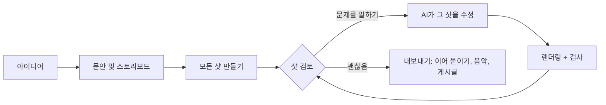

<h1 align="center">
  <br/>
  Shotloop
</h1>

<p align="center"><b>코드로 짧은 설명 영상을 만듭니다. 샷 하나씩.</b><br/>
아이디어 하나가 문안, 스토리보드, 그리고 여러 샷으로 이뤄진 영상이 됩니다. 샷마다 자체 루프가 있습니다. AI가 작성하고, Shotloop이 렌더링하고, 사용자가 검토하면 AI가 고칩니다. 수정하면 영상 전체가 아니라 그 샷만 다시 렌더링합니다.</p>

<p align="center">
  
</p>

<p align="center">
  <a href="https://github.com/chihyungchang/Shotloop/releases/latest"><b>macOS용 다운로드</b></a> ·
  <a href="https://github.com/chihyungchang/Shotloop/releases">릴리스</a> ·
  <a href="#소스에서-빌드">소스에서 빌드</a>
</p>

<p align="center">
  <a href="https://github.com/chihyungchang/Shotloop/releases/latest"></a>
  
  <a href="LICENSE"></a>
  
</p>

<p align="center"><a href="README.md">English</a> · <a href="README.zh-CN.md">简体中文</a> · <a href="README.zh-TW.md">繁體中文</a> · <a href="README.ja.md">日本語</a> · <b>한국어</b> · <a href="README.es.md">Español</a> · <a href="README.pt-BR.md">Português</a> · <a href="README.fr.md">Français</a> · <a href="README.de.md">Deutsch</a> · <a href="README.it.md">Italiano</a> · <a href="README.ru.md">Русский</a> · <a href="README.tr.md">Türkçe</a> · <a href="README.vi.md">Tiếng Việt</a> · <a href="README.id.md">Bahasa Indonesia</a></p>

---

## Shotloop이란

Shotloop은 코드로 그리는 짧은 영상을 위한 데스크톱 앱입니다. 제품 홍보, 과학 설명, 데이터 스토리, 슬라이드형 애니메이션을 2D(프레임 단위로 렌더링하는 웹 페이지) 또는 3D(Blender 장면)로, 일곱 가지 비주얼 스타일 중 하나로 만듭니다.

시작은 문장 하나입니다. 직접 고르지 않으면 AI가 표현 방식(시네마틱 장면, 인포그래픽, 지도, 인터페이스 데모, 설계도, 키네틱 타이포그래피, 3D)과 테마를 고릅니다. 이어서 훅, 대본, 출처가 달린 사실을 쓰고 이를 스토리보드로 나눕니다. 스토리보드를 다듬으면 AI가 모든 샷을 만듭니다. 편집기에서 샷을 하나씩 보면서 문제를 평범한 말로 이야기하면 됩니다. 예를 들어 "글자가 너무 작아요", "너무 정적이에요. 움직임을 좀 넣어 주세요". AI는 그 샷만 고쳐 렌더링하고, 노트와 대조해 검사한 뒤 전후 비교를 보여 줍니다. 영상이 마음에 들면 내보내기에서 샷을 이어 붙이고 음악을 넣습니다. AI는 영상 분위기에 맞는 커버를 디자인하고(또는 시리즈 템플릿을 채우고) 플랫폼별 게시글을 써서, 모두 전용 폴더에 담습니다.

AI는 이미 쓰고 있는 것을 그대로 씁니다. 로그인해 둔 Claude Code나 다른 코딩 에이전트, 내 키로 쓰는 모델 API, 또는 로컬 모델.

앱은 14개 언어를 지원합니다: English, 简体中文, 繁體中文, 日本語, 한국어, Español, Português, Français, Deutsch, Italiano, Русский, Türkçe, Tiếng Việt, Bahasa Indonesia. 기본값은 Mac의 언어를 따르며, AI의 답변과 게시글도 선택한 언어로 작성됩니다.

## Shotloop으로 만든 영상

아래 모든 프레임은 Shotloop에 포함된 [예제](examples/)로 렌더링했습니다.

<table>
<tr>
<td width="25%" valign="top"><br/><sub><b>3D</b>: Blender로 만든 스마트폰 분해.</sub></td>
<td width="25%" valign="top"><br/><sub><b>2D</b>: 햇빛이 지구에 닿기까지 걸리는 시간.</sub></td>
<td width="50%" valign="top"><br/><sub><b>2D 데이터</b>: 매일 1%씩 나아지기, 차트로 보기(16:9).</sub></td>
</tr>
</table>

## 아이디어를 보여 주는 일곱 가지 방법

AI가 주제에 맞는 스타일을 고르고 이유를 알려 줍니다. 계획 화면에서 바꾸거나 홈에서 직접 고를 수도 있습니다. 각 그림은 링크된 예제의 한 프레임입니다.

<table>
<tr>
<td width="25%" valign="top"><a href="examples/sunlight-en/"></a><br/><sub><b>시네마틱 장면</b>: 빛, 깊이, 움직이는 카메라. 촬영할 수 있을 법한 것에: 우주, 자연, 물리.</sub></td>
<td width="25%" valign="top"><a href="examples/solar-share-en/"></a><br/><sub><b>인포그래픽</b>: 차트와 움직이는 숫자. 통계, 비교, 돈 이야기에.</sub></td>
<td width="25%" valign="top"><a href="examples/coffee-map-en/"></a><br/><sub><b>지도</b>: 세계 지도, 경로, 빛나는 국가. 장소와 확산 과정에.</sub></td>
<td width="25%" valign="top"><a href="examples/fake-parcel-text-en/"></a><br/><sub><b>인터페이스 데모</b>: 휴대폰이나 브라우저에서 단계별로. 앱, 설정, 사기 수법에.</sub></td>
</tr>
<tr>
<td width="25%" valign="top"><a href="examples/zipper-blueprint-en/"></a><br/><sub><b>설계도</b>: 격자 위 선화, 분해도, 콜아웃. 기계의 작동 원리에.</sub></td>
<td width="25%" valign="top"><a href="examples/chinese-words-en/"></a><br/><sub><b>키네틱 타이포그래피</b>: 움직이는 큰 글자. 인용구, 단어, 통념 바로잡기에.</sub></td>
<td width="25%" valign="top"><a href="examples/watch-3d-en/"></a><br/><sub><b>3D</b>: 실제 같은 조명과 공간을 누비는 카메라의 Blender 장면.</sub></td>
</tr>
</table>

2D 영상은 고정된 원칙을 따릅니다. 시각 우선, 샷마다 압축된 자막 하나, 모든 문장은 읽을 수 있을 만큼 화면에 머물고, 모든 숫자는 움직이며, 보여 주는 내용에 정직하고, 출처는 화면에 작게 표시합니다. 원칙은 [engine/video/explainers/2d/README.md](engine/video/explainers/2d/README.md)와 모든 2D 프롬프트에 들어 있습니다.

## 둘러보기

<table>
<tr>
<td width="50%" valign="top">
<a href="docs/screenshots/home.jpg"></a><br/>
<sub><b>홈</b>: 문장 하나면 됩니다. 2D/3D, 길이, 스타일, 테마는 자동에 맡겨도 됩니다. 갤러리의 예제에서 시작할 수도 있습니다.</sub>
</td>
<td width="50%" valign="top">
<a href="docs/screenshots/plan.jpg"></a><br/>
<sub><b>문안 및 스토리보드</b>: 훅, 대본, 출처가 달린 사실, 그리고 각 샷이 보여 줄 내용. 렌더링 전에 모두 편집할 수 있습니다.</sub>
</td>
</tr>
<tr>
<td width="50%" valign="top">
<a href="docs/screenshots/studio.jpg"></a><br/>
<sub><b>편집기</b>: 어두운 무대 위의 샷, 필름 스트립, 샷별 노트와 검사 결과.</sub>
</td>
<td width="50%" valign="top">
<a href="docs/screenshots/agent.jpg"></a><br/>
<sub><b>AI 어시스턴트</b>: 무엇이 문제인지 말하면 AI가 그 샷을 고칩니다. 구분선을 끌어 전후를 비교하세요.</sub>
</td>
</tr>
<tr>
<td width="50%" valign="top">
<a href="docs/screenshots/export.jpg"></a><br/>
<sub><b>내보내기</b>: 영상(세로, 가로), 커버, 게시글을 체크하세요. 커버와 게시글은 먼저 편집할 수 있습니다. 내보낼 때마다 새 폴더가 만들어집니다.</sub>
</td>
<td width="50%" valign="top">
<a href="docs/screenshots/settings.jpg"></a><br/>
<sub><b>모델 및 제공업체</b>: 로그인해 둔 CLI 에이전트, 내 키로 쓰는 모델 API, 또는 로컬 모델.</sub>
</td>
</tr>
</table>

## 작동 방식



- **긴 렌더링 한 번이 아니라 샷 단위.** 영상은 샷의 목록입니다. 각 샷은 작은 프로그램으로, 2D 페이지는 `shot.js`, Blender 카메라 이동은 `shot.py`입니다. 샷마다 입력의 해시로 캐시되므로, 수정하면 샷 하나만 몇 초(2D) 또는 1분(3D) 안에 다시 렌더링되고, 내보내기는 클립을 이어 붙이기만 합니다.
- **평범한 말로 수정.** AI는 공유 월드를 건드려야 하는 경우가 아니면 지금 보고 있는 샷만 고칩니다. 정지 화면을 렌더링해 체크리스트(읽기 쉬운지, 가려진 것은 없는지, 자막 영역을 침범하지 않는지 등)와 대조하고, 바꾼 내용을 알려 줍니다.
- **일곱 가지 비주얼 스타일.** 시네마틱 장면, 인포그래픽, 지도, 인터페이스 데모, 설계도, 키네틱 타이포그래피, 3D. 스타일마다 자체 키트와 참고 정지 화면이 있으며, AI는 고르고 만들기 전에 이를 살펴봅니다([`engine/shotloop/styles.mjs`](engine/shotloop/styles.mjs)). 테마는 배경과 글자만 정하고, 그림과 데이터는 주제에 맞는 색을 유지합니다.
- **계획을 평가하는 규칙.** 무엇이든 만들기 전에 자막의 길이와 화면에 머무는 시간을 검사합니다. 여러 샷에 반복되는 그림은 한 번만 그려 공유하므로 어디서나 똑같아 보입니다.
- **출처가 있는 사실.** 문안은 각 사실 옆에 출처를 두고, 게시글은 문안에 있는 사실만 쓸 수 있습니다.
- **커버.** AI가 영상 분위기에 맞는 커버를 디자인하고 렌더링 결과를 스스로 검사합니다. 템플릿으로 저장해 시리즈를 일관되게 유지하거나, 마음에 드는 커버를 올리면 AI가 그 디자인을 따릅니다.
- **편집에 맞춘 음악.** 합성 배경 음악은 컷이 박자에 떨어지도록 맞춰지고, 마지막 프레임까지 이어진 뒤 페이드아웃됩니다.
- **편집할 땐 빠르게, 내보낼 땐 최고 품질로.** 3D는 편집 중에는 빠른 미리보기를 보여 주고, 내보낼 때만 최고 품질로 렌더링합니다. 2D는 처음부터 끝까지 최고 품질입니다.
- **3D 에셋 라이브러리.** 내 키로 [Poly Pizza](https://poly.pizza)와 [Smithsonian Open Access](https://www.si.edu/openaccess)에서 CC0 모델을 검색합니다. 모델은 한 번만 다운로드되며 어떤 3D 프로젝트에도 추가할 수 있습니다.

## 구동하는 AI

| 방식 | 필요한 것 |
| --- | --- |
| **로컬 CLI 에이전트** | 이 Mac에서 로그인한 [Claude Code](https://docs.anthropic.com/en/docs/claude-code)(Codex CLI와 Gemini CLI는 실험적 지원). 헤드리스로 실행되며 자체 도구는 꺼지고 Shotloop의 도구로만 작업합니다. |
| **모델 API** | 내 키. Anthropic, OpenAI, Google Gemini, OpenRouter, xAI, Mistral, Together, DeepSeek, Qwen, Kimi, GLM, MiniMax, Doubao, SiliconFlow 프리셋, 또는 Anthropic·OpenAI 호환 엔드포인트. 키는 Mac에만 저장됩니다. |
| **로컬 모델** | Ollama, LM Studio, vLLM, llama.cpp 또는 OpenAI 호환 서버. |

모델은 도구 호출을 지원해야 하고, 검사에는 이미지를 볼 수 있는 모델이 필요합니다. 에이전트는 좁은 도구 세트로만 작업합니다. 샷 파일을 읽고 쓰고, 정지 화면을 렌더링하고, 검사 결과를 보고할 수 있지만 셸 명령은 실행할 수 없습니다.

## 설치

1. [최신 릴리스](https://github.com/chihyungchang/Shotloop/releases/latest)에서 `Shotloop_<version>_aarch64.dmg`를 다운로드해 열고, Shotloop을 응용 프로그램 폴더로 끌어다 놓습니다.
2. **Google Chrome**이 설치되어 있어야 합니다(2D 샷은 Chrome으로 렌더링합니다). 3D 프로젝트를 처음 만들 때 Shotloop이 **Blender**를 요청합니다.
3. 설정 → 모델 및 제공업체에서 AI를 고릅니다. Mac에 Claude Code가 이미 있으면 자동으로 선택됩니다.

> **처음 실행할 때:** Shotloop은 아직 Apple 공증을 받지 않아 macOS가 개발자를 확인할 수 없다고 표시합니다. **시스템 설정 → 개인정보 보호 및 보안 → 그래도 열기**에서 한 번 열거나, 터미널에서 `xattr -dr com.apple.quarantine /Applications/Shotloop.app`을 실행하세요. 그다음부터는 평소처럼 열리고, 업데이트도 다시 묻지 않고 설치됩니다.

Node.js와 ffmpeg는 앱에 들어 있습니다. Shotloop은 GitHub에서 업데이트를 확인하고 그 자리에서 설치합니다. Apple silicon(M1 이상) Mac에서 실행됩니다.

## 소스에서 빌드

```bash
nvm use                      # Node 22.18+ (the agent runs TypeScript directly)
corepack enable              # once: provides the pinned pnpm
pnpm install
pnpm app                     # tauri dev; needs the Rust toolchain
pnpm app:build               # Shotloop.app and a dmg, with Node and ffmpeg inside
```

`pnpm app`은 Mac에 있는 Node와 ffmpeg를 사용하고 모든 것을 체크아웃에서 바로 실행합니다. 릴리스는 업데이터용으로 서명되며 [`app/scripts/release.mjs`](app/scripts/release.mjs)로 게시됩니다.

<details>
<summary><b>터미널에서 엔진 사용하기</b></summary>

```bash
pnpm shotloop status   fixtures/hello-3d
pnpm shotloop render   fixtures/hello-3d --shot 02-close --stills   # start/middle/end
pnpm shotloop render   fixtures/hello-3d --shot 02-close            # a clip, in the editor's quality
pnpm shotloop export   fixtures/hello-3d                            # only changed shots render
pnpm shotloop new      my-short --idea "휴대폰 배터리는 왜 노화할까?" --track auto --duration auto
pnpm shotloop new      coffee --idea "커피는 어디에서 왔을까?" --track 2d --style map --duration 30
pnpm shotloop export   fixtures/hello-3d --to ~/Movies/Shotloop --name "Hello"   # into a new folder there
pnpm shotloop covers   list                                         # cover templates
pnpm shotloop doctor
```

`--json`을 붙이면 줄 단위 이벤트가 출력됩니다(앱이 읽는 형식). 에이전트도 같은 방식으로 실행됩니다.

```bash
node agent/src/main.ts detect                                         # CLI agents and local servers on this Mac
SHOTLOOP_PROVIDER=cli SHOTLOOP_CLI=claude node agent/src/main.ts check fixtures/hello-3d --shot 01-wide
pnpm test                                                             # every backend against scripted stand-ins
```

</details>

<details>
<summary><b>프로젝트 형식</b></summary>

```
my-video/
  shotloop.json        title, track (2d|3d), style, size, fps, shots [{ id, title, duration }]
  storyboard.json      the plan: copy (hook, script, facts with sources) and shots
  world/               3D: world.py (+ screen.html); 2D: page.html (the style's kit), parts.js (pictures
                       that recur, drawn once), geo.data.js (the map style's countries)
  shots/<id>/          shot.py | shot.js, notes.md (must show, on screen, motion)
  assets/<id>/         3D models from the asset library
  copy.md  script.md  captions.html  music.json  thumb.html  publish.json
  .shotloop/           cache: per shot and input hash, takes, checks, fixes
  out/                 the engine's exports (timestamped); the app copies each into a new folder where you choose
```

- **3D**: `world.py`는 `kit`([`engine/video/explainers/3d/lib/kit.py`](engine/video/explainers/3d/lib/kit.py))으로 공유 월드를 만듭니다. `shot.py`는 월드의 네임스페이스에서 실행되며 카메라 하나를 만듭니다. `at(t)`는 샷 기준 초를 영상 시간으로 변환합니다.
- **2D**: `shot.js`는 `render(t, ctx)`를 default export하며, 샷 기준 시간 `t`의 `world/page.html`을 그립니다.
- **캐시**: 샷의 키는 월드, 샷 코드, 자막, 에셋, 렌더러, 설정을 해시한 값입니다. 바뀌지 않은 샷은 재사용됩니다.

</details>

<details>
<summary><b>저장소 구조</b></summary>

| 경로 | 내용 |
| --- | --- |
| [`app/`](app/) | 데스크톱 앱: 렌더 대기열, 업데이터, 프로세스 관리를 맡는 Tauri 2(Rust) 셸과 React + TypeScript UI. |
| [`engine/shotloop/`](engine/shotloop/) | 샷 엔진: 프로젝트 형식, 샷별 렌더 캐시, 2D(Chrome)·3D(Blender) 렌더링, 영상 조립, MP4 내보내기, 음악, 에셋 라이브러리. 앱이 호출하는 CLI입니다. |
| [`agent/`](agent/) | 에이전트: 계획, 제작, 평범한 말로 하는 수정, 체크리스트 검사, 게시글. API, CLI(MCP 경유), 로컬 모델을 지원합니다. |
| [`examples/`](examples/) | 홈에서 제공하는 영어 예제: 비주얼 스타일마다 하나 이상(2D와 3D, 9:16과 16:9). |
| [`fixtures/`](fixtures/) | 테스트와 터미널 실습용 프로젝트. |

</details>

## 라이선스

[Apache License 2.0](LICENSE). [NOTICE](NOTICE)도 참고하세요. 에셋 라이브러리의 모델은 각자의 라이선스를 따릅니다(CC0 또는 CC-BY, 출처 표기는 프로젝트에 기록됩니다).
