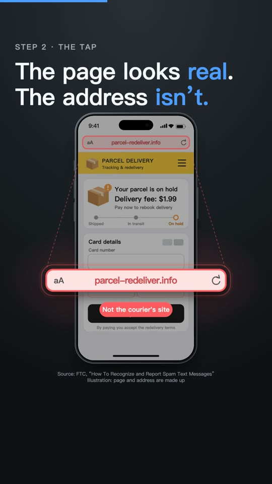
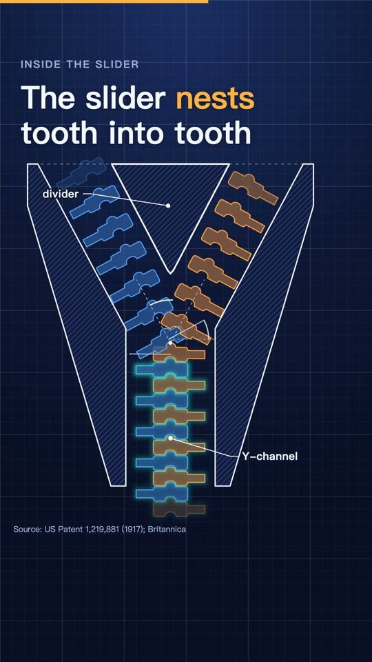
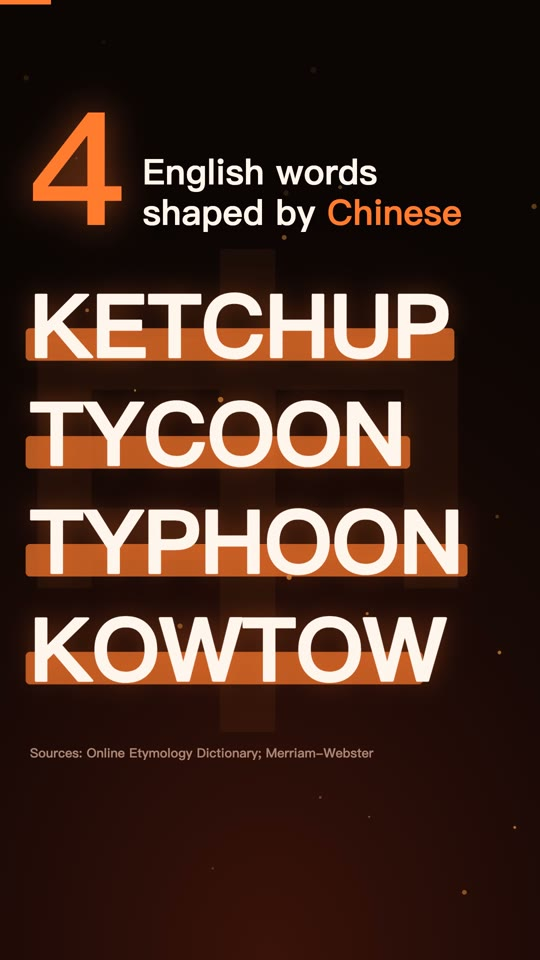
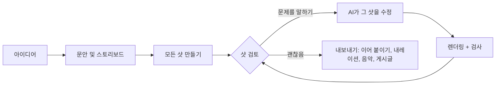

<h1 align="center">
  <br/>
  Shotloop
</h1>

<p align="center"><b>AI로 짧은 영상을. 영상 전체가 아니라 샷 하나만 고칩니다.</b><br/>
아이디어 하나가 문안, 스토리보드, 그리고 여러 샷으로 이뤄진 영상이 됩니다. 샷마다 자체 루프가 있습니다. AI가 작성하고, Shotloop이 렌더링하고, 사용자가 검토하면 AI가 고칩니다. 수정하면 영상 전체가 아니라 그 샷만 다시 렌더링합니다.</p>

<p align="center">
  
</p>

<p align="center">
  <a href="https://github.com/chihyungchang/Shotloop/releases/latest"><b>macOS용 다운로드</b></a> ·
  <a href="https://github.com/chihyungchang/Shotloop/releases">릴리스</a> ·
  <a href="#소스에서-빌드">소스에서 빌드</a>
</p>

<p align="center">
  <a href="https://github.com/chihyungchang/Shotloop/releases/latest"></a>
  
  <a href="LICENSE"></a>
  
</p>

<p align="center"><a href="README.md">English</a> · <a href="README.zh-CN.md">简体中文</a> · <a href="README.zh-TW.md">繁體中文</a> · <a href="README.ja.md">日本語</a> · <b>한국어</b> · <a href="README.es.md">Español</a> · <a href="README.pt-BR.md">Português</a> · <a href="README.fr.md">Français</a> · <a href="README.de.md">Deutsch</a> · <a href="README.it.md">Italiano</a> · <a href="README.ru.md">Русский</a> · <a href="README.tr.md">Türkçe</a> · <a href="README.vi.md">Tiếng Việt</a> · <a href="README.id.md">Bahasa Indonesia</a></p>

---

## Shotloop이란

Shotloop은 코드로 그리는 짧은 영상을 위한 데스크톱 앱입니다. 제품 홍보, 과학 설명, 데이터 스토리, 슬라이드형 애니메이션을 2D(프레임 단위로 렌더링하는 웹 페이지) 또는 3D(오프라인 렌더러처럼 렌더링하는 three.js 월드)로, 여덟 가지 비주얼 스타일 중 하나로 만듭니다.

시작은 문장 하나입니다. 직접 고르지 않으면 AI가 표현 방식(시네마틱 장면, 인포그래픽, 지도, 인터페이스 데모, 설계도, 키네틱 타이포그래피, 뉴스 스토리, 3D)과 테마를 고릅니다. 이어서 훅, 대본, 출처가 달린 사실을 쓰고 이를 스토리보드로 나누며, 샷마다 내레이션이 읽을 대사도 붙입니다. 스토리보드를 다듬으면 AI가 모든 샷을 만듭니다. 편집기에서 샷을 하나씩 보면서 문제를 평범한 말로 이야기하면 됩니다. 예를 들어 "글자가 너무 작아요", "너무 정적이에요. 움직임을 좀 넣어 주세요". AI는 먼저 살펴본 뒤 그 샷을 바꿀 방법을 몇 가지 제안합니다. 하나를 고르면(또는 원하는 방법을 말하면) 그 샷만 고치고 전후 비교를 보여 줍니다. 영상이 마음에 들면 내보내기에서 샷을 이어 붙이고, 자막이 달린 내레이션과 그 아래 깔리는 음악을 넣습니다. AI는 영상 분위기에 맞는 커버를 디자인하고(또는 시리즈 템플릿을 채우고) 플랫폼별 게시글을 써서, 모두 전용 폴더에 담습니다.

AI는 이미 쓰고 있는 것을 그대로 씁니다. 로그인해 둔 Claude Code나 다른 코딩 에이전트, 내 키로 쓰는 모델 API, 또는 로컬 모델.

앱은 14개 언어를 지원합니다: English, 简体中文, 繁體中文, 日本語, 한국어, Español, Português, Français, Deutsch, Italiano, Русский, Türkçe, Tiếng Việt, Bahasa Indonesia. 기본값은 Mac의 언어를 따르며, AI의 답변과 게시글도 선택한 언어로 작성됩니다.

## Shotloop으로 만든 영상

아래 모든 프레임은 Shotloop에 포함된 [예제](examples/)로 렌더링했습니다.

<table>
<tr>
<td width="25%" valign="top"><br/><sub><b>3D</b>: WebGL로 만든 기계식 시계.</sub></td>
<td width="25%" valign="top"><br/><sub><b>2D</b>: 햇빛이 지구에 닿기까지 걸리는 시간.</sub></td>
<td width="50%" valign="top"><br/><sub><b>2D 데이터</b>: 매일 1%씩 나아지기, 차트로 보기(16:9).</sub></td>
</tr>
</table>

## 아이디어를 보여 주는 여덟 가지 방법

AI가 주제에 맞는 스타일을 고르고 이유를 알려 줍니다. 계획 화면에서 바꾸거나 홈에서 직접 고를 수도 있습니다. 각 그림은 링크된 예제의 한 프레임입니다.

<table>
<tr>
<td width="25%" valign="top"><a href="examples/sunlight-en/"></a><br/><sub><b>시네마틱 장면</b>: 빛, 깊이, 움직이는 카메라. 촬영할 수 있을 법한 것에: 우주, 자연, 물리.</sub></td>
<td width="25%" valign="top"><a href="examples/solar-share-en/"></a><br/><sub><b>인포그래픽</b>: 차트와 움직이는 숫자. 통계, 비교, 돈 이야기에.</sub></td>
<td width="25%" valign="top"><a href="examples/coffee-map-en/"></a><br/><sub><b>지도</b>: 세계 지도, 경로, 빛나는 국가. 장소와 확산 과정에.</sub></td>
<td width="25%" valign="top"><a href="examples/fake-parcel-text-en/"></a><br/><sub><b>인터페이스 데모</b>: 휴대폰이나 브라우저에서 단계별로. 앱, 설정, 사기 수법에.</sub></td>
</tr>
<tr>
<td width="25%" valign="top"><a href="examples/zipper-blueprint-en/"></a><br/><sub><b>설계도</b>: 격자 위 선화, 분해도, 콜아웃. 기계의 작동 원리에.</sub></td>
<td width="25%" valign="top"><a href="examples/chinese-words-en/"></a><br/><sub><b>키네틱 타이포그래피</b>: 움직이는 큰 글자. 인용구, 단어, 통념 바로잡기에.</sub></td>
<td width="25%" valign="top"><a href="examples/bybit-heist-en/"></a><br/><sub><b>뉴스 스토리</b>: 긴장감 있게 전하는 속보. 흘러가는 시계, 돈의 흐름, 타임라인, 누가 무엇을 말했는지.</sub></td>
<td width="25%" valign="top"><a href="examples/watch-3d-en/"></a><br/><sub><b>3D</b>: 스튜디오 조명, 부드러운 그림자, 공간을 누비는 카메라의 three.js 월드.</sub></td>
</tr>
</table>

2D 영상은 일련의 규칙을 따릅니다. 모든 프레임을 깔끔하게, 영상을 정확하게 지키는 고정 규칙(가리지 않기, 깨진 프레임 없음, 모든 문장을 읽을 시간, 정직, 출처 표기), 설정 → 규칙에서 고쳐 쓰거나 끄거나 추가할 수 있는 기본 취향, 그리고 직접 기법을 더할 수 있는 애니메이션 기법 도구 상자입니다. 규칙은 [engine/shotloop/rules.mjs](engine/shotloop/rules.mjs)에 있으며 모든 2D 프롬프트에 들어갑니다. "검사 실행"은 이 규칙에 비추어 샷을 검토하며, 통과하지 못한 항목마다 해당 규칙으로 연결됩니다.

## 둘러보기

<table>
<tr>
<td width="50%" valign="top">
<a href="docs/screenshots/home.jpg"></a><br/>
<sub><b>홈</b>: 문장 하나면 됩니다. 2D/3D, 길이, 스타일, 테마는 자동에 맡겨도 됩니다. 갤러리의 예제에서 시작할 수도 있습니다.</sub>
</td>
<td width="50%" valign="top">
<a href="docs/screenshots/plan.jpg"></a><br/>
<sub><b>문안 및 스토리보드</b>: 훅, 대본, 출처가 달린 사실, 그리고 각 샷이 보여 줄 내용. 렌더링 전에 모두 편집할 수 있습니다.</sub>
</td>
</tr>
<tr>
<td width="50%" valign="top">
<a href="docs/screenshots/studio.jpg"></a><br/>
<sub><b>편집기</b>: 어두운 무대 위의 샷, 필름 스트립과 그 아래의 오디오 트랙, 샷별 노트와 검사 결과.</sub>
</td>
<td width="50%" valign="top">
<a href="docs/screenshots/agent.jpg"></a><br/>
<sub><b>AI 샷 어시스턴트</b>: 무엇이 문제인지 말하면 AI가 몇 가지 방법을 제안합니다. 하나를 고르거나 직접 말하면 그 샷을 고칩니다. 구분선을 끌어 전후를 비교하세요.</sub>
</td>
</tr>
<tr>
<td width="50%" valign="top">
<a href="docs/screenshots/export.jpg"></a><br/>
<sub><b>내보내기</b>: 영상(세로, 가로), 커버, 게시글을 체크하세요. 커버와 게시글은 먼저 편집할 수 있습니다. 내보낼 때마다 새 폴더가 만들어집니다.</sub>
</td>
<td width="50%" valign="top">
<a href="docs/screenshots/settings.jpg"></a><br/>
<sub><b>모델 및 제공업체</b>: 로그인해 둔 CLI 에이전트, 내 키로 쓰는 모델 API, 또는 로컬 모델.</sub>
</td>
</tr>
</table>

## 작동 방식



- **긴 렌더링 한 번이 아니라 샷 단위.** 영상은 샷의 목록입니다. 각 샷은 시각 t의 화면을 그리는 작은 프로그램 `shot.js`로, 2D는 페이지를, 3D는 three.js 월드를 그립니다. 샷마다 입력의 해시로 캐시되므로, 수정하면 샷 하나만 몇 초 안에 다시 렌더링되고, 내보내기는 클립을 이어 붙이기만 합니다.
- **평범한 말로 수정.** AI는 공유 월드를 건드려야 하는 경우가 아니면 지금 보고 있는 샷만 고칩니다. 먼저 원하는 변경을 위한 구체적인 방법을 몇 가지 제안하고, 고른 방법(또는 직접 말한 방법)이 그대로 수정이 됩니다. 수정은 1분도 걸리지 않으며, 끝나면 바로 샷 클립이 렌더링되어 곧장 재생할 수 있습니다. "검사 실행"은 체크리스트(읽기 쉬운지, 가려진 것은 없는지, 자막 영역을 침범하지 않는지 등)와 대조해 아무것도 바꾸지 않고 검토만 하며, 찾은 문제는 클릭 한 번으로 고칠 수 있습니다.
- **여덟 가지 비주얼 스타일.** 시네마틱 장면, 인포그래픽, 지도, 인터페이스 데모, 설계도, 키네틱 타이포그래피, 뉴스 스토리, 3D. 스타일마다 자체 키트와 참고 정지 화면이 있으며, AI는 고르고 만들기 전에 이를 살펴봅니다([`engine/shotloop/kits/styles.mjs`](engine/shotloop/kits/styles.mjs)). 테마는 배경과 글자만 정하고, 그림과 데이터는 주제에 맞는 색을 유지합니다.
- **계획을 평가하는 규칙.** 무엇이든 만들기 전에 자막의 길이와 화면에 머무는 시간을 검사합니다. 여러 샷에 반복되는 그림은 한 번만 그려 공유하므로 어디서나 똑같아 보입니다.
- **출처가 있는 사실.** 문안은 각 사실 옆에 출처를 두고, 게시글은 문안에 있는 사실만 쓸 수 있습니다.
- **커버.** AI가 영상 분위기에 맞는 커버를 디자인하고 렌더링 결과를 스스로 검사합니다. 템플릿으로 저장해 시리즈를 일관되게 유지하거나, 마음에 드는 커버를 올리면 AI가 그 디자인을 따릅니다.
- **내 Mac에서 읽어 주는 내레이션, 원할 때만.** 기본은 꺼져 있어 화면이 타이밍을 정하고, 화면에 자막 카드를 띄웁니다. 켜면 샷마다 대사가 있고, 컷은 내레이션을 따라갑니다. 샷의 길이는 대사 길이에 맞춰지고, 화면은 말에 맞춰 움직입니다. 샷을 다 만든 뒤에 내레이션을 더할 수도 있습니다. 대사는 샷에 맞춰 쓰이고 샷 길이는 그대로이며, 조금 긴 대사는 컷을 넘어 이어집니다. 영어는 Kokoro가, 중국어는 CosyVoice 2가, 나머지 언어는 Supertonic이 읽으며 모두 오프라인으로 동작합니다. 말한 내용의 자막이 자동으로 붙고, 자막이 가리게 될 것(글자와 표시해 둔 피사체)을 검사로 나열하므로 가려진 영상은 절대 내보내지지 않습니다.
- **화면이 완성된 뒤에 사운드.** 사운드는 필름 스트립 아래에 파형이 보이는 색깔별 트랙으로 놓입니다. 내레이션, 음악, 앰비언스, 효과음입니다. 어디서든 재생하면 화면이 따라옵니다. 트랙마다 볼륨은 트랙 헤더에 있어 드래그하는 동안 바로 들리고, 설정은 그 옆에서 열리며, 효과음은 클릭 한 번으로 끌 수 있습니다. "AI 사운드"는 어떤 부분을 만들지(각 샷의 코드에서 읽어 낸 화면의 박자에 넣을 효과음, 앰비언스, 내레이션이 없을 때는 나중에 더하는 내레이션) 물어본 뒤 영상 전체를 한 번에 처리합니다.
- **편집에 맞춘 음악.** 합성 배경 음악은 컷이 박자에 떨어지도록 맞춰지고, 마지막 프레임까지 이어진 뒤 페이드아웃됩니다. 내레이션이 있으면 더 낮게 깔리고, 대사가 나오는 동안에는 한층 줄어듭니다.
- **오프라인 렌더러 같은 3D를 몇 분 만에.** 3D의 각 프레임은 여러 서브프레임(안티에일리어싱, 소프트 섀도, 앰비언트 오클루전, 피사계 심도, 모션 블러)을 평균해 약 0.5초 만에 완성되므로, 30초 영상도 몇 분이면 렌더링됩니다. 따로 설치할 것은 없습니다.
- **에셋 라이브러리: 모델과 사운드.** 내 키로 [Poly Pizza](https://poly.pizza)와 [Smithsonian Open Access](https://www.si.edu/openaccess)에서 CC0 모델을, 키 없이 [Openverse](https://openverse.org)(Freesound, Wikimedia, Jamendo)에서 효과음, 앰비언스, 음악을 검색합니다. 다운로드하기 전에 미리 들어 볼 수 있습니다. 에셋은 한 번만 다운로드되며 어떤 프로젝트에도 추가할 수 있습니다. 모델은 3D 월드에, 사운드는 화면의 박자에 맞추거나 영상 전체에 깔리는 앰비언스로 넣습니다. 다운로드는 "대기열"에서 승인을 기다립니다.

## 구동하는 AI

| 방식 | 필요한 것 |
| --- | --- |
| **로컬 CLI 에이전트** | 이 Mac에서 로그인한 [Claude Code](https://docs.anthropic.com/en/docs/claude-code)(Codex CLI와 Gemini CLI는 실험적 지원). 헤드리스로 실행되며 자체 도구는 꺼지고 Shotloop의 도구로만 작업합니다. |
| **모델 API** | 내 키. Anthropic, OpenAI, Google Gemini, OpenRouter, xAI, Mistral, Together, DeepSeek, Qwen, Kimi, GLM, MiniMax, Doubao, SiliconFlow 프리셋, 또는 Anthropic·OpenAI 호환 엔드포인트. 키는 Mac에만 저장됩니다. |
| **로컬 모델** | Ollama, LM Studio, vLLM, llama.cpp 또는 OpenAI 호환 서버. |

모델은 도구 호출을 지원해야 하고, 검사에는 이미지를 볼 수 있는 모델이 필요합니다. 에이전트는 좁은 도구 세트로만 작업합니다. 샷 파일을 읽고 쓰고, 정지 화면을 렌더링하고, 검사 결과를 보고할 수 있지만 셸 명령은 실행할 수 없습니다.

## 설치

1. [최신 릴리스](https://github.com/chihyungchang/Shotloop/releases/latest)에서 `Shotloop_<version>_aarch64.dmg`를 다운로드해 열고, Shotloop을 응용 프로그램 폴더로 끌어다 놓습니다.
2. 샷은 Mac에 이미 있는 Chromium 기반 브라우저(Chrome, Edge, Brave, Arc…)로 렌더링합니다. 없으면 첫 렌더링 때 헤드리스 브라우저(약 100MB)를 내려받으며, 설정 → 의존성에서 미리 받을 수도 있습니다.
3. 설정 → 모델 및 제공업체에서 AI를 고릅니다. Mac에 Claude Code가 이미 있으면 자동으로 선택됩니다.

> **처음 실행할 때:** Shotloop은 아직 Apple 공증을 받지 않아 macOS가 개발자를 확인할 수 없다고 표시합니다. **시스템 설정 → 개인정보 보호 및 보안 → 그래도 열기**에서 한 번 열거나, 터미널에서 `xattr -dr com.apple.quarantine /Applications/Shotloop.app`을 실행하세요. 그다음부터는 평소처럼 열리고, 업데이트도 다시 묻지 않고 설치됩니다.

Node.js, ffmpeg, 내레이션의 음성 엔진은 앱에 들어 있습니다. 음성 모델은 들어 있지 않습니다. 영상이 해당 언어로 처음 말할 때 진행 표시줄과 함께 다운로드되며(영어용 Kokoro 132 MB, 실행에 쓰는 Python을 포함한 중국어용 CosyVoice 2 약 5 GB, 그 밖의 언어용 Supertonic 400 MB), 설정 → 의존성에서 미리 받아 둘 수도 있습니다. 설정 → 정보에는 모든 서드파티 구성 요소와 그 라이선스가 나와 있습니다. Shotloop은 GitHub에서 업데이트를 확인하고 그 자리에서 설치합니다. Apple silicon(M1 이상) Mac에서 실행됩니다.

## 소스에서 빌드

```bash
nvm use                      # Node 22.18+ (the agent runs TypeScript directly)
corepack enable              # once: provides the pinned pnpm
pnpm install
pnpm app                     # tauri dev; needs the Rust toolchain
pnpm app:build               # Shotloop.app and a dmg, with Node and ffmpeg inside
```

`pnpm app`은 Mac에 있는 Node와 ffmpeg를 사용하고 모든 것을 체크아웃에서 바로 실행합니다. 릴리스는 업데이터용으로 서명되며 [`app/scripts/release.mjs`](app/scripts/release.mjs)로 게시됩니다.

<details>
<summary><b>터미널에서 엔진 사용하기</b></summary>

```bash
pnpm shotloop status   fixtures/ep01-password-crack-time
pnpm shotloop render   fixtures/ep01-password-crack-time --shot 02-stack-16-gpu --stills   # start/middle/end
pnpm shotloop render   fixtures/ep01-password-crack-time --shot 02-stack-16-gpu            # a clip
pnpm shotloop export   fixtures/ep01-password-crack-time                                   # only changed shots render
pnpm shotloop new      my-short --idea "휴대폰 배터리는 왜 노화할까?" --track auto --duration auto
pnpm shotloop new      coffee --idea "커피는 어디에서 왔을까?" --track 2d --style map --duration 30
pnpm shotloop export   fixtures/ep01-password-crack-time --to ~/Movies/Shotloop --name "Hello"   # into a new folder there
pnpm shotloop covers   list                                         # cover templates
pnpm shotloop voice    my-short --on --voice af_heart --fit        # the voice-over: speak the lines, fit the shots
pnpm shotloop check-subtitles my-short                              # what the subtitles would cover (fails if anything)
pnpm shotloop voice-models --download kokoro-en                     # a speech model, ahead of time
pnpm shotloop doctor
```

`--json`을 붙이면 줄 단위 이벤트가 출력됩니다(앱이 읽는 형식). 에이전트도 같은 방식으로 실행됩니다.

```bash
node agent/src/main.ts detect                                         # CLI agents and local servers on this Mac
SHOTLOOP_PROVIDER=cli SHOTLOOP_CLI=claude node agent/src/main.ts check fixtures/ep01-password-crack-time --shot 01-password-field-dots
pnpm test                                                             # every backend against scripted stand-ins
```

</details>

<details>
<summary><b>프로젝트 형식</b></summary>

```
my-video/
  shotloop.json        title, track (2d|3d), style, size, fps, lang, voice { on, voice, speed },
                       shots [{ id, title, duration, say (the spoken line), cues (its sentences' times) }]
  storyboard.json      the plan: copy (hook, script, facts with sources) and shots
  world/               page.html (2D: the style's kit; 3D: the WebGL kit), 2D: parts.js (pictures that
                       recur, drawn once), geo.data.js (the map style's countries); 3D: *.js (sets, machines)
  shots/<id>/          shot.js, notes.md (must show, on screen, motion, sound), sounds.json (its sound effects)
  assets/<id>/         models and sounds from the asset library
  copy.md  script.md  music.json  thumb.html  publish.json
  .shotloop/           cache: per shot and input hash, takes, checks, fixes; voice/: spoken lines, subtitles
  out/                 the engine's exports (timestamped); the app copies each into a new folder where you choose
```

- **3D**: `world/page.html`은 엔진의 WebGL 키트([`engine/shotloop/kits/webgl.mjs`](engine/shotloop/kits/webgl.mjs))로, 스튜디오 조명, 머티리얼, 도형, glTF 모델, 렌즈 기반 카메라와 그 위의 글자를 갖춘 three.js 무대입니다. 샷들이 공유하는 세트와 기계는 `world/*.js`에 둡니다. 샷은 보여 줄 것을 `setup(ctx)`에서 만들고, `render(t)`에서 `t` 시점의 포즈를 잡습니다.
- **2D**: `shot.js`는 `render(t, ctx)`를 default export하며, 샷 기준 시간 `t`의 `world/page.html`을 그립니다. `ctx.voice`에는 샷에서 말하는 문장과 그 시간이 담겨 있어 화면을 말에 맞출 수 있습니다. 피사체를 `data-keep`(canvas라면 `subtitles.keep()`)으로 표시하면 자막 검사가 그 부분을 비워 둡니다.
- **캐시**: 샷의 키는 월드, 샷 코드, 모델, 렌더러, 설정을 해시한 값입니다. 바뀌지 않은 샷은 재사용됩니다.

</details>

<details>
<summary><b>저장소 구조</b></summary>

| 경로 | 내용 |
| --- | --- |
| [`app/`](app/) | 데스크톱 앱: 렌더 대기열, 업데이터, 프로세스 관리를 맡는 Tauri 2(Rust) 셸과 React + TypeScript UI. |
| [`engine/shotloop/`](engine/shotloop/) | 샷 엔진: 프로젝트 형식, 샷별 렌더 캐시, Chrome에서의 2D·3D(three.js) 렌더링, 영상 조립, MP4 내보내기, 내레이션 타이밍, 자막과 그 검사, 음악, 에셋 라이브러리. 앱이 호출하는 CLI입니다. |
| [`voice/`](voice/) | 내레이션의 텍스트 음성 변환(이 Mac에서 실행): sherpa-onnx를 통한 Kokoro, ONNX Runtime 기반 Supertonic, 로컬 Python 서버에서 실행되는 CosyVoice 2, 그리고 모델 다운로드. |
| [`agent/`](agent/) | 에이전트: 계획, 제작, 평범한 말로 하는 수정, 체크리스트 검사, 게시글. API, CLI(MCP 경유), 로컬 모델을 지원합니다. |
| [`examples/`](examples/) | 홈에서 제공하는 영어 예제: 비주얼 스타일마다 하나 이상(2D와 3D, 9:16과 16:9). |
| [`fixtures/`](fixtures/) | 테스트와 터미널 실습용 프로젝트. |

</details>

## 감사의 말

Shotloop은 오픈 소스의 성과 위에 서 있습니다. 다음 프로젝트를 만든 분들께 감사드립니다.

- **내레이션:** hexgrad의 [Kokoro](https://huggingface.co/hexgrad/Kokoro-82M)와 [sherpa-onnx](https://github.com/k2-fsa/sherpa-onnx)(영어), FunAudioLLM의 [CosyVoice 2](https://github.com/FunAudioLLM/CosyVoice)와 이를 받쳐 주는 [Matcha-TTS](https://github.com/shivammehta25/Matcha-TTS), [WeTextProcessing](https://github.com/wenet-e2e/WeTextProcessing), [Whisper](https://github.com/openai/whisper), [PyTorch](https://pytorch.org), [Transformers](https://github.com/huggingface/transformers)(중국어), Supertone의 [Supertonic](https://huggingface.co/Supertone/supertonic-3)(그 밖의 언어), [ONNX Runtime](https://onnxruntime.ai), 중국어 음성을 실행하는 [uv](https://github.com/astral-sh/uv)와 [Python](https://www.python.org).
- **렌더링과 영상:** [FFmpeg](https://ffmpeg.org), DevTools 프로토콜을 통한 [Google Chrome](https://www.google.com/chrome/), [three.js](https://threejs.org), [Node.js](https://nodejs.org).
- **앱:** [Tauri](https://tauri.app), [React](https://react.dev), [Anthropic SDK](https://github.com/anthropics/anthropic-sdk-typescript), [Model Context Protocol SDK](https://github.com/modelcontextprotocol/typescript-sdk).
- **에셋과 데이터:** [Kenney](https://kenney.nl), [Poly Haven](https://polyhaven.com), [Quaternius](https://quaternius.com), [Poly Pizza](https://poly.pizza), [Smithsonian Open Access](https://www.si.edu/openaccess), [Openverse](https://openverse.org), 그리고 [world-atlas](https://github.com/topojson/world-atlas)를 통한 [Natural Earth](https://www.naturalearthdata.com).

설정 → 정보에는 모든 구성 요소가 버전, 라이선스와 함께 나와 있고, 자세한 내용은 [NOTICE](NOTICE)에 있습니다.

## 개인정보

Shotloop은 하루 한 번까지 개발자에게 익명 집계를 보냅니다: 버전, 칩, 화면 언어, 기획·제작·수정·내보낸 영상 수(내보내기는 스타일별)와 무작위 설치 ID. 프로젝트 내용, 이름, 텍스트, 파일, API 키는 절대 보내지 않으며 IP 주소도 저장하지 않습니다. 처음 실행할 때 알려 드리며, **설정 → 일반**에서 끌 수 있습니다. 소스에서 빌드한 버전은 보내지 않습니다([`app/src-tauri/src/telemetry.rs`](app/src-tauri/src/telemetry.rs)). Shotloop이 저장하고 보내는 모든 내용은 [개인정보 안내](https://oliverz.dev/ko/products/shotloop/privacy)에 있습니다.

## 라이선스

[Apache License 2.0](LICENSE). [NOTICE](NOTICE)도 참고하세요. 에셋 라이브러리의 모델과 사운드는 각자의 라이선스를 따릅니다(CC0 또는 CC-BY, 출처 표기는 프로젝트에 기록됩니다). 음성 모델도 마찬가지입니다(Kokoro와 CosyVoice 2: Apache-2.0, Supertonic: OpenRAIL-M).
