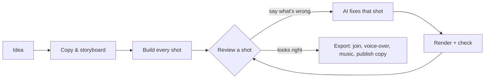

<h1 align="center">
  <br/>
  Shotloop
</h1>

<p align="center"><b>Make short explainer videos from code, one shot at a time.</b><br/>
An idea becomes copy, a storyboard and a film made of shots. Each shot has its own loop: the AI writes it, Shotloop renders it, you review it and the AI fixes it. A fix re-renders that shot only, not the whole film.</p>

<p align="center">
  
</p>

<p align="center">
  <a href="https://github.com/chihyungchang/Shotloop/releases/latest"><b>Download for macOS</b></a> ·
  <a href="https://github.com/chihyungchang/Shotloop/releases">Releases</a> ·
  <a href="#build-from-source">Build from source</a>
</p>

<p align="center">
  <a href="https://github.com/chihyungchang/Shotloop/releases/latest"></a>
  
  <a href="LICENSE"></a>
  
</p>

<p align="center"><b>English</b> · <a href="README.zh-CN.md">简体中文</a> · <a href="README.zh-TW.md">繁體中文</a> · <a href="README.ja.md">日本語</a> · <a href="README.ko.md">한국어</a> · <a href="README.es.md">Español</a> · <a href="README.pt-BR.md">Português</a> · <a href="README.fr.md">Français</a> · <a href="README.de.md">Deutsch</a> · <a href="README.it.md">Italiano</a> · <a href="README.ru.md">Русский</a> · <a href="README.tr.md">Türkçe</a> · <a href="README.vi.md">Tiếng Việt</a> · <a href="README.id.md">Bahasa Indonesia</a></p>

---

## What is Shotloop

Shotloop is a desktop app for short videos that are drawn with code: product promos, science explainers, data stories and slide-style animation, made in 2D (web pages rendered frame by frame) or 3D (Blender scenes), in eight visual styles.

You start with one sentence. The AI picks how to show it (a cinematic scene, an infographic, a map, an interface demo, a blueprint, kinetic type, a news story or 3D) and a theme, unless you choose them. It writes the hook, the script and the facts with their sources, then splits them into a storyboard, with the line a voice-over says over each shot. You edit the storyboard, and the AI builds every shot. In the Studio you look at each shot and say what is wrong in plain words, such as "the text is too small" or "it's too still: add some motion". The AI changes that shot, renders it, checks it against the notes and shows you a before/after. When the film reads right, Export joins the shots, lays the voice-over with its subtitles and the music under them, the AI designs a cover in the film's look (or fills your series' template) and writes the post for each platform, all into a folder of its own.

The AI is the one you already use: Claude Code or another coding agent you're signed in to, a model API with your own key, or a local model.

The app speaks 14 languages: English, 简体中文, 繁體中文, 日本語, 한국어, Español, Português, Français, Deutsch, Italiano, Русский, Türkçe, Tiếng Việt and Bahasa Indonesia. It follows your Mac's language, and the AI replies and writes the publish posts in the one you pick.

## Made with Shotloop

Every frame below was rendered by Shotloop from the [examples](examples/) it ships with.

<table>
<tr>
<td width="25%" valign="top"><br/><sub><b>3D</b>: a phone teardown in Blender.</sub></td>
<td width="25%" valign="top"><br/><sub><b>2D</b>: how long sunlight takes to reach Earth.</sub></td>
<td width="50%" valign="top"><br/><sub><b>2D data</b>: 1% better every day, in charts (16:9).</sub></td>
</tr>
</table>

## Eight ways to show an idea

The AI picks the style that fits the subject and tells you why; you can switch on the plan, or choose one on Home. Each picture is a frame of the example it links to.

<table>
<tr>
<td width="25%" valign="top"><a href="examples/sunlight-en/"></a><br/><sub><b>Cinematic scene</b>: light, depth and a moving camera, for things you could film: space, nature, physics.</sub></td>
<td width="25%" valign="top"><a href="examples/solar-share-en/"></a><br/><sub><b>Infographic</b>: charts and moving numbers, for statistics, comparisons, money.</sub></td>
<td width="25%" valign="top"><a href="examples/coffee-map-en/"></a><br/><sub><b>Map</b>: the world map, routes and countries lighting up, for places and how things spread.</sub></td>
<td width="25%" valign="top"><a href="examples/fake-parcel-text-en/"></a><br/><sub><b>Interface demo</b>: a phone or a browser, step by step, for apps, settings and scams.</sub></td>
</tr>
<tr>
<td width="25%" valign="top"><a href="examples/zipper-blueprint-en/"></a><br/><sub><b>Blueprint</b>: line art on a grid, exploded views and callouts, for how a machine works.</sub></td>
<td width="25%" valign="top"><a href="examples/chinese-words-en/"></a><br/><sub><b>Kinetic type</b>: huge type that moves, for quotes, words and myths.</sub></td>
<td width="25%" valign="top"><a href="examples/bybit-heist-en/"></a><br/><sub><b>News story</b>: breaking events told with tension: a running clock, the money trail, the timeline, who said what.</sub></td>
<td width="25%" valign="top"><a href="examples/watch-3d-en/"></a><br/><sub><b>3D</b>: Blender scenes with real light and a camera through space.</sub></td>
</tr>
</table>

2D videos follow a set of rules: fixed ones that keep every frame clean and the video true (nothing covered, no broken frames, time to read every line, honest, sourced), and a house taste you can reword, switch off or add to in Settings → Rules, together with a toolbox of animation devices you can extend with your own. They live in [engine/shotloop/rules.mjs](engine/shotloop/rules.mjs) and reach every 2D prompt.

## Product tour

<table>
<tr>
<td width="50%" valign="top">
<a href="docs/screenshots/home.jpg"></a><br/>
<sub><b>Home</b>: one sentence. 2D or 3D, the length, the style and the theme can stay on Auto. Or start from an example in the gallery.</sub>
</td>
<td width="50%" valign="top">
<a href="docs/screenshots/plan.jpg"></a><br/>
<sub><b>Copy &amp; storyboard</b>: the hook, the script and sourced facts, and the shots with what each one shows, all editable before anything renders.</sub>
</td>
</tr>
<tr>
<td width="50%" valign="top">
<a href="docs/screenshots/studio.jpg"></a><br/>
<sub><b>Studio</b>: the shot on a dark stage, the filmstrip, and each shot's notes and checks.</sub>
</td>
<td width="50%" valign="top">
<a href="docs/screenshots/agent.jpg"></a><br/>
<sub><b>AI assistant</b>: say what's wrong and the AI fixes that shot. Drag the divider to compare before and after.</sub>
</td>
</tr>
<tr>
<td width="50%" valign="top">
<a href="docs/screenshots/export.jpg"></a><br/>
<sub><b>Export</b>: tick the video (vertical, horizontal), the cover and the publish copy; edit the cover and the copy first. Every export goes into its own folder.</sub>
</td>
<td width="50%" valign="top">
<a href="docs/screenshots/settings.jpg"></a><br/>
<sub><b>Models &amp; providers</b>: a CLI agent you're signed in to, a model API with your key, or a local model.</sub>
</td>
</tr>
</table>

## How it works



- **Shots, not one long render.** A film is a list of shots. Each shot is a small program: `shot.js` for a 2D page, `shot.py` for a Blender camera move. Each one is cached by a hash of its inputs, so a fix re-renders one shot in seconds (2D) or a minute (3D), and Export only joins clips.
- **Plain-language fixes.** The AI only touches the shot you're on, unless the fix needs the shared world. It renders stills, checks them against a checklist (readable, nothing covered, out of the caption zone and so on) and reports what it changed.
- **Eight visual styles.** A cinematic scene, an infographic, a map, an interface demo, a blueprint, kinetic type, a news story or 3D, each with its own kit and reference stills the AI looks at before it chooses and builds ([`engine/shotloop/styles.mjs`](engine/shotloop/styles.mjs)). A theme sets only the ground and the type; pictures and data keep the colors their subject needs.
- **Rules a plan is measured against.** Captions are checked for length and for the time they stay up before anything is built. A picture that recurs across shots is drawn once and shared, so it looks the same in each.
- **Facts with sources.** The copy keeps each fact next to its source, and the publish copy may only use facts from the copy.
- **Covers.** The AI designs a cover in the film's look and checks its own renders. Save one as a template to keep a series consistent, or upload a cover you like and the AI follows its design.
- **A voice-over, spoken on your Mac.** Each shot has a line, and the voice leads the cut: a shot lasts as long as its line, and the picture lands on the words. Kokoro speaks English, CosyVoice 2 Chinese and Supertonic the other languages, all offline. Subtitles of the spoken words are added automatically, and a check lists anything they would cover (text and the marked subject), so a covered film is never exported. Turn it off for a film with captions only.
- **Music that fits the cut.** The synthesized bed is tuned so the cuts land on its beats, runs to the last frame and fades out. Under a voice-over it sits lower and dips while a line is spoken.
- **Fast while editing, full quality on export.** 3D shows quick previews while you edit and renders full-quality frames only when you export. 2D works in full quality throughout.
- **Asset library for 3D.** Search CC0 models on [Poly Pizza](https://poly.pizza) and [Smithsonian Open Access](https://www.si.edu/openaccess) with your own key. Each model is downloaded once and can be added to any 3D project.

## The AI that drives it

| Mode | What you need |
| --- | --- |
| **Local CLI agent** | [Claude Code](https://docs.anthropic.com/en/docs/claude-code), signed in on this Mac (Codex CLI and Gemini CLI are experimental). It runs headless with its own tools switched off and works only through Shotloop's tools. |
| **Model API** | Your own key. Presets for Anthropic, OpenAI, Google Gemini, OpenRouter, xAI, Mistral, Together, DeepSeek, Qwen, Kimi, GLM, MiniMax, Doubao and SiliconFlow, or any Anthropic- or OpenAI-compatible endpoint. Keys stay on your Mac. |
| **Local model** | Ollama, LM Studio, vLLM, llama.cpp or any OpenAI-compatible server. |

The model needs tool calling, and checks need one that can see images. The agent works through a narrow set of tools: it can read and write the shot's files, render stills and report checks. It can't run shell commands.

## Install

1. Download `Shotloop_<version>_aarch64.dmg` from the [latest release](https://github.com/chihyungchang/Shotloop/releases/latest), open it and drag Shotloop into Applications.
2. Have **Google Chrome** installed (2D shots render in it). For 3D projects, Shotloop asks for **Blender** the first time you create one.
3. Pick the AI in Settings → Models & providers. Claude Code is picked for you if it's already on your Mac.

> **First launch:** Shotloop isn't notarized by Apple yet, so macOS says it can't verify the developer. Open it once from **System Settings → Privacy & Security → Open Anyway**, or run `xattr -dr com.apple.quarantine /Applications/Shotloop.app` in Terminal. After that it opens normally, and updates install without asking again.

Node.js, ffmpeg and the voice-over's speech engines are inside the app. The voice models are not: each downloads the first time a film speaks its languages (Kokoro for English 132 MB; CosyVoice 2 for Chinese about 5 GB, with the Python it runs on; Supertonic for the other languages 400 MB), with a progress bar, or ahead of time in Settings → Dependencies. Settings → About lists every third-party component with its license. Shotloop checks GitHub for updates and installs them in place. It runs on Macs with Apple silicon (M1 and later).

## Build from source

```bash
nvm use                      # Node 22.18+ (the agent runs TypeScript directly)
corepack enable              # once: provides the pinned pnpm
pnpm install
pnpm app                     # tauri dev; needs the Rust toolchain
pnpm app:build               # Shotloop.app and a dmg, with Node and ffmpeg inside
```

`pnpm app` uses the Node and ffmpeg on your Mac and runs everything from the checkout. Releases are signed for the updater and published with [`app/scripts/release.mjs`](app/scripts/release.mjs).

<details>
<summary><b>The engine from a terminal</b></summary>

```bash
pnpm shotloop status   fixtures/hello-3d
pnpm shotloop render   fixtures/hello-3d --shot 02-close --stills   # start/middle/end
pnpm shotloop render   fixtures/hello-3d --shot 02-close            # a clip, in the editor's quality
pnpm shotloop export   fixtures/hello-3d                            # only changed shots render
pnpm shotloop new      my-short --idea "Why does your phone battery age?" --track auto --duration auto
pnpm shotloop new      coffee --idea "Where does coffee come from?" --track 2d --style map --duration 30
pnpm shotloop export   fixtures/hello-3d --to ~/Movies/Shotloop --name "Hello"   # into a new folder there
pnpm shotloop covers   list                                         # cover templates
pnpm shotloop voice    my-short --on --voice af_heart --fit        # the voice-over: speak the lines, fit the shots
pnpm shotloop check-subtitles my-short                              # what the subtitles would cover (fails if anything)
pnpm shotloop voice-models --download kokoro-en                     # a speech model, ahead of time
pnpm shotloop doctor
```

Add `--json` for line-delimited events (what the app reads). The agent runs the same way:

```bash
node agent/src/main.ts detect                                         # CLI agents and local servers on this Mac
SHOTLOOP_PROVIDER=cli SHOTLOOP_CLI=claude node agent/src/main.ts check fixtures/hello-3d --shot 01-wide
pnpm test                                                             # every backend against scripted stand-ins
```

</details>

<details>
<summary><b>Project format</b></summary>

```
my-video/
  shotloop.json        title, track (2d|3d), style, size, fps, lang, voice { on, voice, speed },
                       shots [{ id, title, duration, say (the spoken line), cues (its sentences' times) }]
  storyboard.json      the plan: copy (hook, script, facts with sources) and shots
  world/               3D: world.py (+ screen.html); 2D: page.html (the style's kit), parts.js (pictures
                       that recur, drawn once), geo.data.js (the map style's countries)
  shots/<id>/          shot.py | shot.js, notes.md (must show, on screen, motion)
  assets/<id>/         3D models from the asset library
  copy.md  script.md  captions.html  music.json  thumb.html  publish.json
  .shotloop/           cache: per shot and input hash, takes, checks, fixes; voice/: spoken lines, subtitles
  out/                 the engine's exports (timestamped); the app copies each into a new folder where you choose
```

- **3D**: `world.py` builds the shared world with `kit` ([`engine/shotloop/blender/kit/kit.py`](engine/shotloop/blender/kit/kit.py)). `shot.py` runs in the world's namespace and creates one camera; `at(t)` maps shot-local seconds to film time.
- **2D**: `shot.js` default-exports `render(t, ctx)`, which draws `world/page.html` at shot-local time `t`. `ctx.voice` holds the shot's spoken sentences with their times, so the picture can land on the words; mark the subject with `data-keep` (or `subtitles.keep()` on a canvas) so the subtitle check keeps it clear.
- **Cache**: a shot's key hashes the world, its code, the captions, the assets, the renderer and the settings. Unchanged shots are reused.

</details>

<details>
<summary><b>Repository layout</b></summary>

| Path | What |
| --- | --- |
| [`app/`](app/) | The desktop app: a Tauri 2 (Rust) shell with the render queue, updater and process supervision, and the React + TypeScript UI. |
| [`engine/shotloop/`](engine/shotloop/) | The shot engine: project format, per-shot render cache, 2D (Chrome) and 3D (Blender) renders, film assembly, MP4 export, voice-over timing, subtitles and their check, music, asset library. A CLI that the app calls. |
| [`voice/`](voice/) | The voice-over's text to speech, on this Mac: Kokoro through sherpa-onnx, Supertonic on ONNX Runtime, and CosyVoice 2 in a local Python server, with the models' downloads. |
| [`agent/`](agent/) | The agent: planning, building, plain-language fixes, checks against the checklist, publish copy. It supports API, CLI (through MCP) and local models. |
| [`examples/`](examples/) | The examples Home offers, in English: at least one for every visual style (2D and 3D, 9:16 and 16:9). |
| [`fixtures/`](fixtures/) | Projects for the tests and terminal walkthroughs. |

</details>

## Acknowledgements

Shotloop stands on open-source work. Thank you to the people behind:

- **The voice-over:** [Kokoro](https://huggingface.co/hexgrad/Kokoro-82M) by hexgrad and [sherpa-onnx](https://github.com/k2-fsa/sherpa-onnx) (English); [CosyVoice 2](https://github.com/FunAudioLLM/CosyVoice) by FunAudioLLM with [Matcha-TTS](https://github.com/shivammehta25/Matcha-TTS), [WeTextProcessing](https://github.com/wenet-e2e/WeTextProcessing), [Whisper](https://github.com/openai/whisper), [PyTorch](https://pytorch.org) and [Transformers](https://github.com/huggingface/transformers) (Chinese); [Supertonic](https://huggingface.co/Supertone/supertonic-3) by Supertone (the other languages); [ONNX Runtime](https://onnxruntime.ai); [uv](https://github.com/astral-sh/uv) and [Python](https://www.python.org), which run the Chinese voice.
- **Rendering and the film:** [FFmpeg](https://ffmpeg.org), [Google Chrome](https://www.google.com/chrome/) through the DevTools protocol, [Blender](https://www.blender.org) and [Node.js](https://nodejs.org).
- **The app:** [Tauri](https://tauri.app), [React](https://react.dev), the [Anthropic SDK](https://github.com/anthropics/anthropic-sdk-typescript) and the [Model Context Protocol SDK](https://github.com/modelcontextprotocol/typescript-sdk).
- **Assets and data:** [Kenney](https://kenney.nl), [Poly Haven](https://polyhaven.com), [Quaternius](https://quaternius.com), [Poly Pizza](https://poly.pizza), [Smithsonian Open Access](https://www.si.edu/openaccess), and [Natural Earth](https://www.naturalearthdata.com) via [world-atlas](https://github.com/topojson/world-atlas).

Settings → About lists every component with its version and license, and [NOTICE](NOTICE) has the details.

## Privacy

Once a day Shotloop sends anonymous counts to its maker: the version, the chip, the interface language and how many films were planned, built, fixed and exported (exports by visual style), with a random install ID. Never your projects, their names or text, your files or your API keys, and no IP address is stored. The first launch says so; turn it off in **Settings → General**. Builds from source never send ([`app/src-tauri/src/telemetry.rs`](app/src-tauri/src/telemetry.rs)). The full [privacy notice](https://oliverz.dev/products/shotloop/privacy) lists everything Shotloop stores and sends.

## License

[Apache License 2.0](LICENSE); see [NOTICE](NOTICE). Models from the asset library keep their own licenses (CC0 or CC-BY, with credit written into the project), and so do the voice models (Kokoro and CosyVoice 2: Apache-2.0; Supertonic: OpenRAIL-M).
