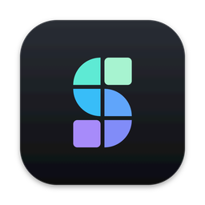
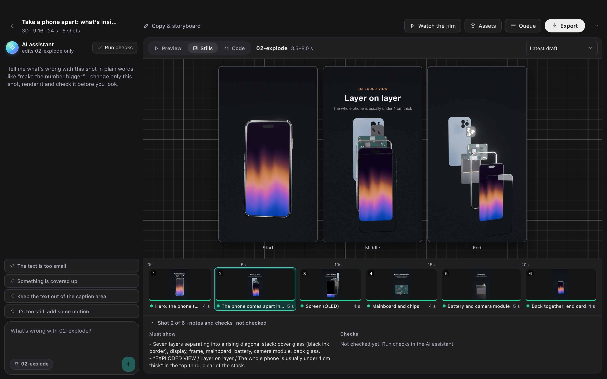
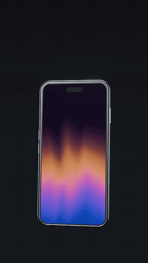
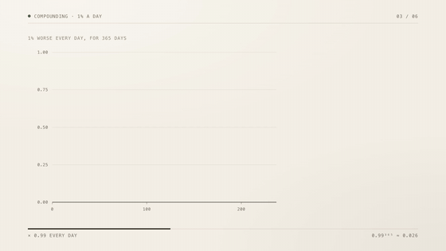
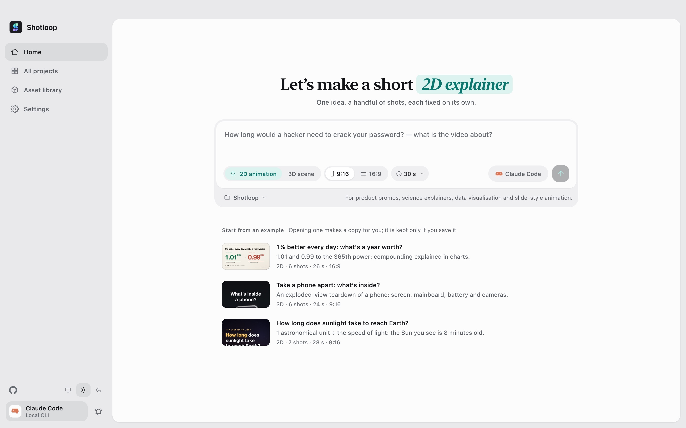
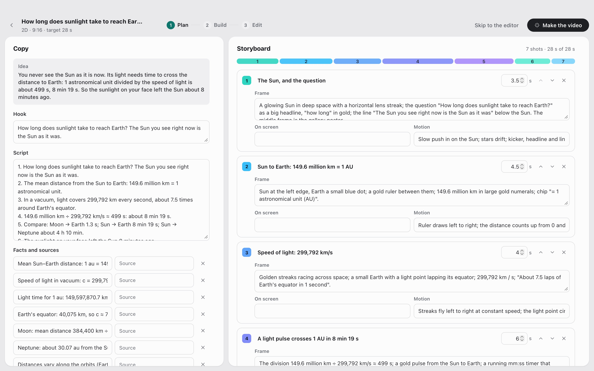
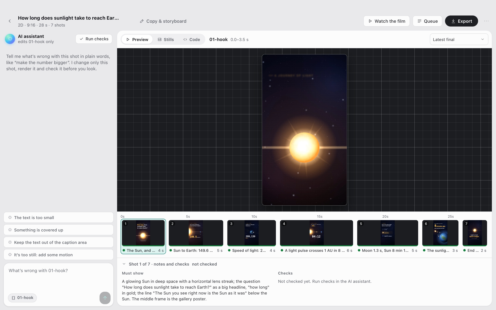
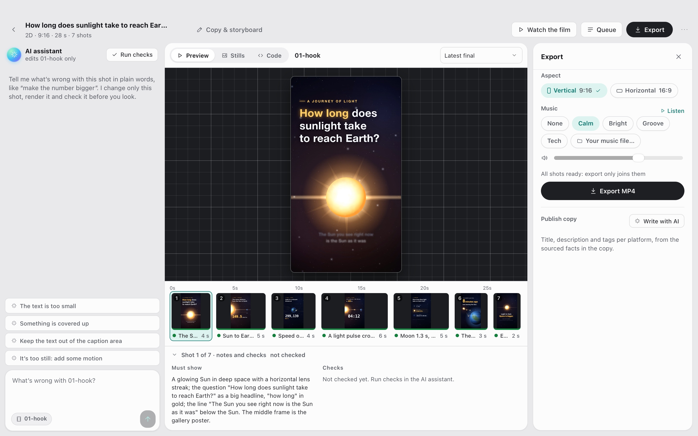
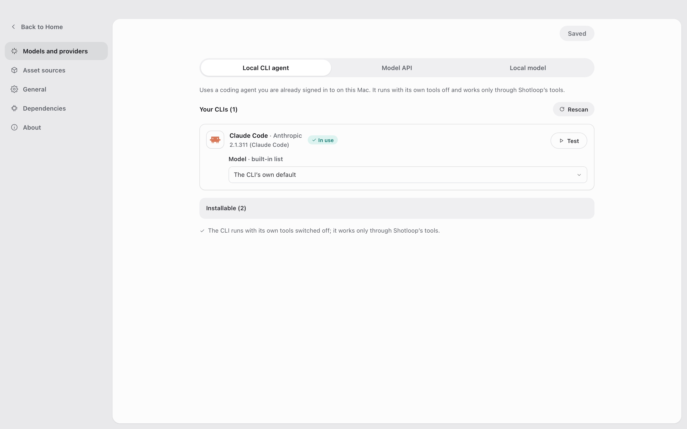
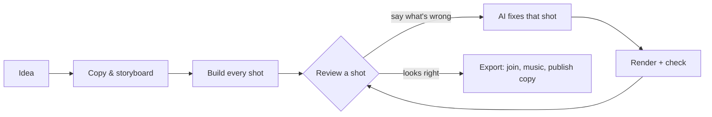

<h1 align="center">
  <br/>
  Shotloop
</h1>

<p align="center"><b>Make short explainer videos from code, one shot at a time.</b><br/>
An idea becomes copy, a storyboard and a film made of shots. Each shot has its own loop: the AI writes it, Shotloop renders it, you review it and the AI fixes it. A fix re-renders that shot only, not the whole film.</p>

<p align="center">
  
</p>

<p align="center">
  <a href="https://github.com/chihyungchang/Shotloop/releases/latest"><b>Download for macOS</b></a> ·
  <a href="https://github.com/chihyungchang/Shotloop/releases">Releases</a> ·
  <a href="#build-from-source">Build from source</a>
</p>

<p align="center">
  <a href="https://github.com/chihyungchang/Shotloop/releases/latest"></a>
  
  <a href="LICENSE"></a>
  
</p>

<p align="center"><b>English</b> · <a href="README.zh-CN.md">简体中文</a></p>

---

## What is Shotloop

Shotloop is a desktop app for short videos that are drawn with code: product promos, science explainers, data stories and slide-style animation, made in 2D (web pages rendered frame by frame) or 3D (Blender scenes).

You start with one sentence. The AI writes the hook, the script and the facts with their sources, then splits them into a storyboard. You edit the storyboard, and the AI builds every shot. In the Studio you look at each shot and say what is wrong in plain words, such as "the text is too small" or "it's too still: add some motion". The AI changes that shot, renders it, checks it against the notes and shows you a before/after. When the film reads right, Export joins the shots and adds music, and the AI writes the post for each platform.

The AI is the one you already use: Claude Code or another coding agent you're signed in to, a model API with your own key, or a local model.

## Made with Shotloop

Every frame below was rendered by Shotloop from the [examples](examples/) it ships with.

<table>
<tr>
<td width="25%" valign="top"><br/><sub><b>3D</b>: a phone teardown in Blender.</sub></td>
<td width="25%" valign="top"><br/><sub><b>2D</b>: how long sunlight takes to reach Earth.</sub></td>
<td width="50%" valign="top"><br/><sub><b>2D data</b>: 1% better every day, in charts (16:9).</sub></td>
</tr>
</table>

## Product tour

<table>
<tr>
<td width="50%" valign="top">
<a href="docs/screenshots/home.jpg"></a><br/>
<sub><b>Home</b>: one sentence, 2D or 3D, 9:16 or 16:9, a length. Or open an example.</sub>
</td>
<td width="50%" valign="top">
<a href="docs/screenshots/plan.jpg"></a><br/>
<sub><b>Copy &amp; storyboard</b>: the hook, the script and sourced facts, and the shots with what each one shows, all editable before anything renders.</sub>
</td>
</tr>
<tr>
<td width="50%" valign="top">
<a href="docs/screenshots/studio.jpg"></a><br/>
<sub><b>Studio</b>: the shot on a dark stage, the filmstrip, and each shot's notes and checks.</sub>
</td>
<td width="50%" valign="top">
<a href="docs/screenshots/agent.jpg"></a><br/>
<sub><b>AI assistant</b>: say what's wrong and the AI fixes that shot. Drag the divider to compare before and after.</sub>
</td>
</tr>
<tr>
<td width="50%" valign="top">
<a href="docs/screenshots/export.jpg"></a><br/>
<sub><b>Export</b>: vertical and horizontal cuts, original music you can listen to first, and the publish copy for each platform.</sub>
</td>
<td width="50%" valign="top">
<a href="docs/screenshots/settings.jpg"></a><br/>
<sub><b>Models &amp; providers</b>: a CLI agent you're signed in to, a model API with your key, or a local model.</sub>
</td>
</tr>
</table>

## How it works



- **Shots, not one long render.** A film is a list of shots. Each shot is a small program: `shot.js` for a 2D page, `shot.py` for a Blender camera move. Each one is cached by a hash of its inputs, so a fix re-renders one shot in seconds (2D) or a minute (3D), and Export only joins clips.
- **Plain-language fixes.** The AI only touches the shot you're on, unless the fix needs the shared world. It renders stills, checks them against a checklist (readable, nothing covered, out of the caption zone and so on) and reports what it changed.
- **Facts with sources.** The copy keeps each fact next to its source, and the publish copy may only use facts from the copy.
- **Fast while editing, full quality on export.** 3D shows quick previews while you edit and renders full-quality frames only when you export. 2D works in full quality throughout.
- **Asset library for 3D.** Search CC0 models on [Poly Pizza](https://poly.pizza) and [Smithsonian Open Access](https://www.si.edu/openaccess) with your own key. Each model is downloaded once and can be added to any 3D project.

## The AI that drives it

| Mode | What you need |
| --- | --- |
| **Local CLI agent** | [Claude Code](https://docs.anthropic.com/en/docs/claude-code), signed in on this Mac (Codex CLI and Gemini CLI are experimental). It runs headless with its own tools switched off and works only through Shotloop's tools. |
| **Model API** | Your own key. Presets for Anthropic, OpenAI, Google Gemini, OpenRouter, xAI, Mistral, Together, DeepSeek, Qwen, Kimi, GLM, MiniMax, Doubao and SiliconFlow, or any Anthropic- or OpenAI-compatible endpoint. Keys stay on your Mac. |
| **Local model** | Ollama, LM Studio, vLLM, llama.cpp or any OpenAI-compatible server. |

The model needs tool calling, and checks need one that can see images. The agent works through a narrow set of tools: it can read and write the shot's files, render stills and report checks. It can't run shell commands.

## Install

1. Download `Shotloop_<version>_aarch64.dmg` from the [latest release](https://github.com/chihyungchang/Shotloop/releases/latest), open it and drag Shotloop into Applications.
2. Have **Google Chrome** installed (2D shots render in it). For 3D projects, Shotloop asks for **Blender** the first time you create one.
3. Pick the AI in Settings → Models & providers. Claude Code is picked for you if it's already on your Mac.

> **First launch:** Shotloop isn't notarized by Apple yet, so macOS says it can't verify the developer. Open it once from **System Settings → Privacy & Security → Open Anyway**, or run `xattr -dr com.apple.quarantine /Applications/Shotloop.app` in Terminal. After that it opens normally, and updates install without asking again.

Node.js and ffmpeg are inside the app. Shotloop checks GitHub for updates and installs them in place. It runs on Macs with Apple silicon (M1 and later).

## Build from source

```bash
nvm use                      # Node 22.18+ (the agent runs TypeScript directly)
corepack enable              # once: provides the pinned pnpm
pnpm install
pnpm app                     # tauri dev; needs the Rust toolchain
pnpm app:build               # Shotloop.app and a dmg, with Node and ffmpeg inside
```

`pnpm app` uses the Node and ffmpeg on your Mac and runs everything from the checkout. Releases are signed for the updater and published with [`app/scripts/release.mjs`](app/scripts/release.mjs).

<details>
<summary><b>The engine from a terminal</b></summary>

```bash
pnpm shotloop status   fixtures/hello-3d
pnpm shotloop render   fixtures/hello-3d --shot 02-close --stills   # start/middle/end
pnpm shotloop render   fixtures/hello-3d --shot 02-close            # a clip, in the editor's quality
pnpm shotloop export   fixtures/hello-3d                            # only changed shots render
pnpm shotloop new      my-short --idea "Why does your phone battery age?" --track 2d --duration 30
pnpm shotloop doctor
```

Add `--json` for line-delimited events (what the app reads). The agent runs the same way:

```bash
node agent/src/main.ts detect                                         # CLI agents and local servers on this Mac
SHOTLOOP_PROVIDER=cli SHOTLOOP_CLI=claude node agent/src/main.ts check fixtures/hello-3d --shot 01-wide
pnpm test                                                             # every backend against scripted stand-ins
```

</details>

<details>
<summary><b>Project format</b></summary>

```
my-video/
  shotloop.json        title, track (2d|3d), size, fps, shots [{ id, title, duration }]
  storyboard.json      the plan: copy (hook, script, facts with sources) and shots
  world/               3D: world.py (+ screen.html); 2D: page.html
  shots/<id>/          shot.py | shot.js, notes.md (must show, on screen, motion)
  assets/<id>/         3D models from the asset library
  copy.md  script.md  captions.html  music.json  thumb.html  publish.json
  .shotloop/           cache: per shot and input hash, takes, checks, fixes
  out/                 exported films, covers, publish kits (timestamped)
```

- **3D**: `world.py` builds the shared world with `kit` ([`engine/video/explainers/3d/lib/kit.py`](engine/video/explainers/3d/lib/kit.py)). `shot.py` runs in the world's namespace and creates one camera; `at(t)` maps shot-local seconds to film time.
- **2D**: `shot.js` default-exports `render(t, ctx)`, which draws `world/page.html` at shot-local time `t`.
- **Cache**: a shot's key hashes the world, its code, the captions, the assets, the renderer and the settings. Unchanged shots are reused.

</details>

<details>
<summary><b>Repository layout</b></summary>

| Path | What |
| --- | --- |
| [`app/`](app/) | The desktop app: a Tauri 2 (Rust) shell with the render queue, updater and process supervision, and the React + TypeScript UI. |
| [`engine/shotloop/`](engine/shotloop/) | The shot engine: project format, per-shot render cache, 2D (Chrome) and 3D (Blender) renders, film assembly, MP4 export, music, asset library. A CLI that the app calls. |
| [`agent/`](agent/) | The agent: planning, building, plain-language fixes, checks against the checklist, publish copy. It supports API, CLI (through MCP) and local models. |
| [`examples/`](examples/) | The examples Home offers, in Chinese and English (2D and 3D, 9:16 and 16:9). |
| [`fixtures/`](fixtures/) | Projects for the tests and terminal walkthroughs. |

</details>

## License

[Apache License 2.0](LICENSE); see [NOTICE](NOTICE). Models from the asset library keep their own licenses (CC0 or CC-BY, with credit written into the project).
