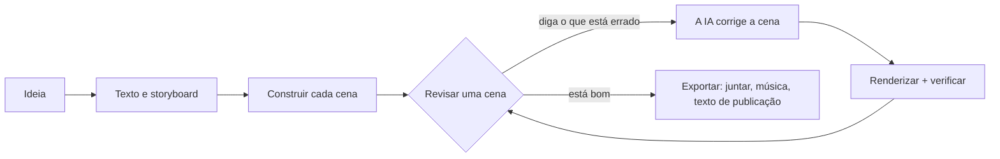

<h1 align="center">
  <br/>
  Shotloop
</h1>

<p align="center"><b>Vídeos explicativos curtos feitos com código, uma cena por vez.</b><br/>
Uma ideia vira texto, storyboard e um filme feito de cenas. Cada cena tem o seu próprio ciclo: a IA escreve, o Shotloop renderiza, você revisa e a IA corrige. Uma correção renderiza de novo só aquela cena, não o filme inteiro.</p>

<p align="center">
  
</p>

<p align="center">
  <a href="https://github.com/chihyungchang/Shotloop/releases/latest"><b>Baixar para macOS</b></a> ·
  <a href="https://github.com/chihyungchang/Shotloop/releases">Versões</a> ·
  <a href="#compilar-a-partir-do-código-fonte">Compilar a partir do código-fonte</a>
</p>

<p align="center">
  <a href="https://github.com/chihyungchang/Shotloop/releases/latest"></a>
  
  <a href="LICENSE"></a>
  
</p>

<p align="center"><a href="README.md">English</a> · <a href="README.zh-CN.md">简体中文</a> · <a href="README.zh-TW.md">繁體中文</a> · <a href="README.ja.md">日本語</a> · <a href="README.ko.md">한국어</a> · <a href="README.es.md">Español</a> · <b>Português</b> · <a href="README.fr.md">Français</a> · <a href="README.de.md">Deutsch</a> · <a href="README.it.md">Italiano</a> · <a href="README.ru.md">Русский</a> · <a href="README.tr.md">Türkçe</a> · <a href="README.vi.md">Tiếng Việt</a> · <a href="README.id.md">Bahasa Indonesia</a></p>

---

## O que é o Shotloop

O Shotloop é um app de desktop para vídeos curtos desenhados com código: promoções de produto, divulgação científica, histórias com dados e animações em estilo de slides, em 2D (páginas web renderizadas quadro a quadro) ou 3D (cenas do Blender), em sete estilos visuais.

Você começa com uma frase. A IA escolhe como mostrá-la (cena cinematográfica, infográfico, mapa, demonstração de interface, planta técnica, tipografia cinética ou 3D) e um tema, a menos que você escolha. Ela escreve o gancho, o roteiro e os fatos com as fontes, e depois divide tudo em um storyboard. Você edita o storyboard e a IA constrói cada cena. No editor, você olha cada cena e diz o que está errado com palavras simples, como "o texto está pequeno demais" ou "está muito parado: coloca um pouco de movimento". A IA altera aquela cena, renderiza, confere com as notas e mostra um antes/depois. Quando o filme estiver bom, Exportar junta as cenas e adiciona música; a IA cria uma capa no visual do filme (ou preenche o modelo da sua série) e escreve o post de cada plataforma, tudo em uma pasta própria.

A IA é a que você já usa: Claude Code ou outro agente de código em que você está logado, uma API de modelos com a sua própria chave, ou um modelo local.

O app fala 14 idiomas: English, 简体中文, 繁體中文, 日本語, 한국어, Español, Português, Français, Deutsch, Italiano, Русский, Türkçe, Tiếng Việt e Bahasa Indonesia. Ele segue o idioma do seu Mac, e a IA responde e escreve os posts no idioma que você escolher.

## Feito com o Shotloop

Cada quadro abaixo foi renderizado pelo Shotloop a partir dos [exemplos](examples/) que vêm com ele.

<table>
<tr>
<td width="25%" valign="top"><br/><sub><b>3D</b>: a desmontagem de um celular no Blender.</sub></td>
<td width="25%" valign="top"><br/><sub><b>2D</b>: quanto tempo a luz do Sol leva para chegar à Terra.</sub></td>
<td width="50%" valign="top"><br/><sub><b>Dados em 2D</b>: 1% melhor a cada dia, em gráficos (16:9).</sub></td>
</tr>
</table>

## Sete jeitos de mostrar uma ideia

A IA escolhe o estilo que combina com o assunto e explica por quê; você pode trocar no plano ou escolher um no Início. Cada imagem é um quadro do exemplo para o qual ela aponta.

<table>
<tr>
<td width="25%" valign="top"><a href="examples/sunlight-en/"></a><br/><sub><b>Cena cinematográfica</b>: luz, profundidade e câmera em movimento, para coisas que daria para filmar: espaço, natureza, física.</sub></td>
<td width="25%" valign="top"><a href="examples/solar-share-en/"></a><br/><sub><b>Infográfico</b>: gráficos e números em movimento, para estatísticas, comparações, dinheiro.</sub></td>
<td width="25%" valign="top"><a href="examples/coffee-map-en/"></a><br/><sub><b>Mapa</b>: o mapa-múndi, rotas e países se acendendo, para lugares e como as coisas se espalham.</sub></td>
<td width="25%" valign="top"><a href="examples/fake-parcel-text-en/"></a><br/><sub><b>Demonstração de interface</b>: um celular ou um navegador, passo a passo, para apps, configurações e golpes.</sub></td>
</tr>
<tr>
<td width="25%" valign="top"><a href="examples/zipper-blueprint-en/"></a><br/><sub><b>Planta técnica</b>: desenho de linhas sobre uma grade, vistas explodidas e legendas, para mostrar como uma máquina funciona.</sub></td>
<td width="25%" valign="top"><a href="examples/chinese-words-en/"></a><br/><sub><b>Tipografia cinética</b>: letras enormes em movimento, para citações, palavras e mitos.</sub></td>
<td width="25%" valign="top"><a href="examples/watch-3d-en/"></a><br/><sub><b>3D</b>: cenas do Blender com luz real e uma câmera percorrendo o espaço.</sub></td>
</tr>
</table>

Os vídeos 2D seguem um conjunto fixo de princípios: o visual primeiro, uma legenda condensada por cena, cada linha na tela tempo suficiente para ser lida, cada número em movimento, honestidade sobre o que se mostra e as fontes pequenas na tela. Eles estão em [engine/video/explainers/2d/README.md](engine/video/explainers/2d/README.md) e em todo prompt 2D.

## Tour pelo app

<table>
<tr>
<td width="50%" valign="top">
<a href="docs/screenshots/home.jpg"></a><br/>
<sub><b>Início</b>: uma frase. 2D ou 3D, a duração, o estilo e o tema podem ficar no Auto. Ou comece com um exemplo da galeria.</sub>
</td>
<td width="50%" valign="top">
<a href="docs/screenshots/plan.jpg"></a><br/>
<sub><b>Texto e storyboard</b>: o gancho, o roteiro e os fatos com fontes, e as cenas com o que cada uma mostra, tudo editável antes de qualquer renderização.</sub>
</td>
</tr>
<tr>
<td width="50%" valign="top">
<a href="docs/screenshots/studio.jpg"></a><br/>
<sub><b>Editor</b>: a cena em um palco escuro, a faixa de cenas e as notas e verificações de cada cena.</sub>
</td>
<td width="50%" valign="top">
<a href="docs/screenshots/agent.jpg"></a><br/>
<sub><b>Assistente de IA</b>: diga o que está errado e a IA corrige aquela cena. Arraste o divisor para comparar o antes e o depois.</sub>
</td>
</tr>
<tr>
<td width="50%" valign="top">
<a href="docs/screenshots/export.jpg"></a><br/>
<sub><b>Exportar</b>: marque o vídeo (vertical, horizontal), a capa e o texto de publicação; antes, edite a capa e o texto. Cada exportação vai para a sua própria pasta.</sub>
</td>
<td width="50%" valign="top">
<a href="docs/screenshots/settings.jpg"></a><br/>
<sub><b>Modelos e provedores</b>: um agente CLI em que você está logado, uma API de modelos com a sua chave, ou um modelo local.</sub>
</td>
</tr>
</table>

## Como funciona



- **Cenas, não um render longo.** Um filme é uma lista de cenas. Cada cena é um pequeno programa: `shot.js` para uma página 2D, `shot.py` para um movimento de câmera no Blender. Cada uma fica em cache pelo hash das suas entradas, então uma correção renderiza de novo uma cena em segundos (2D) ou em um minuto (3D), e Exportar só junta os clipes.
- **Correções em linguagem simples.** A IA só mexe na cena em que você está, a menos que a correção precise do mundo compartilhado. Ela renderiza quadros, confere com uma checklist (legível, nada encoberto, fora da área da legenda etc.) e informa o que mudou.
- **Sete estilos visuais.** Cena cinematográfica, infográfico, mapa, demonstração de interface, planta técnica, tipografia cinética ou 3D, cada um com o seu kit e quadros de referência que a IA consulta antes de escolher e construir ([`engine/shotloop/styles.mjs`](engine/shotloop/styles.mjs)). Um tema define só o fundo e a tipografia; imagens e dados mantêm as cores de que o assunto precisa.
- **Regras para avaliar um plano.** Antes de construir qualquer coisa, as legendas são verificadas quanto ao tamanho e ao tempo que ficam na tela. Uma imagem que se repete entre cenas é desenhada uma vez e compartilhada, para ficar igual em todas.
- **Fatos com fontes.** O texto guarda cada fato ao lado da fonte, e o texto de publicação só pode usar fatos do texto.
- **Capas.** A IA cria uma capa no visual do filme e confere os próprios renders. Salve uma como modelo para manter uma série consistente, ou envie uma capa de que você gosta e a IA segue o design dela.
- **Música no ritmo da edição.** A trilha sintetizada é ajustada para que os cortes caiam nas batidas, vai até o último quadro e termina em fade-out.
- **Rápido para editar, qualidade máxima na exportação.** O 3D mostra prévias rápidas enquanto você edita e renderiza quadros em qualidade máxima só na exportação. O 2D trabalha em qualidade máxima o tempo todo.
- **Biblioteca 3D.** Busque modelos CC0 no [Poly Pizza](https://poly.pizza) e no [Smithsonian Open Access](https://www.si.edu/openaccess) com a sua própria chave. Cada modelo é baixado uma vez e pode ser adicionado a qualquer projeto 3D.

## A IA por trás

| Modo | Do que você precisa |
| --- | --- |
| **Agente CLI local** | [Claude Code](https://docs.anthropic.com/en/docs/claude-code), logado neste Mac (Codex CLI e Gemini CLI são experimentais). Ele roda sem interface, com as próprias ferramentas desativadas, e trabalha só com as ferramentas do Shotloop. |
| **API de modelos** | A sua própria chave. Predefinições para Anthropic, OpenAI, Google Gemini, OpenRouter, xAI, Mistral, Together, DeepSeek, Qwen, Kimi, GLM, MiniMax, Doubao e SiliconFlow, ou qualquer endpoint compatível com Anthropic ou OpenAI. As chaves ficam no seu Mac. |
| **Modelo local** | Ollama, LM Studio, vLLM, llama.cpp ou qualquer servidor compatível com OpenAI. |

O modelo precisa de chamada de ferramentas, e as verificações precisam de um que enxergue imagens. O agente trabalha com um conjunto restrito de ferramentas: pode ler e escrever os arquivos da cena, renderizar quadros e relatar verificações. Ele não pode executar comandos de shell.

## Instalação

1. Baixe `Shotloop_<version>_aarch64.dmg` da [versão mais recente](https://github.com/chihyungchang/Shotloop/releases/latest), abra e arraste o Shotloop para Aplicativos.
2. Tenha o **Google Chrome** instalado (as cenas 2D são renderizadas nele). Para projetos 3D, o Shotloop pede o **Blender** na primeira vez que você cria um.
3. Escolha a IA em Configurações → Modelos e provedores. Se o Claude Code já estiver no seu Mac, ele é escolhido automaticamente.

> **Primeira abertura:** o Shotloop ainda não é notarizado pela Apple, então o macOS diz que não consegue verificar o desenvolvedor. Abra uma vez em **Ajustes do Sistema → Privacidade e Segurança → Abrir Mesmo Assim**, ou rode `xattr -dr com.apple.quarantine /Applications/Shotloop.app` no Terminal. Depois disso ele abre normalmente, e as atualizações são instaladas sem perguntar de novo.

Node.js e ffmpeg vêm dentro do app. O Shotloop busca atualizações no GitHub e as instala no lugar. Funciona em Macs com Apple silicon (M1 ou posterior).

## Compilar a partir do código-fonte

```bash
nvm use                      # Node 22.18+ (o agente roda TypeScript diretamente)
corepack enable              # uma vez: fornece o pnpm fixado
pnpm install
pnpm app                     # tauri dev; precisa da toolchain do Rust
pnpm app:build               # Shotloop.app e um dmg, com Node e ffmpeg dentro
```

`pnpm app` usa o Node e o ffmpeg do seu Mac e roda tudo a partir do repositório clonado. As versões são assinadas para o atualizador e publicadas com [`app/scripts/release.mjs`](app/scripts/release.mjs).

<details>
<summary><b>O motor pelo terminal</b></summary>

```bash
pnpm shotloop status   fixtures/hello-3d
pnpm shotloop render   fixtures/hello-3d --shot 02-close --stills   # início/meio/fim
pnpm shotloop render   fixtures/hello-3d --shot 02-close            # um clipe, na qualidade do editor
pnpm shotloop export   fixtures/hello-3d                            # só as cenas alteradas são renderizadas
pnpm shotloop new      my-short --idea "Por que a bateria do celular envelhece?" --track auto --duration auto
pnpm shotloop new      coffee --idea "De onde vem o café?" --track 2d --style map --duration 30
pnpm shotloop export   fixtures/hello-3d --to ~/Movies/Shotloop --name "Hello"   # em uma pasta nova ali
pnpm shotloop covers   list                                         # modelos de capa
pnpm shotloop doctor
```

Adicione `--json` para receber eventos linha a linha (o que o app lê). O agente roda do mesmo jeito:

```bash
node agent/src/main.ts detect                                         # agentes CLI e servidores locais neste Mac
SHOTLOOP_PROVIDER=cli SHOTLOOP_CLI=claude node agent/src/main.ts check fixtures/hello-3d --shot 01-wide
pnpm test                                                             # cada backend contra dublês roteirizados
```

</details>

<details>
<summary><b>Formato do projeto</b></summary>

```
my-video/
  shotloop.json        título, track (2d|3d), estilo, tamanho, fps, cenas [{ id, title, duration }]
  storyboard.json      o plano: texto (gancho, roteiro, fatos com fontes) e cenas
  world/               3D: world.py (+ screen.html); 2D: page.html (o kit do estilo), parts.js (imagens
                       que se repetem, desenhadas uma vez), geo.data.js (os países do estilo mapa)
  shots/<id>/          shot.py | shot.js, notes.md (o que deve mostrar, texto na tela, movimento)
  assets/<id>/         modelos 3D da biblioteca
  copy.md  script.md  captions.html  music.json  thumb.html  publish.json
  .shotloop/           cache: por cena e hash das entradas, tomadas, verificações, correções
  out/                 as exportações do motor (com data e hora); o app copia cada uma para uma pasta nova onde você escolher
```

- **3D**: `world.py` constrói o mundo compartilhado com `kit` ([`engine/video/explainers/3d/lib/kit.py`](engine/video/explainers/3d/lib/kit.py)). `shot.py` roda no namespace do mundo e cria uma câmera; `at(t)` converte os segundos locais da cena em tempo do filme.
- **2D**: `shot.js` exporta por padrão `render(t, ctx)`, que desenha `world/page.html` no tempo local da cena `t`.
- **Cache**: a chave de uma cena é um hash do mundo, do código dela, das legendas, dos assets, do renderizador e das configurações. Cenas sem mudança são reaproveitadas.

</details>

<details>
<summary><b>Estrutura do repositório</b></summary>

| Caminho | O que é |
| --- | --- |
| [`app/`](app/) | O app de desktop: um shell Tauri 2 (Rust) com a fila de renderização, o atualizador e a supervisão de processos, e a interface em React + TypeScript. |
| [`engine/shotloop/`](engine/shotloop/) | O motor de cenas: formato de projeto, cache de renderização por cena, renders 2D (Chrome) e 3D (Blender), montagem do filme, exportação para MP4, música, biblioteca 3D. Uma CLI que o app chama. |
| [`agent/`](agent/) | O agente: planejamento, construção, correções em linguagem simples, verificações pela checklist, texto de publicação. Suporta API, CLI (via MCP) e modelos locais. |
| [`examples/`](examples/) | Os exemplos oferecidos no Início, em inglês: pelo menos um para cada estilo visual (2D e 3D, 9:16 e 16:9). |
| [`fixtures/`](fixtures/) | Projetos para os testes e os passo a passos no terminal. |

</details>

## Licença

[Apache License 2.0](LICENSE); veja [NOTICE](NOTICE). Os modelos da biblioteca 3D mantêm as próprias licenças (CC0 ou CC-BY, com o crédito escrito no projeto).
