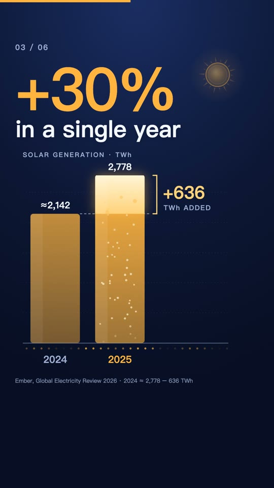
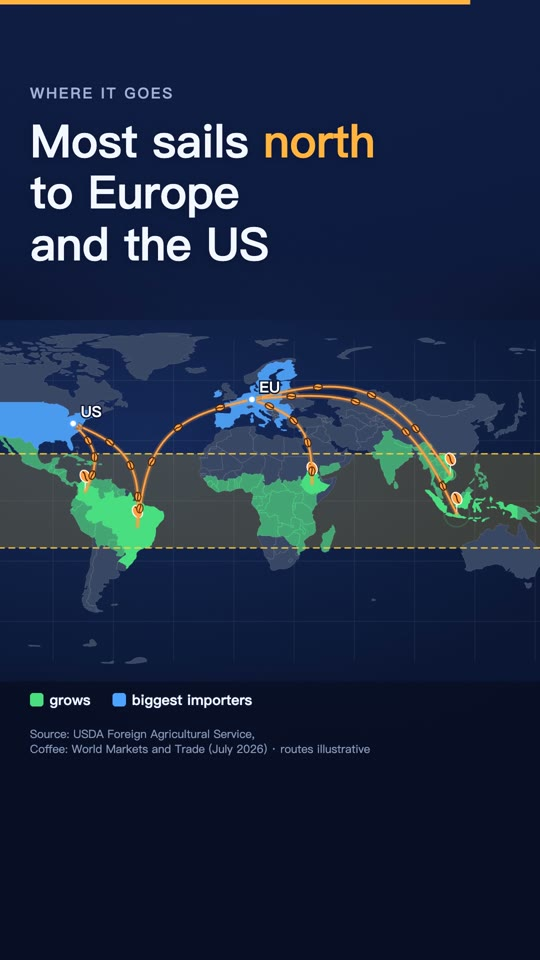
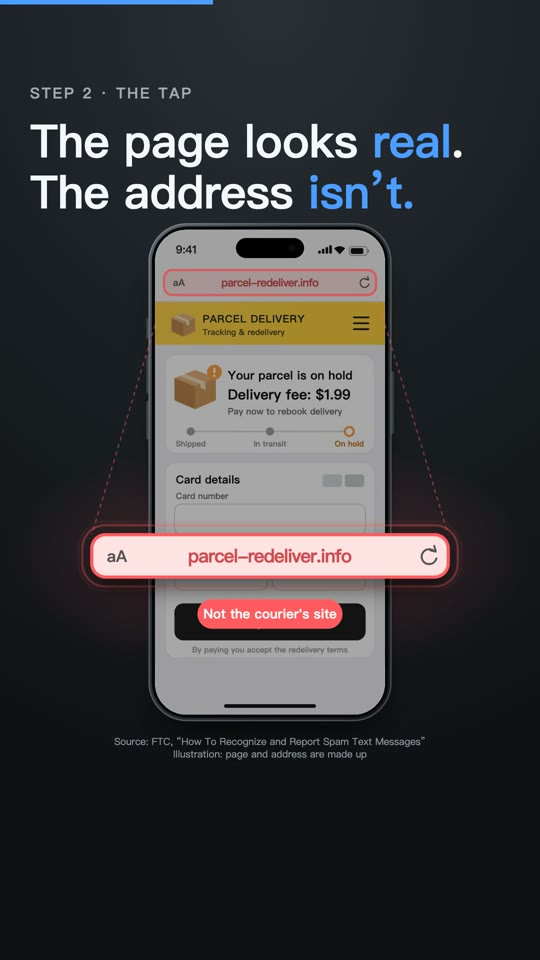
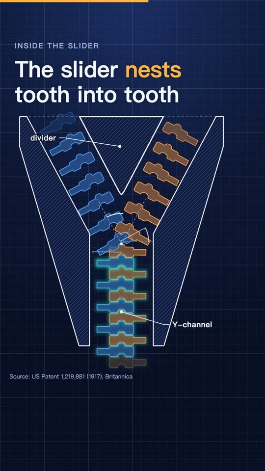
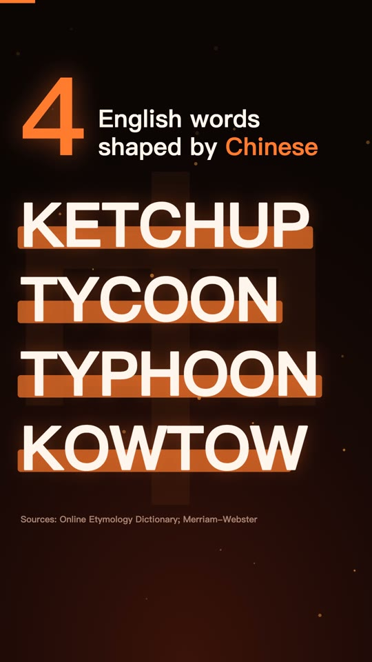
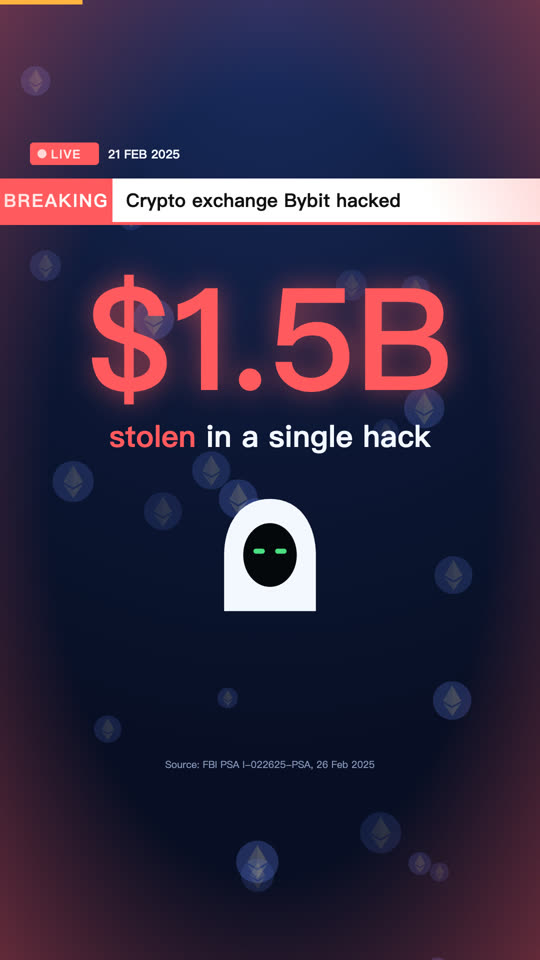
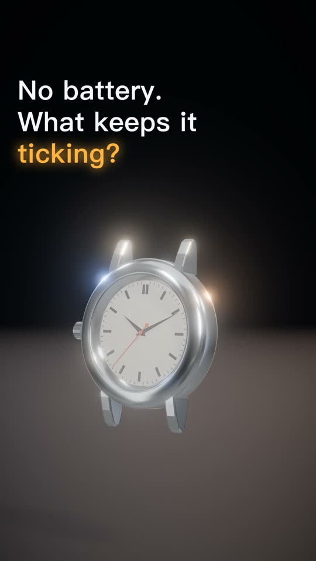
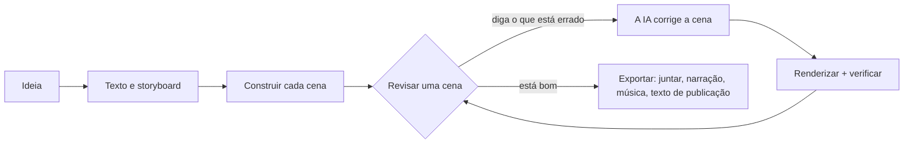

<h1 align="center">
  <br/>
  Shotloop
</h1>

<p align="center"><b>Vídeos curtos com IA. Corrija uma cena, não o filme inteiro.</b><br/>
Uma ideia vira texto, storyboard e um filme feito de cenas. Cada cena tem o seu próprio ciclo: a IA escreve, o Shotloop renderiza, você revisa e a IA corrige. Uma correção renderiza de novo só aquela cena, não o filme inteiro.</p>

<p align="center">
  
</p>

<p align="center">
  <a href="https://github.com/chihyungchang/Shotloop/releases/latest"><b>Baixar para macOS</b></a> ·
  <a href="https://github.com/chihyungchang/Shotloop/releases">Versões</a> ·
  <a href="#compilar-a-partir-do-código-fonte">Compilar a partir do código-fonte</a>
</p>

<p align="center">
  <a href="https://github.com/chihyungchang/Shotloop/releases/latest"></a>
  
  <a href="LICENSE"></a>
  
</p>

<p align="center"><a href="README.md">English</a> · <a href="README.zh-CN.md">简体中文</a> · <a href="README.zh-TW.md">繁體中文</a> · <a href="README.ja.md">日本語</a> · <a href="README.ko.md">한국어</a> · <a href="README.es.md">Español</a> · <b>Português</b> · <a href="README.fr.md">Français</a> · <a href="README.de.md">Deutsch</a> · <a href="README.it.md">Italiano</a> · <a href="README.ru.md">Русский</a> · <a href="README.tr.md">Türkçe</a> · <a href="README.vi.md">Tiếng Việt</a> · <a href="README.id.md">Bahasa Indonesia</a></p>

---

## O que é o Shotloop

O Shotloop é um app de desktop para vídeos curtos desenhados com código: promoções de produto, divulgação científica, histórias com dados e animações em estilo de slides, em 2D (páginas web renderizadas quadro a quadro) ou 3D (mundos three.js renderizados como num renderizador offline), em oito estilos visuais.

Você começa com uma frase. A IA escolhe como mostrá-la (cena cinematográfica, infográfico, mapa, demonstração de interface, planta técnica, tipografia cinética, narrativa jornalística ou 3D) e um tema, a menos que você escolha. Ela escreve o gancho, o roteiro e os fatos com as fontes, e depois divide tudo em um storyboard, com a fala que a narração diz sobre cada cena. Você edita o storyboard e a IA constrói cada cena. No editor, você olha cada cena e diz o que está errado com palavras simples, como "o texto está pequeno demais" ou "está muito parado: coloca um pouco de movimento". A IA olha primeiro e oferece algumas formas de mudar aquela cena; você escolhe uma (ou diz a sua), e ela altera a cena e mostra um antes/depois. Quando o filme estiver bom, Exportar junta as cenas e coloca a narração com as legendas e a música por baixo; a IA cria uma capa no visual do filme (ou preenche o modelo da sua série) e escreve o post de cada plataforma, tudo em uma pasta própria.

A IA é a que você já usa: Claude Code ou outro agente de código em que você está logado, uma API de modelos com a sua própria chave, ou um modelo local.

O app fala 14 idiomas: English, 简体中文, 繁體中文, 日本語, 한국어, Español, Português, Français, Deutsch, Italiano, Русский, Türkçe, Tiếng Việt e Bahasa Indonesia. Ele segue o idioma do seu Mac, e a IA responde e escreve os posts no idioma que você escolher.

## Feito com o Shotloop

Cada quadro abaixo foi renderizado pelo Shotloop a partir dos [exemplos](examples/) que vêm com ele.

<table>
<tr>
<td width="25%" valign="top"><br/><sub><b>3D</b>: um relógio mecânico em WebGL.</sub></td>
<td width="25%" valign="top"><br/><sub><b>2D</b>: quanto tempo a luz do Sol leva para chegar à Terra.</sub></td>
<td width="50%" valign="top"><br/><sub><b>Dados em 2D</b>: 1% melhor a cada dia, em gráficos (16:9).</sub></td>
</tr>
</table>

## Oito jeitos de mostrar uma ideia

A IA escolhe o estilo que combina com o assunto e explica por quê; você pode trocar no plano ou escolher um no Início. Cada imagem é um quadro do exemplo para o qual ela aponta.

<table>
<tr>
<td width="25%" valign="top"><a href="examples/sunlight-en/"></a><br/><sub><b>Cena cinematográfica</b>: luz, profundidade e câmera em movimento, para coisas que daria para filmar: espaço, natureza, física.</sub></td>
<td width="25%" valign="top"><a href="examples/solar-share-en/"></a><br/><sub><b>Infográfico</b>: gráficos e números em movimento, para estatísticas, comparações, dinheiro.</sub></td>
<td width="25%" valign="top"><a href="examples/coffee-map-en/"></a><br/><sub><b>Mapa</b>: o mapa-múndi, rotas e países se acendendo, para lugares e como as coisas se espalham.</sub></td>
<td width="25%" valign="top"><a href="examples/fake-parcel-text-en/"></a><br/><sub><b>Demonstração de interface</b>: um celular ou um navegador, passo a passo, para apps, configurações e golpes.</sub></td>
</tr>
<tr>
<td width="25%" valign="top"><a href="examples/zipper-blueprint-en/"></a><br/><sub><b>Planta técnica</b>: desenho de linhas sobre uma grade, vistas explodidas e legendas, para mostrar como uma máquina funciona.</sub></td>
<td width="25%" valign="top"><a href="examples/chinese-words-en/"></a><br/><sub><b>Tipografia cinética</b>: letras enormes em movimento, para citações, palavras e mitos.</sub></td>
<td width="25%" valign="top"><a href="examples/bybit-heist-en/"></a><br/><sub><b>Narrativa jornalística</b>: acontecimentos urgentes contados com tensão: um relógio correndo, o rastro do dinheiro, a linha do tempo, quem disse o quê.</sub></td>
<td width="25%" valign="top"><a href="examples/watch-3d-en/"></a><br/><sub><b>3D</b>: mundos three.js com luz de estúdio, sombras suaves e uma câmera percorrendo o espaço.</sub></td>
</tr>
</table>

Os vídeos 2D seguem um conjunto de regras: as fixas, que mantêm cada quadro limpo e o vídeo fiel (nada encoberto, sem quadros quebrados, tempo para ler cada linha, honestidade, fontes citadas), e um gosto da casa que você pode reescrever, desativar ou ampliar em Configurações → Regras, junto com uma caixa de ferramentas de recursos de animação que você pode ampliar com os seus. Elas estão em [engine/shotloop/rules.mjs](engine/shotloop/rules.mjs) e chegam a todo prompt 2D. "Verificar" revisa uma cena com base nelas, e cada verificação que falha leva à sua regra.

## Tour pelo app

<table>
<tr>
<td width="50%" valign="top">
<a href="docs/screenshots/home.jpg"></a><br/>
<sub><b>Início</b>: uma frase. 2D ou 3D, a duração, o estilo e o tema podem ficar no Auto. Ou comece com um exemplo da galeria.</sub>
</td>
<td width="50%" valign="top">
<a href="docs/screenshots/plan.jpg"></a><br/>
<sub><b>Texto e storyboard</b>: o gancho, o roteiro e os fatos com fontes, e as cenas com o que cada uma mostra, tudo editável antes de qualquer renderização.</sub>
</td>
</tr>
<tr>
<td width="50%" valign="top">
<a href="docs/screenshots/studio.jpg"></a><br/>
<sub><b>Editor</b>: a cena em um palco escuro, a faixa de cenas com as faixas de som embaixo e as notas e verificações de cada cena.</sub>
</td>
<td width="50%" valign="top">
<a href="docs/screenshots/agent.jpg"></a><br/>
<sub><b>Assistente IA de planos</b>: diga o que está errado, escolha uma das formas que a IA propõe (ou diga a sua) e ela corrige aquela cena. Arraste o divisor para comparar o antes e o depois.</sub>
</td>
</tr>
<tr>
<td width="50%" valign="top">
<a href="docs/screenshots/export.jpg"></a><br/>
<sub><b>Exportar</b>: marque o vídeo (vertical, horizontal), a capa e o texto de publicação; antes, edite a capa e o texto. Cada exportação vai para a sua própria pasta.</sub>
</td>
<td width="50%" valign="top">
<a href="docs/screenshots/settings.jpg"></a><br/>
<sub><b>Modelos e provedores</b>: um agente CLI em que você está logado, uma API de modelos com a sua chave, ou um modelo local.</sub>
</td>
</tr>
</table>

## Como funciona



- **Cenas, não um render longo.** Um filme é uma lista de cenas. Cada cena é um pequeno programa, `shot.js`, que desenha a sua página em um instante t: uma página 2D, ou um mundo three.js para o 3D. Cada uma fica em cache pelo hash das suas entradas, então uma correção renderiza de novo uma cena em segundos, e Exportar só junta os clipes.
- **Correções em linguagem simples.** A IA só mexe na cena em que você está, a menos que a correção precise do mundo compartilhado. Primeiro ela oferece algumas formas concretas de fazer a sua mudança; a que você escolher (ou a sua) é a correção, feita em bem menos de um minuto, e o clipe da cena é renderizado logo em seguida para tocar na hora. "Verificar" revisa a cena com a checklist (legível, nada encoberto, fora da área da legenda etc.) sem mudar nada, e corrige o que encontrou com um clique.
- **Oito estilos visuais.** Cena cinematográfica, infográfico, mapa, demonstração de interface, planta técnica, tipografia cinética, narrativa jornalística ou 3D, cada um com o seu kit e quadros de referência que a IA consulta antes de escolher e construir ([`engine/shotloop/kits/styles.mjs`](engine/shotloop/kits/styles.mjs)). Um tema define só o fundo e a tipografia; imagens e dados mantêm as cores de que o assunto precisa.
- **Regras para avaliar um plano.** Antes de construir qualquer coisa, as legendas são verificadas quanto ao tamanho e ao tempo que ficam na tela. Uma imagem que se repete entre cenas é desenhada uma vez e compartilhada, para ficar igual em todas.
- **Fatos com fontes.** O texto guarda cada fato ao lado da fonte, e o texto de publicação só pode usar fatos do texto.
- **Capas.** A IA cria uma capa no visual do filme e confere os próprios renders. Salve uma como modelo para manter uma série consistente, ou envie uma capa de que você gosta e a IA segue o design dela.
- **Uma narração, gerada no seu Mac, quando você quiser.** Desligada por padrão: a imagem define o ritmo, com textos na tela. Ative e cada cena tem uma fala que conduz a edição: uma cena dura o tempo da sua fala, e a imagem cai sobre as palavras. Ou adicione uma narração depois que as cenas estiverem prontas: as falas são escritas na medida das cenas, que mantêm suas durações, e uma fala um pouco longa demais continua por cima do corte. O Kokoro fala inglês, o CosyVoice 2 chinês e o Supertonic os outros idiomas, tudo offline. As legendas do que é falado são adicionadas automaticamente, e uma verificação lista tudo o que elas cobririam (texto e o objeto marcado), então um filme coberto nunca é exportado.
- **O som, depois que a imagem estiver certa.** O som fica embaixo da faixa de cenas em faixas coloridas, cada uma com sua forma de onda: voz, música, ambiente e efeitos. Toque de qualquer ponto e a imagem acompanha. O volume de cada faixa fica no cabeçalho dela e se ouve na hora enquanto você arrasta; os ajustes abrem ao lado, e qualquer efeito desliga com um clique. "Som com IA" pergunta quais partes criar (efeitos nas batidas da imagem, lidas do código de cada cena, um ambiente e uma narração quando ainda não houver uma) e percorre o filme inteiro de uma vez.
- **Música no ritmo da edição.** A trilha sintetizada é ajustada para que os cortes caiam nas batidas, vai até o último quadro e termina em fade-out. Sob uma narração, ela fica mais baixa e abaixa ainda mais enquanto uma fala é dita.
- **3D que renderiza como um renderizador offline, em minutos.** Cada quadro 3D tira a média de vários subquadros (antialiasing, sombras suaves, oclusão de ambiente, profundidade de campo, desfoque de movimento) em cerca de meio segundo, então um filme de 30 segundos fica pronto em poucos minutos, sem nada para instalar.
- **Biblioteca de recursos: modelos e sons.** Busque modelos CC0 no [Poly Pizza](https://poly.pizza) e no [Smithsonian Open Access](https://www.si.edu/openaccess) com a sua própria chave, e efeitos sonoros, ambientes e músicas no [Openverse](https://openverse.org) (Freesound, Wikimedia, Jamendo) sem chave; ouça antes de baixar. Cada recurso é baixado uma vez e pode ser adicionado a qualquer projeto: um modelo a um mundo 3D, um som a um momento da imagem ou como ambiente sob o filme inteiro. Os downloads esperam a sua aprovação na "Fila".

## A IA por trás

| Modo | Do que você precisa |
| --- | --- |
| **Agente CLI local** | [Claude Code](https://docs.anthropic.com/en/docs/claude-code), logado neste Mac (Codex CLI e Gemini CLI são experimentais). Ele roda sem interface, com as próprias ferramentas desativadas, e trabalha só com as ferramentas do Shotloop. |
| **API de modelos** | A sua própria chave. Predefinições para Anthropic, OpenAI, Google Gemini, OpenRouter, xAI, Mistral, Together, DeepSeek, Qwen, Kimi, GLM, MiniMax, Doubao e SiliconFlow, ou qualquer endpoint compatível com Anthropic ou OpenAI. As chaves ficam no seu Mac. |
| **Modelo local** | Ollama, LM Studio, vLLM, llama.cpp ou qualquer servidor compatível com OpenAI. |

O modelo precisa de chamada de ferramentas, e as verificações precisam de um que enxergue imagens. O agente trabalha com um conjunto restrito de ferramentas: pode ler e escrever os arquivos da cena, renderizar quadros e relatar verificações. Ele não pode executar comandos de shell.

## Instalação

1. Baixe `Shotloop_<version>_aarch64.dmg` da [versão mais recente](https://github.com/chihyungchang/Shotloop/releases/latest), abra e arraste o Shotloop para Aplicativos.
2. As cenas são renderizadas em um navegador Chromium que você já tenha no Mac (Chrome, Edge, Brave, Arc…). Sem nenhum, o Shotloop baixa um headless (cerca de 100 MB) na primeira renderização, ou antes em Ajustes → Dependências.
3. Escolha a IA em Configurações → Modelos e provedores. Se o Claude Code já estiver no seu Mac, ele é escolhido automaticamente.

> **Primeira abertura:** o Shotloop ainda não é notarizado pela Apple, então o macOS diz que não consegue verificar o desenvolvedor. Abra uma vez em **Ajustes do Sistema → Privacidade e Segurança → Abrir Mesmo Assim**, ou rode `xattr -dr com.apple.quarantine /Applications/Shotloop.app` no Terminal. Depois disso ele abre normalmente, e as atualizações são instaladas sem perguntar de novo.

Node.js, ffmpeg e os motores de voz da narração vêm dentro do app. Os modelos de voz não: cada um é baixado na primeira vez que um filme fala os seus idiomas (Kokoro para inglês 132 MB; CosyVoice 2 para chinês cerca de 5 GB, com o Python em que ele roda; Supertonic para os outros idiomas 400 MB), com uma barra de progresso, ou com antecedência em Configurações → Dependências. Configurações → Sobre lista cada componente de terceiros com a sua licença. O Shotloop busca atualizações no GitHub e as instala no lugar. Funciona em Macs com Apple silicon (M1 ou posterior).

## Compilar a partir do código-fonte

```bash
nvm use                      # Node 22.18+ (o agente roda TypeScript diretamente)
corepack enable              # uma vez: fornece o pnpm fixado
pnpm install
pnpm app                     # tauri dev; precisa da toolchain do Rust
pnpm app:build               # Shotloop.app e um dmg, com Node e ffmpeg dentro
```

`pnpm app` usa o Node e o ffmpeg do seu Mac e roda tudo a partir do repositório clonado. As versões são assinadas para o atualizador e publicadas com [`app/scripts/release.mjs`](app/scripts/release.mjs).

<details>
<summary><b>O motor pelo terminal</b></summary>

```bash
pnpm shotloop status   fixtures/ep01-password-crack-time
pnpm shotloop render   fixtures/ep01-password-crack-time --shot 02-stack-16-gpu --stills   # início/meio/fim
pnpm shotloop render   fixtures/ep01-password-crack-time --shot 02-stack-16-gpu            # um clipe
pnpm shotloop export   fixtures/ep01-password-crack-time                                   # só as cenas alteradas são renderizadas
pnpm shotloop new      my-short --idea "Por que a bateria do celular envelhece?" --track auto --duration auto
pnpm shotloop new      coffee --idea "De onde vem o café?" --track 2d --style map --duration 30
pnpm shotloop export   fixtures/ep01-password-crack-time --to ~/Movies/Shotloop --name "Hello"   # em uma pasta nova ali
pnpm shotloop covers   list                                         # modelos de capa
pnpm shotloop voice    my-short --on --voice af_heart --fit        # a narração: fala as falas e ajusta as cenas
pnpm shotloop check-subtitles my-short                              # o que as legendas cobririam (falha se cobrirem algo)
pnpm shotloop voice-models --download kokoro-en                     # um modelo de voz, com antecedência
pnpm shotloop doctor
```

Adicione `--json` para receber eventos linha a linha (o que o app lê). O agente roda do mesmo jeito:

```bash
node agent/src/main.ts detect                                         # agentes CLI e servidores locais neste Mac
SHOTLOOP_PROVIDER=cli SHOTLOOP_CLI=claude node agent/src/main.ts check fixtures/ep01-password-crack-time --shot 01-password-field-dots
pnpm test                                                             # cada backend contra dublês roteirizados
```

</details>

<details>
<summary><b>Formato do projeto</b></summary>

```
my-video/
  shotloop.json        título, track (2d|3d), estilo, tamanho, fps, lang, voice { on, voice, speed },
                       cenas [{ id, title, duration, say (a fala dita), cues (os tempos das suas frases) }]
  storyboard.json      o plano: texto (gancho, roteiro, fatos com fontes) e cenas
  world/               page.html (2D: o kit do estilo; 3D: o kit WebGL), 2D: parts.js (imagens
                       que se repetem, desenhadas uma vez), geo.data.js (os países do estilo mapa); 3D: *.js (cenários, máquinas)
  shots/<id>/          shot.js, notes.md (o que deve mostrar, texto na tela, movimento, som), sounds.json (os seus efeitos sonoros)
  assets/<id>/         modelos e sons da biblioteca de recursos
  copy.md  script.md  music.json  thumb.html  publish.json
  .shotloop/           cache: por cena e hash das entradas, tomadas, verificações, correções; voice/: falas, legendas
  out/                 as exportações do motor (com data e hora); o app copia cada uma para uma pasta nova onde você escolher
```

- **3D**: `world/page.html` é o kit WebGL do motor ([`engine/shotloop/kits/webgl.mjs`](engine/shotloop/kits/webgl.mjs)): um palco three.js com luz de estúdio, materiais, formas, modelos glTF, câmeras baseadas em lentes e texto por cima. Cenários e máquinas que as cenas compartilham ficam em `world/*.js`; uma cena monta o que mostra em `setup(ctx)` e o posiciona para `t` em `render(t)`.
- **2D**: `shot.js` exporta por padrão `render(t, ctx)`, que desenha `world/page.html` no tempo local da cena `t`. `ctx.voice` traz as frases faladas da cena com os seus tempos, para que a imagem caia sobre as palavras; marque o objeto com `data-keep` (ou `subtitles.keep()` em um canvas) para que a verificação de legendas o deixe livre.
- **Cache**: a chave de uma cena é um hash do mundo, do código dela, dos modelos dela, do renderizador e das configurações. Cenas sem mudança são reaproveitadas.

</details>

<details>
<summary><b>Estrutura do repositório</b></summary>

| Caminho | O que é |
| --- | --- |
| [`app/`](app/) | O app de desktop: um shell Tauri 2 (Rust) com a fila de renderização, o atualizador e a supervisão de processos, e a interface em React + TypeScript. |
| [`engine/shotloop/`](engine/shotloop/) | O motor de cenas: formato de projeto, cache de renderização por cena, renders 2D e 3D (three.js) no Chrome, montagem do filme, exportação para MP4, tempo da narração, legendas e a sua verificação, música, biblioteca 3D. Uma CLI que o app chama. |
| [`voice/`](voice/) | A conversão de texto em fala da narração, neste Mac: Kokoro via sherpa-onnx, Supertonic sobre ONNX Runtime e CosyVoice 2 num servidor Python local, com os downloads dos modelos. |
| [`agent/`](agent/) | O agente: planejamento, construção, correções em linguagem simples, verificações pela checklist, texto de publicação. Suporta API, CLI (via MCP) e modelos locais. |
| [`examples/`](examples/) | Os exemplos oferecidos no Início, em inglês: pelo menos um para cada estilo visual (2D e 3D, 9:16 e 16:9). |
| [`fixtures/`](fixtures/) | Projetos para os testes e os passo a passos no terminal. |

</details>

## Agradecimentos

O Shotloop se apoia em trabalho de código aberto. Obrigado às pessoas por trás de:

- **A narração:** [Kokoro](https://huggingface.co/hexgrad/Kokoro-82M), da hexgrad, e [sherpa-onnx](https://github.com/k2-fsa/sherpa-onnx) (inglês); [CosyVoice 2](https://github.com/FunAudioLLM/CosyVoice), da FunAudioLLM, com [Matcha-TTS](https://github.com/shivammehta25/Matcha-TTS), [WeTextProcessing](https://github.com/wenet-e2e/WeTextProcessing), [Whisper](https://github.com/openai/whisper), [PyTorch](https://pytorch.org) e [Transformers](https://github.com/huggingface/transformers) (chinês); [Supertonic](https://huggingface.co/Supertone/supertonic-3), da Supertone (os outros idiomas); [ONNX Runtime](https://onnxruntime.ai); [uv](https://github.com/astral-sh/uv) e [Python](https://www.python.org), que rodam a voz em chinês.
- **A renderização e o filme:** [FFmpeg](https://ffmpeg.org), [Google Chrome](https://www.google.com/chrome/) pelo protocolo DevTools, [three.js](https://threejs.org) e [Node.js](https://nodejs.org).
- **O app:** [Tauri](https://tauri.app), [React](https://react.dev), o [Anthropic SDK](https://github.com/anthropics/anthropic-sdk-typescript) e o [Model Context Protocol SDK](https://github.com/modelcontextprotocol/typescript-sdk).
- **Recursos e dados:** [Kenney](https://kenney.nl), [Poly Haven](https://polyhaven.com), [Quaternius](https://quaternius.com), [Poly Pizza](https://poly.pizza), [Smithsonian Open Access](https://www.si.edu/openaccess), [Openverse](https://openverse.org) e [Natural Earth](https://www.naturalearthdata.com) via [world-atlas](https://github.com/topojson/world-atlas).

Configurações → Sobre lista cada componente com a sua versão e licença, e o [NOTICE](NOTICE) traz os detalhes.

## Privacidade

Uma vez por dia, o Shotloop envia ao autor contagens anônimas: a versão, o chip, o idioma da interface e quantos vídeos foram planejados, criados, corrigidos e exportados (as exportações por estilo visual), com um ID de instalação aleatório. Nunca seus projetos, os nomes ou textos deles, seus arquivos nem suas chaves de API, e nenhum endereço IP é guardado. A primeira abertura avisa; desative em **Configurações → Geral**. Builds a partir do código-fonte nunca enviam nada ([`app/src-tauri/src/telemetry.rs`](app/src-tauri/src/telemetry.rs)). O [aviso de privacidade](https://oliverz.dev/pt-br/products/shotloop/privacy) completo lista tudo o que o Shotloop guarda e envia.

## Licença

[Apache License 2.0](LICENSE); veja [NOTICE](NOTICE). Os modelos e sons da biblioteca de recursos mantêm as próprias licenças (CC0 ou CC-BY, com o crédito escrito no projeto), assim como os modelos de voz (Kokoro e CosyVoice 2: Apache-2.0; Supertonic: OpenRAIL-M).
