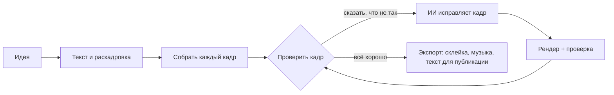

<h1 align="center">
  <br/>
  Shotloop
</h1>

<p align="center"><b>Короткие видео-объяснялки из кода, кадр за кадром.</b><br/>
Идея превращается в текст, раскадровку и фильм из кадров. У каждого кадра свой цикл: ИИ пишет его, Shotloop рендерит, вы смотрите, ИИ исправляет. Правка перерендеривает только этот кадр, а не весь фильм.</p>

<p align="center">
  
</p>

<p align="center">
  <a href="https://github.com/chihyungchang/Shotloop/releases/latest"><b>Скачать для macOS</b></a> ·
  <a href="https://github.com/chihyungchang/Shotloop/releases">Релизы</a> ·
  <a href="#сборка-из-исходников">Сборка из исходников</a>
</p>

<p align="center">
  <a href="https://github.com/chihyungchang/Shotloop/releases/latest"></a>
  
  <a href="LICENSE"></a>
  
</p>

<p align="center"><a href="README.md">English</a> · <a href="README.zh-CN.md">简体中文</a> · <a href="README.zh-TW.md">繁體中文</a> · <a href="README.ja.md">日本語</a> · <a href="README.ko.md">한국어</a> · <a href="README.es.md">Español</a> · <a href="README.pt-BR.md">Português</a> · <a href="README.fr.md">Français</a> · <a href="README.de.md">Deutsch</a> · <a href="README.it.md">Italiano</a> · <b>Русский</b> · <a href="README.tr.md">Türkçe</a> · <a href="README.vi.md">Tiếng Việt</a> · <a href="README.id.md">Bahasa Indonesia</a></p>

---

## Что такое Shotloop

Shotloop — десктопное приложение для коротких видео, нарисованных кодом: промо продуктов, научпоп, истории на данных и анимация в стиле слайдов. В 2D (веб-страницы, отрендеренные покадрово) или 3D (сцены Blender), в семи визуальных стилях.

Вы начинаете с одного предложения. ИИ выбирает, как его показать (кинематографичная сцена, инфографика, карта, демо интерфейса, чертёж, кинетическая типографика или 3D), и тему — если вы не выбрали сами. Он пишет хук, сценарий и факты с источниками, а затем разбивает всё на раскадровку. Вы правите раскадровку, ИИ собирает каждый кадр. В студии вы смотрите каждый кадр и простыми словами говорите, что не так, например «текст слишком мелкий» или «слишком статично, добавь движения». ИИ меняет этот кадр, рендерит, сверяет с заметками и показывает «до/после». Когда фильм готов, «Экспорт» склеивает кадры и добавляет музыку, ИИ делает обложку в стиле фильма (или заполняет шаблон вашей серии) и пишет пост для каждой площадки — всё в отдельную папку.

ИИ — тот, которым вы уже пользуетесь: Claude Code или другой агент для кода, в котором вы вошли в аккаунт, API модели с вашим ключом или локальная модель.

Приложение говорит на 14 языках: English, 简体中文, 繁體中文, 日本語, 한국어, Español, Português, Français, Deutsch, Italiano, Русский, Türkçe, Tiếng Việt и Bahasa Indonesia. Оно следует языку вашего Mac, а ИИ отвечает и пишет посты на выбранном вами языке.

## Сделано в Shotloop

Каждый кадр ниже отрендерен Shotloop из встроенных [примеров](examples/).

<table>
<tr>
<td width="25%" valign="top"><br/><sub><b>3D</b>: разборка телефона в Blender.</sub></td>
<td width="25%" valign="top"><br/><sub><b>2D</b>: сколько солнечный свет идёт до Земли.</sub></td>
<td width="50%" valign="top"><br/><sub><b>2D, данные</b>: на 1% лучше каждый день, в графиках (16:9).</sub></td>
</tr>
</table>

## Семь способов показать идею

ИИ выбирает стиль под тему и объясняет почему; сменить его можно в плане или выбрать сразу на главной. Каждая картинка — кадр из примера, на который она ссылается.

<table>
<tr>
<td width="25%" valign="top"><a href="examples/sunlight-en/"></a><br/><sub><b>Кинематографичная сцена</b>: свет, глубина и движущаяся камера — для того, что можно снять: космос, природа, физика.</sub></td>
<td width="25%" valign="top"><a href="examples/solar-share-en/"></a><br/><sub><b>Инфографика</b>: графики и живые цифры — для статистики, сравнений, денег.</sub></td>
<td width="25%" valign="top"><a href="examples/coffee-map-en/"></a><br/><sub><b>Карта</b>: карта мира, маршруты и подсвеченные страны — для мест и распространения.</sub></td>
<td width="25%" valign="top"><a href="examples/fake-parcel-text-en/"></a><br/><sub><b>Демо интерфейса</b>: телефон или браузер, шаг за шагом — для приложений, настроек и мошеннических схем.</sub></td>
</tr>
<tr>
<td width="25%" valign="top"><a href="examples/zipper-blueprint-en/"></a><br/><sub><b>Чертёж</b>: линии на сетке, разнесённые виды и выноски — чтобы показать, как работает механизм.</sub></td>
<td width="25%" valign="top"><a href="examples/chinese-words-en/"></a><br/><sub><b>Кинетическая типографика</b>: огромный движущийся текст — для цитат, слов и мифов.</sub></td>
<td width="25%" valign="top"><a href="examples/watch-3d-en/"></a><br/><sub><b>3D</b>: сцены Blender с настоящим светом и камерой, летящей в пространстве.</sub></td>
</tr>
</table>

2D-видео следуют фиксированным принципам: сначала картинка, одна сжатая подпись на кадр, каждая строка висит достаточно долго, чтобы её прочитать, каждое число движется, показывается только правда, источники мелко на экране. Они описаны в [engine/video/explainers/2d/README.md](engine/video/explainers/2d/README.md) и есть в каждом 2D-промпте.

## Обзор

<table>
<tr>
<td width="50%" valign="top">
<a href="docs/screenshots/home.jpg"></a><br/>
<sub><b>Главная</b>: одно предложение. 2D или 3D, длительность, стиль и тему можно оставить на «Авто». Или начните с примера из галереи.</sub>
</td>
<td width="50%" valign="top">
<a href="docs/screenshots/plan.jpg"></a><br/>
<sub><b>Текст и раскадровка</b>: хук, сценарий и факты с источниками, а также кадры с описанием того, что в каждом. Всё можно править до рендера.</sub>
</td>
</tr>
<tr>
<td width="50%" valign="top">
<a href="docs/screenshots/studio.jpg"></a><br/>
<sub><b>Студия</b>: кадр на тёмной сцене, лента кадров, заметки и проверки для каждого кадра.</sub>
</td>
<td width="50%" valign="top">
<a href="docs/screenshots/agent.jpg"></a><br/>
<sub><b>ИИ-ассистент</b>: скажите, что не так, и ИИ исправит этот кадр. Тяните разделитель, чтобы сравнить до и после.</sub>
</td>
</tr>
<tr>
<td width="50%" valign="top">
<a href="docs/screenshots/export.jpg"></a><br/>
<sub><b>Экспорт</b>: отметьте видео (вертикальное, горизонтальное), обложку и текст для публикации; обложку и текст можно сначала отредактировать. Каждый экспорт — в своей папке.</sub>
</td>
<td width="50%" valign="top">
<a href="docs/screenshots/settings.jpg"></a><br/>
<sub><b>Модели и провайдеры</b>: CLI-агент, в котором вы вошли в аккаунт, API модели с вашим ключом или локальная модель.</sub>
</td>
</tr>
</table>

## Как это работает



- **Кадры, а не один долгий рендер.** Фильм — это список кадров. Каждый кадр — маленькая программа: `shot.js` для 2D-страницы, `shot.py` для движения камеры в Blender. Каждый кешируется по хешу входных данных, поэтому правка перерендеривает один кадр за секунды (2D) или минуту (3D), а экспорт лишь склеивает клипы.
- **Правки простыми словами.** ИИ трогает только текущий кадр, если правка не требует менять общий мир. Он рендерит стоп-кадры, проверяет их по чек-листу (читаемо, ничего не перекрыто, вне зоны субтитров и т. д.) и сообщает, что изменил.
- **Семь визуальных стилей.** Кинематографичная сцена, инфографика, карта, демо интерфейса, чертёж, кинетическая типографика или 3D — у каждого свой набор инструментов и эталонные кадры, которые ИИ смотрит перед выбором и сборкой ([`engine/shotloop/styles.mjs`](engine/shotloop/styles.mjs)). Тема задаёт только фон и шрифт; картинки и данные сохраняют цвета, нужные их теме.
- **Правила, по которым проверяется план.** Подписи проверяются на длину и время показа ещё до сборки. Картинка, которая повторяется в нескольких кадрах, рисуется один раз и переиспользуется, поэтому везде выглядит одинаково.
- **Факты с источниками.** Текст хранит каждый факт рядом с источником, а текст для публикации может использовать только факты из текста.
- **Обложки.** ИИ делает обложку в стиле фильма и сам проверяет рендеры. Сохраните её как шаблон, чтобы серия выглядела единообразно, или загрузите понравившуюся обложку — ИИ повторит её дизайн.
- **Музыка под монтаж.** Синтезированный фон подстроен так, что склейки попадают в бит; он звучит до последнего кадра и плавно затихает.
- **Быстро при правке, полное качество при экспорте.** 3D показывает быстрые превью во время работы и рендерит кадры в полном качестве только при экспорте. 2D всегда работает в полном качестве.
- **Библиотека ресурсов для 3D.** Ищите CC0-модели на [Poly Pizza](https://poly.pizza) и [Smithsonian Open Access](https://www.si.edu/openaccess) со своим ключом. Каждая модель скачивается один раз и добавляется в любой 3D-проект.

## Какой ИИ им управляет

| Режим | Что нужно |
| --- | --- |
| **Локальный CLI-агент** | [Claude Code](https://docs.anthropic.com/en/docs/claude-code) с выполненным входом на этом Mac (Codex CLI и Gemini CLI — экспериментально). Работает в фоновом режиме с отключёнными собственными инструментами и действует только через инструменты Shotloop. |
| **API модели** | Ваш собственный ключ. Пресеты для Anthropic, OpenAI, Google Gemini, OpenRouter, xAI, Mistral, Together, DeepSeek, Qwen, Kimi, GLM, MiniMax, Doubao и SiliconFlow или любой эндпоинт, совместимый с Anthropic или OpenAI. Ключи остаются на вашем Mac. |
| **Локальная модель** | Ollama, LM Studio, vLLM, llama.cpp или любой OpenAI-совместимый сервер. |

Модели нужен вызов инструментов, а для проверок — умение видеть изображения. Агент работает через узкий набор инструментов: читает и пишет файлы кадра, рендерит стоп-кадры и сообщает результаты проверок. Выполнять команды оболочки он не может.

## Установка

1. Скачайте `Shotloop_<version>_aarch64.dmg` из [последнего релиза](https://github.com/chihyungchang/Shotloop/releases/latest), откройте его и перетащите Shotloop в «Программы».
2. Установите **Google Chrome** (в нём рендерятся 2D-кадры). Для 3D-проектов Shotloop попросит установить **Blender** при создании первого из них.
3. Выберите ИИ в «Настройки → Модели и провайдеры». Если Claude Code уже есть на вашем Mac, он будет выбран автоматически.

> **Первый запуск:** Shotloop пока не нотаризован Apple, поэтому macOS сообщает, что не может проверить разработчика. Откройте его один раз через **Системные настройки → Конфиденциальность и безопасность → Всё равно открыть** или выполните в Терминале `xattr -dr com.apple.quarantine /Applications/Shotloop.app`. После этого приложение открывается как обычно, а обновления ставятся без повторных вопросов.

Node.js и ffmpeg встроены в приложение. Shotloop проверяет обновления на GitHub и устанавливает их на место. Работает на Mac с Apple silicon (M1 и новее).

## Сборка из исходников

```bash
nvm use                      # Node 22.18+ (агент запускает TypeScript напрямую)
corepack enable              # один раз: даёт зафиксированную версию pnpm
pnpm install
pnpm app                     # tauri dev; нужен тулчейн Rust
pnpm app:build               # Shotloop.app и dmg со встроенными Node и ffmpeg
```

`pnpm app` использует Node и ffmpeg вашего Mac и запускает всё прямо из рабочей копии. Релизы подписываются для апдейтера и публикуются через [`app/scripts/release.mjs`](app/scripts/release.mjs).

<details>
<summary><b>Движок из терминала</b></summary>

```bash
pnpm shotloop status   fixtures/hello-3d
pnpm shotloop render   fixtures/hello-3d --shot 02-close --stills   # начало/середина/конец
pnpm shotloop render   fixtures/hello-3d --shot 02-close            # клип в качестве редактора
pnpm shotloop export   fixtures/hello-3d                            # рендерятся только изменённые кадры
pnpm shotloop new      my-short --idea "Почему стареет аккумулятор телефона?" --track auto --duration auto
pnpm shotloop new      coffee --idea "Откуда берётся кофе?" --track 2d --style map --duration 30
pnpm shotloop export   fixtures/hello-3d --to ~/Movies/Shotloop --name "Hello"   # в новую папку там
pnpm shotloop covers   list                                         # шаблоны обложек
pnpm shotloop doctor
```

Добавьте `--json`, чтобы получать события построчно (их и читает приложение). Агент запускается так же:

```bash
node agent/src/main.ts detect                                         # CLI-агенты и локальные серверы на этом Mac
SHOTLOOP_PROVIDER=cli SHOTLOOP_CLI=claude node agent/src/main.ts check fixtures/hello-3d --shot 01-wide
pnpm test                                                             # каждый бэкенд против скриптовых заглушек
```

</details>

<details>
<summary><b>Формат проекта</b></summary>

```
my-video/
  shotloop.json        название, трек (2d|3d), стиль, размер, fps, кадры [{ id, title, duration }]
  storyboard.json      план: текст (хук, сценарий, факты с источниками) и кадры
  world/               3D: world.py (+ screen.html); 2D: page.html (набор стиля), parts.js (повторяющиеся
                       картинки, нарисованные один раз), geo.data.js (страны для стиля «Карта»)
  shots/<id>/          shot.py | shot.js, notes.md (что показать, текст на экране, движение)
  assets/<id>/         3D-модели из библиотеки ресурсов
  copy.md  script.md  captions.html  music.json  thumb.html  publish.json
  .shotloop/           кеш: по кадру и хешу входных данных, дубли, проверки, правки
  out/                 экспорты движка (с отметкой времени); приложение копирует каждый в новую папку, где вы укажете
```

- **3D**: `world.py` строит общий мир с помощью `kit` ([`engine/video/explainers/3d/lib/kit.py`](engine/video/explainers/3d/lib/kit.py)). `shot.py` выполняется в пространстве имён мира и создаёт одну камеру; `at(t)` переводит локальные секунды кадра во время фильма.
- **2D**: `shot.js` по умолчанию экспортирует `render(t, ctx)`, который рисует `world/page.html` в локальное время кадра `t`.
- **Кеш**: ключ кадра — хеш мира, его кода, подписей, ресурсов, рендерера и настроек. Неизменённые кадры переиспользуются.

</details>

<details>
<summary><b>Структура репозитория</b></summary>

| Путь | Что там |
| --- | --- |
| [`app/`](app/) | Десктопное приложение: оболочка на Tauri 2 (Rust) с очередью рендера, апдейтером и контролем процессов, плюс интерфейс на React + TypeScript. |
| [`engine/shotloop/`](engine/shotloop/) | Движок кадров: формат проекта, кеш рендера по кадрам, рендер 2D (Chrome) и 3D (Blender), сборка фильма, экспорт в MP4, музыка, библиотека ресурсов. CLI, который вызывает приложение. |
| [`agent/`](agent/) | Агент: планирование, сборка, правки простыми словами, проверки по чек-листу, текст для публикации. Поддерживает API, CLI (через MCP) и локальные модели. |
| [`examples/`](examples/) | Примеры с главной, на английском: минимум один на каждый визуальный стиль (2D и 3D, 9:16 и 16:9). |
| [`fixtures/`](fixtures/) | Проекты для тестов и пошаговых примеров в терминале. |

</details>

## Лицензия

[Apache License 2.0](LICENSE); см. также [NOTICE](NOTICE). Модели из библиотеки ресурсов сохраняют собственные лицензии (CC0 или CC-BY, с указанием авторства в проекте).
