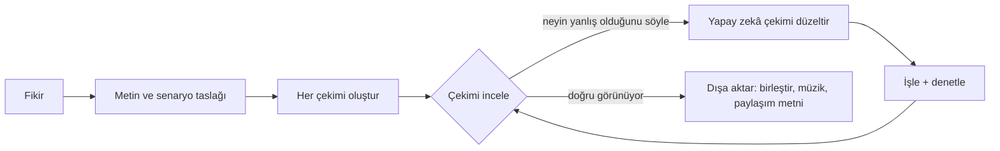

<h1 align="center">
  <br/>
  Shotloop
</h1>

<p align="center"><b>Kodla kısa anlatım videoları yapın, her seferinde bir çekim.</b><br/>
Bir fikir metne, senaryo taslağına ve çekimlerden oluşan bir filme dönüşür. Her çekimin kendi döngüsü vardır: yapay zekâ yazar, Shotloop işler, siz incelersiniz, yapay zekâ düzeltir. Bir düzeltme tüm filmi değil, yalnızca o çekimi yeniden işler.</p>

<p align="center">
  
</p>

<p align="center">
  <a href="https://github.com/chihyungchang/Shotloop/releases/latest"><b>macOS için indir</b></a> ·
  <a href="https://github.com/chihyungchang/Shotloop/releases">Sürümler</a> ·
  <a href="#kaynaktan-derleme">Kaynaktan derleme</a>
</p>

<p align="center">
  <a href="https://github.com/chihyungchang/Shotloop/releases/latest"></a>
  
  <a href="LICENSE"></a>
  
</p>

<p align="center"><a href="README.md">English</a> · <a href="README.zh-CN.md">简体中文</a> · <a href="README.zh-TW.md">繁體中文</a> · <a href="README.ja.md">日本語</a> · <a href="README.ko.md">한국어</a> · <a href="README.es.md">Español</a> · <a href="README.pt-BR.md">Português</a> · <a href="README.fr.md">Français</a> · <a href="README.de.md">Deutsch</a> · <a href="README.it.md">Italiano</a> · <a href="README.ru.md">Русский</a> · <b>Türkçe</b> · <a href="README.vi.md">Tiếng Việt</a> · <a href="README.id.md">Bahasa Indonesia</a></p>

---

## Shotloop nedir

Shotloop, kodla çizilen kısa videolar için bir masaüstü uygulamasıdır: ürün tanıtımları, bilim anlatımları, veri hikâyeleri ve sunum tarzı animasyonlar. 2D (kare kare işlenen web sayfaları) veya 3D (Blender sahneleri) olarak, yedi görsel stilde.

Tek bir cümleyle başlarsınız. Siz seçmezseniz yapay zekâ fikrin nasıl gösterileceğini (sinematik sahne, infografik, harita, arayüz demosu, teknik çizim, kinetik tipografi veya 3D) ve bir temayı kendisi seçer. Açılış cümlesini, senaryoyu ve kaynaklı bilgileri yazar, ardından bunları bir senaryo taslağına böler. Taslağı düzenlersiniz, yapay zekâ da her çekimi oluşturur. Studio'da her çekime bakar ve neyin yanlış olduğunu sade bir dille söylersiniz; örneğin "yazı çok küçük" ya da "çok durgun: biraz hareket ekle". Yapay zekâ o çekimi değiştirir, işler, notlarla karşılaştırarak denetler ve size önce/sonra görünümünü gösterir. Film doğru göründüğünde Dışa aktar çekimleri birleştirip müzik ekler; yapay zekâ filmin görünümünde bir kapak tasarlar (ya da serinizin şablonunu doldurur) ve her platform için paylaşım metnini yazar. Hepsi kendi klasörüne kaydedilir.

Yapay zekâ zaten kullandığınız yapay zekâdır: oturum açtığınız Claude Code veya başka bir kodlama ajanı, kendi anahtarınızla bir model API'si ya da yerel bir model.

Uygulama 14 dilde kullanılabilir: English, 简体中文, 繁體中文, 日本語, 한국어, Español, Português, Français, Deutsch, Italiano, Русский, Türkçe, Tiếng Việt ve Bahasa Indonesia. Mac'inizin dilini izler; yapay zekâ seçtiğiniz dilde yanıt verir ve paylaşım metinlerini o dilde yazar.

## Shotloop ile yapıldı

Aşağıdaki her kare, Shotloop'un birlikte geldiği [örneklerden](examples/) Shotloop tarafından işlendi.

<table>
<tr>
<td width="25%" valign="top"><br/><sub><b>3D</b>: Blender'da bir telefonun parçalarına ayrılması.</sub></td>
<td width="25%" valign="top"><br/><sub><b>2D</b>: Güneş ışığının Dünya'ya ulaşması ne kadar sürer.</sub></td>
<td width="50%" valign="top"><br/><sub><b>2D veri</b>: her gün %1 daha iyi, grafiklerle (16:9).</sub></td>
</tr>
</table>

## Bir fikri göstermenin yedi yolu

Yapay zekâ konuya uyan stili seçer ve nedenini söyler; planda değiştirebilir ya da Ana Sayfa'da kendiniz seçebilirsiniz. Her görsel, bağlantı verdiği örnekten bir karedir.

<table>
<tr>
<td width="25%" valign="top"><a href="examples/sunlight-en/"></a><br/><sub><b>Sinematik sahne</b>: ışık, derinlik ve hareketli kamera; filme alınabilecek şeyler için: uzay, doğa, fizik.</sub></td>
<td width="25%" valign="top"><a href="examples/solar-share-en/"></a><br/><sub><b>İnfografik</b>: grafikler ve hareketli sayılar; istatistik, karşılaştırma, para için.</sub></td>
<td width="25%" valign="top"><a href="examples/coffee-map-en/"></a><br/><sub><b>Harita</b>: dünya haritası, rotalar ve yanan ülkeler; yerler ve yayılan şeyler için.</sub></td>
<td width="25%" valign="top"><a href="examples/fake-parcel-text-en/"></a><br/><sub><b>Arayüz demosu</b>: adım adım bir telefon veya tarayıcı; uygulamalar, ayarlar ve dolandırıcılıklar için.</sub></td>
</tr>
<tr>
<td width="25%" valign="top"><a href="examples/zipper-blueprint-en/"></a><br/><sub><b>Teknik çizim</b>: ızgara üzerinde çizgiler, patlatılmış görünümler ve açıklamalar; bir makinenin nasıl çalıştığı için.</sub></td>
<td width="25%" valign="top"><a href="examples/chinese-words-en/"></a><br/><sub><b>Kinetik tipografi</b>: hareket eden dev yazılar; alıntılar, kelimeler ve efsaneler için.</sub></td>
<td width="25%" valign="top"><a href="examples/watch-3d-en/"></a><br/><sub><b>3D</b>: gerçek ışık ve uzayda dolaşan kamerayla Blender sahneleri.</sub></td>
</tr>
</table>

2D videolar sabit ilkelere uyar: önce görsel, her çekimde tek bir yoğun altyazı, her satır okunacak kadar ekranda kalır, her sayı hareket eder, gösterdiği şey konusunda dürüsttür, kaynaklar ekranda küçük yazılır. Bu ilkeler [engine/video/explainers/2d/README.md](engine/video/explainers/2d/README.md) dosyasında ve her 2D isteminde yer alır.

## Ürün turu

<table>
<tr>
<td width="50%" valign="top">
<a href="docs/screenshots/home.jpg"></a><br/>
<sub><b>Ana Sayfa</b>: tek bir cümle. 2D veya 3D, süre, stil ve tema Otomatik kalabilir. Ya da galerideki bir örnekten başlayın.</sub>
</td>
<td width="50%" valign="top">
<a href="docs/screenshots/plan.jpg"></a><br/>
<sub><b>Metin ve senaryo taslağı</b>: açılış cümlesi, senaryo, kaynaklı bilgiler ve her birinin ne gösterdiğiyle çekimler; hiçbir şey işlenmeden önce hepsi düzenlenebilir.</sub>
</td>
</tr>
<tr>
<td width="50%" valign="top">
<a href="docs/screenshots/studio.jpg"></a><br/>
<sub><b>Studio</b>: karanlık sahnede çekim, film şeridi ve her çekimin notları ile denetimleri.</sub>
</td>
<td width="50%" valign="top">
<a href="docs/screenshots/agent.jpg"></a><br/>
<sub><b>Yapay zekâ asistanı</b>: neyin yanlış olduğunu söyleyin, yapay zekâ o çekimi düzeltsin. Önceyi ve sonrayı karşılaştırmak için ayırıcıyı sürükleyin.</sub>
</td>
</tr>
<tr>
<td width="50%" valign="top">
<a href="docs/screenshots/export.jpg"></a><br/>
<sub><b>Dışa aktar</b>: videoyu (dikey, yatay), kapağı ve paylaşım metnini işaretleyin; kapağı ve metni önceden düzenleyin. Her dışa aktarım kendi klasörüne gider.</sub>
</td>
<td width="50%" valign="top">
<a href="docs/screenshots/settings.jpg"></a><br/>
<sub><b>Modeller ve sağlayıcılar</b>: oturum açtığınız bir CLI ajanı, kendi anahtarınızla bir model API'si veya yerel bir model.</sub>
</td>
</tr>
</table>

## Nasıl çalışır



- **Tek uzun işleme değil, çekimler.** Bir film, çekimlerden oluşan bir listedir. Her çekim küçük bir programdır: 2D sayfa için `shot.js`, Blender kamera hareketi için `shot.py`. Her biri girdilerinin hash'iyle önbelleğe alınır; böylece bir düzeltme tek bir çekimi saniyeler (2D) veya bir dakika (3D) içinde yeniden işler ve Dışa aktar yalnızca klipleri birleştirir.
- **Sade dille düzeltmeler.** Düzeltme ortak dünyayı gerektirmedikçe yapay zekâ yalnızca bulunduğunuz çekime dokunur. Kareler işler, bunları bir kontrol listesine göre denetler (okunabilir, hiçbir şey örtülmemiş, altyazı alanının dışında vb.) ve neyi değiştirdiğini bildirir.
- **Yedi görsel stil.** Sinematik sahne, infografik, harita, arayüz demosu, teknik çizim, kinetik tipografi veya 3D; her birinin kendi kiti ve yapay zekânın seçip oluşturmadan önce baktığı referans kareleri vardır ([`engine/shotloop/styles.mjs`](engine/shotloop/styles.mjs)). Tema yalnızca zemini ve yazıyı belirler; görseller ve veriler konularının gerektirdiği renkleri korur.
- **Planın ölçüldüğü kurallar.** Altyazıların uzunluğu ve ekranda kalma süresi, hiçbir şey oluşturulmadan önce denetlenir. Çekimler boyunca tekrar eden bir görsel bir kez çizilip paylaşılır, böylece her çekimde aynı görünür.
- **Kaynaklı bilgiler.** Metin her bilgiyi kaynağının yanında tutar; paylaşım metni yalnızca metindeki bilgileri kullanabilir.
- **Kapaklar.** Yapay zekâ filmin görünümünde bir kapak tasarlar ve kendi işlediklerini denetler. Bir seriyi tutarlı tutmak için birini şablon olarak kaydedin ya da beğendiğiniz bir kapağı yükleyin, yapay zekâ onun tasarımını izlesin.
- **Kurguya uyan müzik.** Sentezlenen fon müziği, kesmeler vuruşlarına denk gelecek şekilde ayarlanır, son kareye kadar sürer ve yavaşça kısılır.
- **Düzenlerken hızlı, dışa aktarırken tam kalite.** 3D, düzenleme sırasında hızlı önizlemeler gösterir ve tam kaliteli kareleri yalnızca dışa aktarırken işler. 2D baştan sona tam kalitede çalışır.
- **3D için varlık kütüphanesi.** Kendi anahtarınızla [Poly Pizza](https://poly.pizza) ve [Smithsonian Open Access](https://www.si.edu/openaccess) üzerinde CC0 modeller arayın. Her model bir kez indirilir ve herhangi bir 3D projeye eklenebilir.

## Arkasındaki yapay zekâ

| Mod | Gerekenler |
| --- | --- |
| **Yerel CLI ajanı** | Bu Mac'te oturum açılmış [Claude Code](https://docs.anthropic.com/en/docs/claude-code) (Codex CLI ve Gemini CLI deneyseldir). Kendi araçları kapalı olarak arayüzsüz çalışır ve yalnızca Shotloop'un araçlarını kullanır. |
| **Model API'si** | Kendi anahtarınız. Anthropic, OpenAI, Google Gemini, OpenRouter, xAI, Mistral, Together, DeepSeek, Qwen, Kimi, GLM, MiniMax, Doubao ve SiliconFlow için hazır ayarlar ya da Anthropic veya OpenAI uyumlu herhangi bir uç nokta. Anahtarlar Mac'inizde kalır. |
| **Yerel model** | Ollama, LM Studio, vLLM, llama.cpp veya OpenAI uyumlu herhangi bir sunucu. |

Modelin araç çağırmayı desteklemesi, denetimler için de görüntü görebilmesi gerekir. Ajan dar bir araç setiyle çalışır: çekimin dosyalarını okuyup yazabilir, kare işleyebilir ve denetim sonuçlarını bildirebilir. Kabuk komutu çalıştıramaz.

## Kurulum

1. [En son sürümden](https://github.com/chihyungchang/Shotloop/releases/latest) `Shotloop_<version>_aarch64.dmg` dosyasını indirin, açın ve Shotloop'u Uygulamalar klasörüne sürükleyin.
2. **Google Chrome** kurulu olsun (2D çekimler onunla işlenir). 3D projeler için Shotloop, ilkini oluşturduğunuzda **Blender** ister.
3. Yapay zekâyı Ayarlar → Modeller ve sağlayıcılar bölümünden seçin. Claude Code Mac'inizde zaten varsa sizin için seçilir.

> **İlk açılış:** Shotloop henüz Apple tarafından onaylanmadı (notarize edilmedi), bu yüzden macOS geliştiriciyi doğrulayamadığını söyler. Bir kez **Sistem Ayarları → Gizlilik ve Güvenlik → Yine de Aç** yoluyla açın ya da Terminal'de `xattr -dr com.apple.quarantine /Applications/Shotloop.app` komutunu çalıştırın. Sonrasında normal açılır ve güncellemeler yeniden sormadan kurulur.

Node.js ve ffmpeg uygulamanın içindedir. Shotloop güncellemeleri GitHub'da denetler ve yerinde kurar. Apple silikonlu Mac'lerde (M1 ve sonrası) çalışır.

## Kaynaktan derleme

```bash
nvm use                      # Node 22.18+ (ajan TypeScript'i doğrudan çalıştırır)
corepack enable              # bir kez: sabitlenmiş pnpm sürümünü sağlar
pnpm install
pnpm app                     # tauri dev; Rust araç zinciri gerekir
pnpm app:build               # içinde Node ve ffmpeg bulunan Shotloop.app ve bir dmg
```

`pnpm app`, Mac'inizdeki Node ve ffmpeg'i kullanır ve her şeyi depodan çalıştırır. Sürümler güncelleyici için imzalanır ve [`app/scripts/release.mjs`](app/scripts/release.mjs) ile yayımlanır.

<details>
<summary><b>Terminalden motor</b></summary>

```bash
pnpm shotloop status   fixtures/hello-3d
pnpm shotloop render   fixtures/hello-3d --shot 02-close --stills   # başlangıç/orta/bitiş
pnpm shotloop render   fixtures/hello-3d --shot 02-close            # düzenleyici kalitesinde bir klip
pnpm shotloop export   fixtures/hello-3d                            # yalnızca değişen çekimler işlenir
pnpm shotloop new      my-short --idea "Telefon pili neden yaşlanır?" --track auto --duration auto
pnpm shotloop new      coffee --idea "Kahve nereden gelir?" --track 2d --style map --duration 30
pnpm shotloop export   fixtures/hello-3d --to ~/Movies/Shotloop --name "Hello"   # oradaki yeni bir klasöre
pnpm shotloop covers   list                                         # kapak şablonları
pnpm shotloop doctor
```

Satır satır olaylar için `--json` ekleyin (uygulamanın okuduğu budur). Ajan da aynı şekilde çalışır:

```bash
node agent/src/main.ts detect                                         # bu Mac'teki CLI ajanları ve yerel sunucular
SHOTLOOP_PROVIDER=cli SHOTLOOP_CLI=claude node agent/src/main.ts check fixtures/hello-3d --shot 01-wide
pnpm test                                                             # her arka uç, betikli yedeklere karşı
```

</details>

<details>
<summary><b>Proje biçimi</b></summary>

```
my-video/
  shotloop.json        başlık, track (2d|3d), stil, boyut, fps, çekimler [{ id, title, duration }]
  storyboard.json      plan: metin (açılış, senaryo, kaynaklı bilgiler) ve çekimler
  world/               3D: world.py (+ screen.html); 2D: page.html (stilin kiti), parts.js (tekrar eden,
                       bir kez çizilen görseller), geo.data.js (harita stilinin ülkeleri)
  shots/<id>/          shot.py | shot.js, notes.md (gösterilmesi gerekenler, ekran yazısı, hareket)
  assets/<id>/         varlık kütüphanesinden 3D modeller
  copy.md  script.md  captions.html  music.json  thumb.html  publish.json
  .shotloop/           önbellek: çekim ve girdi hash'ine göre; denemeler, denetimler, düzeltmeler
  out/                 motorun dışa aktarımları (zaman damgalı); uygulama her birini seçtiğiniz yerde yeni bir klasöre kopyalar
```

- **3D**: `world.py`, ortak dünyayı `kit` ile kurar ([`engine/video/explainers/3d/lib/kit.py`](engine/video/explainers/3d/lib/kit.py)). `shot.py` dünyanın ad alanında çalışır ve tek bir kamera oluşturur; `at(t)`, çekim içi saniyeleri film zamanına çevirir.
- **2D**: `shot.js`, varsayılan olarak `render(t, ctx)` dışa aktarır; bu fonksiyon `world/page.html` sayfasını çekim içi `t` anında çizer.
- **Önbellek**: bir çekimin anahtarı dünyanın, kodunun, altyazıların, varlıkların, işleyicinin ve ayarların hash'idir. Değişmeyen çekimler yeniden kullanılır.

</details>

<details>
<summary><b>Depo yapısı</b></summary>

| Yol | Ne |
| --- | --- |
| [`app/`](app/) | Masaüstü uygulaması: işleme kuyruğu, güncelleyici ve süreç denetimi içeren bir Tauri 2 (Rust) kabuğu ile React + TypeScript arayüzü. |
| [`engine/shotloop/`](engine/shotloop/) | Çekim motoru: proje biçimi, çekim başına işleme önbelleği, 2D (Chrome) ve 3D (Blender) işleme, film birleştirme, MP4 dışa aktarma, müzik, varlık kütüphanesi. Uygulamanın çağırdığı bir CLI. |
| [`agent/`](agent/) | Ajan: planlama, oluşturma, sade dille düzeltmeler, kontrol listesine göre denetimler, paylaşım metni. API, CLI (MCP üzerinden) ve yerel modelleri destekler. |
| [`examples/`](examples/) | Ana Sayfa'nın sunduğu İngilizce örnekler: her görsel stil için en az bir tane (2D ve 3D, 9:16 ve 16:9). |
| [`fixtures/`](fixtures/) | Testler ve terminal örnekleri için projeler. |

</details>

## Lisans

[Apache License 2.0](LICENSE); bkz. [NOTICE](NOTICE). Varlık kütüphanesindeki modeller kendi lisanslarını korur (CC0 veya CC-BY; atıf projeye yazılır).
