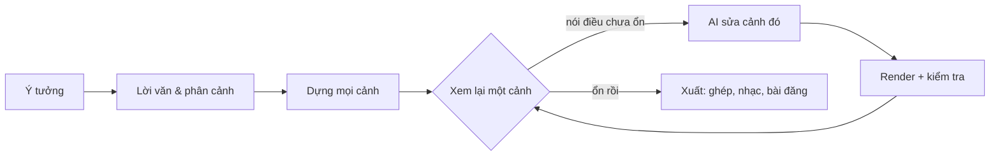

<h1 align="center">
  <br/>
  Shotloop
</h1>

<p align="center"><b>Làm video giải thích ngắn bằng code, từng cảnh một.</b><br/>
Một ý tưởng trở thành lời văn, phân cảnh và một video gồm nhiều cảnh. Mỗi cảnh có vòng lặp riêng: AI viết, Shotloop render, bạn xem lại và AI sửa. Sửa một cảnh chỉ render lại cảnh đó, không phải cả video.</p>

<p align="center">
  
</p>

<p align="center">
  <a href="https://github.com/chihyungchang/Shotloop/releases/latest"><b>Tải cho macOS</b></a> ·
  <a href="https://github.com/chihyungchang/Shotloop/releases">Các phiên bản</a> ·
  <a href="#build-từ-mã-nguồn">Build từ mã nguồn</a>
</p>

<p align="center">
  <a href="https://github.com/chihyungchang/Shotloop/releases/latest"></a>
  
  <a href="LICENSE"></a>
  
</p>

<p align="center"><a href="README.md">English</a> · <a href="README.zh-CN.md">简体中文</a> · <a href="README.zh-TW.md">繁體中文</a> · <a href="README.ja.md">日本語</a> · <a href="README.ko.md">한국어</a> · <a href="README.es.md">Español</a> · <a href="README.pt-BR.md">Português</a> · <a href="README.fr.md">Français</a> · <a href="README.de.md">Deutsch</a> · <a href="README.it.md">Italiano</a> · <a href="README.ru.md">Русский</a> · <a href="README.tr.md">Türkçe</a> · <b>Tiếng Việt</b> · <a href="README.id.md">Bahasa Indonesia</a></p>

---

## Shotloop là gì

Shotloop là ứng dụng desktop để làm video ngắn được vẽ bằng code: quảng bá sản phẩm, giải thích khoa học, kể chuyện bằng dữ liệu và hoạt ảnh kiểu slide, ở dạng 2D (trang web render từng khung hình) hoặc 3D (cảnh Blender), với bảy phong cách hình ảnh.

Bạn bắt đầu bằng một câu. Nếu bạn không tự chọn, AI sẽ chọn cách thể hiện (cảnh điện ảnh, infographic, bản đồ, demo giao diện, bản vẽ kỹ thuật, chữ chuyển động hoặc 3D) và chủ đề màu. AI viết câu mở đầu, kịch bản và các dữ kiện kèm nguồn, rồi chia thành phân cảnh. Bạn chỉnh phân cảnh, AI dựng từng cảnh. Trong trình chỉnh sửa, bạn xem từng cảnh và nói điều chưa ổn bằng lời thường, ví dụ "chữ nhỏ quá" hay "tĩnh quá, thêm chút chuyển động đi". AI sửa cảnh đó, render, đối chiếu với ghi chú và cho bạn xem trước/sau. Khi video đã ổn, Xuất sẽ ghép các cảnh và thêm nhạc; AI thiết kế ảnh bìa theo phong cách của video (hoặc điền vào mẫu của series) và viết bài đăng cho từng nền tảng, tất cả trong một thư mục riêng.

AI là cái bạn đang dùng: Claude Code hoặc một coding agent khác đã đăng nhập, API mô hình với khóa của bạn, hoặc mô hình chạy cục bộ.

Ứng dụng có 14 ngôn ngữ: English, 简体中文, 繁體中文, 日本語, 한국어, Español, Português, Français, Deutsch, Italiano, Русский, Türkçe, Tiếng Việt và Bahasa Indonesia. Mặc định theo ngôn ngữ của Mac; AI trả lời và viết bài đăng bằng ngôn ngữ bạn chọn.

## Làm bằng Shotloop

Mọi khung hình dưới đây đều do Shotloop render từ các [ví dụ](examples/) đi kèm.

<table>
<tr>
<td width="25%" valign="top"><br/><sub><b>3D</b>: tháo rời điện thoại trong Blender.</sub></td>
<td width="25%" valign="top"><br/><sub><b>2D</b>: ánh nắng mất bao lâu để tới Trái Đất.</sub></td>
<td width="50%" valign="top"><br/><sub><b>2D dữ liệu</b>: mỗi ngày tốt hơn 1%, qua biểu đồ (16:9).</sub></td>
</tr>
</table>

## Bảy cách thể hiện một ý tưởng

AI chọn phong cách hợp với chủ đề và giải thích lý do; bạn có thể đổi trong bản kế hoạch, hoặc chọn sẵn ở Trang chủ. Mỗi ảnh là một khung hình của ví dụ được liên kết.

<table>
<tr>
<td width="25%" valign="top"><a href="examples/sunlight-en/"></a><br/><sub><b>Cảnh điện ảnh</b>: ánh sáng, chiều sâu và máy quay chuyển động, cho những thứ quay được: vũ trụ, thiên nhiên, vật lý.</sub></td>
<td width="25%" valign="top"><a href="examples/solar-share-en/"></a><br/><sub><b>Infographic</b>: biểu đồ và con số chuyển động, cho thống kê, so sánh, tiền bạc.</sub></td>
<td width="25%" valign="top"><a href="examples/coffee-map-en/"></a><br/><sub><b>Bản đồ</b>: bản đồ thế giới, tuyến đường và quốc gia sáng lên, cho địa điểm và sự lan tỏa.</sub></td>
<td width="25%" valign="top"><a href="examples/fake-parcel-text-en/"></a><br/><sub><b>Demo giao diện</b>: điện thoại hoặc trình duyệt, từng bước, cho ứng dụng, cài đặt và chiêu lừa đảo.</sub></td>
</tr>
<tr>
<td width="25%" valign="top"><a href="examples/zipper-blueprint-en/"></a><br/><sub><b>Bản vẽ kỹ thuật</b>: nét vẽ trên lưới, hình tách lớp và chú thích, cho cách một cỗ máy hoạt động.</sub></td>
<td width="25%" valign="top"><a href="examples/chinese-words-en/"></a><br/><sub><b>Chữ chuyển động</b>: chữ cỡ lớn chuyển động, cho trích dẫn, từ ngữ và ngộ nhận.</sub></td>
<td width="25%" valign="top"><a href="examples/watch-3d-en/"></a><br/><sub><b>3D</b>: cảnh Blender với ánh sáng thật và máy quay bay trong không gian.</sub></td>
</tr>
</table>

Video 2D theo một bộ nguyên tắc cố định: hình ảnh trước tiên, mỗi cảnh một phụ đề cô đọng, mỗi dòng ở lại đủ lâu để đọc, mọi con số đều chuyển động, trung thực về những gì được thể hiện, nguồn ghi nhỏ trên màn hình. Xem trong [engine/video/explainers/2d/README.md](engine/video/explainers/2d/README.md) và trong mọi prompt 2D.

## Tham quan sản phẩm

<table>
<tr>
<td width="50%" valign="top">
<a href="docs/screenshots/home.jpg"></a><br/>
<sub><b>Trang chủ</b>: một câu là đủ. 2D hay 3D, độ dài, phong cách và chủ đề có thể để Tự động. Hoặc bắt đầu từ một ví dụ trong thư viện.</sub>
</td>
<td width="50%" valign="top">
<a href="docs/screenshots/plan.jpg"></a><br/>
<sub><b>Lời văn &amp; phân cảnh</b>: câu mở đầu, kịch bản, dữ kiện có nguồn, và nội dung từng cảnh, tất cả đều sửa được trước khi render.</sub>
</td>
</tr>
<tr>
<td width="50%" valign="top">
<a href="docs/screenshots/studio.jpg"></a><br/>
<sub><b>Trình chỉnh sửa</b>: cảnh trên sân khấu tối, dải phim, ghi chú và kết quả kiểm tra của từng cảnh.</sub>
</td>
<td width="50%" valign="top">
<a href="docs/screenshots/agent.jpg"></a><br/>
<sub><b>Trợ lý AI</b>: nói điều chưa ổn và AI sửa cảnh đó. Kéo thanh chia để so sánh trước và sau.</sub>
</td>
</tr>
<tr>
<td width="50%" valign="top">
<a href="docs/screenshots/export.jpg"></a><br/>
<sub><b>Xuất</b>: chọn video (dọc, ngang), ảnh bìa và bài đăng; có thể sửa ảnh bìa và bài đăng trước. Mỗi lần xuất vào một thư mục riêng.</sub>
</td>
<td width="50%" valign="top">
<a href="docs/screenshots/settings.jpg"></a><br/>
<sub><b>Mô hình và nhà cung cấp</b>: CLI agent bạn đã đăng nhập, API mô hình với khóa của bạn, hoặc mô hình cục bộ.</sub>
</td>
</tr>
</table>

## Cách hoạt động



- **Theo từng cảnh, không phải một lần render dài.** Video là một danh sách cảnh. Mỗi cảnh là một chương trình nhỏ: `shot.js` cho trang 2D, `shot.py` cho chuyển động máy quay trong Blender. Mỗi cảnh được cache theo hash của đầu vào, nên sửa một cảnh chỉ render lại cảnh đó trong vài giây (2D) hoặc một phút (3D), và Xuất chỉ ghép các clip.
- **Sửa bằng lời thường.** AI chỉ đụng vào cảnh bạn đang xem, trừ khi cần sửa thế giới dùng chung. AI render khung hình tĩnh, đối chiếu với danh sách kiểm tra (đọc được, không bị che, không lấn vùng phụ đề…) và báo lại đã thay đổi gì.
- **Bảy phong cách hình ảnh.** Cảnh điện ảnh, infographic, bản đồ, demo giao diện, bản vẽ kỹ thuật, chữ chuyển động hoặc 3D, mỗi phong cách có bộ kit và khung hình tham khảo riêng mà AI xem trước khi chọn và dựng ([`engine/shotloop/styles.mjs`](engine/shotloop/styles.mjs)). Chủ đề chỉ quyết định nền và chữ; hình ảnh và dữ liệu giữ màu mà nội dung cần.
- **Kế hoạch được đo theo quy tắc.** Trước khi dựng, phụ đề được kiểm tra độ dài và thời gian hiển thị. Hình xuất hiện lặp lại qua nhiều cảnh chỉ vẽ một lần và dùng chung, nên trông giống nhau ở mọi cảnh.
- **Dữ kiện có nguồn.** Lời văn giữ mỗi dữ kiện cạnh nguồn của nó, và bài đăng chỉ được dùng dữ kiện có trong lời văn.
- **Ảnh bìa.** AI thiết kế ảnh bìa theo phong cách video và tự kiểm tra bản render. Lưu một ảnh làm mẫu để giữ series đồng nhất, hoặc tải lên ảnh bìa bạn thích để AI làm theo bố cục đó.
- **Nhạc khớp nhịp cắt.** Nhạc nền tổng hợp được chỉnh để điểm cắt rơi đúng nhịp, chạy đến khung hình cuối rồi nhỏ dần.
- **Nhanh khi chỉnh sửa, chất lượng đầy đủ khi xuất.** 3D hiển thị bản xem trước nhanh khi bạn chỉnh và chỉ render chất lượng đầy đủ khi xuất. 2D luôn ở chất lượng đầy đủ.
- **Thư viện tài nguyên 3D.** Tìm mô hình CC0 trên [Poly Pizza](https://poly.pizza) và [Smithsonian Open Access](https://www.si.edu/openaccess) bằng khóa của bạn. Mỗi mô hình chỉ tải một lần và thêm được vào bất kỳ dự án 3D nào.

## AI điều khiển

| Chế độ | Bạn cần gì |
| --- | --- |
| **CLI agent cục bộ** | [Claude Code](https://docs.anthropic.com/en/docs/claude-code) đã đăng nhập trên Mac này (Codex CLI và Gemini CLI đang thử nghiệm). Chạy headless, tắt công cụ riêng của nó và chỉ làm việc qua công cụ của Shotloop. |
| **API mô hình** | Khóa của bạn. Có sẵn cấu hình cho Anthropic, OpenAI, Google Gemini, OpenRouter, xAI, Mistral, Together, DeepSeek, Qwen, Kimi, GLM, MiniMax, Doubao và SiliconFlow, hoặc bất kỳ endpoint tương thích Anthropic hay OpenAI. Khóa chỉ lưu trên Mac của bạn. |
| **Mô hình cục bộ** | Ollama, LM Studio, vLLM, llama.cpp hoặc bất kỳ server tương thích OpenAI. |

Mô hình cần hỗ trợ gọi công cụ (tool calling), và việc kiểm tra cần mô hình xem được ảnh. Agent làm việc qua một bộ công cụ hẹp: đọc và ghi file của cảnh, render khung hình tĩnh và báo cáo kết quả kiểm tra. Nó không chạy được lệnh shell.

## Cài đặt

1. Tải `Shotloop_<version>_aarch64.dmg` từ [bản phát hành mới nhất](https://github.com/chihyungchang/Shotloop/releases/latest), mở ra và kéo Shotloop vào Applications.
2. Cần cài **Google Chrome** (cảnh 2D được render bằng nó). Với dự án 3D, Shotloop sẽ yêu cầu **Blender** khi bạn tạo dự án đầu tiên.
3. Chọn AI trong Cài đặt → Mô hình và nhà cung cấp. Nếu Mac đã có Claude Code, nó sẽ được chọn sẵn.

> **Lần mở đầu tiên:** Shotloop chưa được Apple công chứng (notarize), nên macOS báo không thể xác minh nhà phát triển. Hãy mở một lần từ **Cài đặt hệ thống → Quyền riêng tư & Bảo mật → Vẫn mở**, hoặc chạy `xattr -dr com.apple.quarantine /Applications/Shotloop.app` trong Terminal. Sau đó ứng dụng mở bình thường và các bản cập nhật cài đặt mà không hỏi lại.

Node.js và ffmpeg có sẵn trong ứng dụng. Shotloop kiểm tra bản cập nhật trên GitHub và cài tại chỗ. Chạy trên Mac dùng Apple silicon (M1 trở lên).

## Build từ mã nguồn

```bash
nvm use                      # Node 22.18+ (the agent runs TypeScript directly)
corepack enable              # once: provides the pinned pnpm
pnpm install
pnpm app                     # tauri dev; needs the Rust toolchain
pnpm app:build               # Shotloop.app and a dmg, with Node and ffmpeg inside
```

`pnpm app` dùng Node và ffmpeg có trên Mac của bạn và chạy mọi thứ từ bản checkout. Các bản phát hành được ký cho trình cập nhật và phát hành bằng [`app/scripts/release.mjs`](app/scripts/release.mjs).

<details>
<summary><b>Dùng engine từ terminal</b></summary>

```bash
pnpm shotloop status   fixtures/hello-3d
pnpm shotloop render   fixtures/hello-3d --shot 02-close --stills   # start/middle/end
pnpm shotloop render   fixtures/hello-3d --shot 02-close            # a clip, in the editor's quality
pnpm shotloop export   fixtures/hello-3d                            # only changed shots render
pnpm shotloop new      my-short --idea "Vì sao pin điện thoại bị chai?" --track auto --duration auto
pnpm shotloop new      coffee --idea "Cà phê đến từ đâu?" --track 2d --style map --duration 30
pnpm shotloop export   fixtures/hello-3d --to ~/Movies/Shotloop --name "Hello"   # into a new folder there
pnpm shotloop covers   list                                         # cover templates
pnpm shotloop doctor
```

Thêm `--json` để nhận sự kiện theo từng dòng (thứ ứng dụng đọc). Agent chạy theo cách tương tự:

```bash
node agent/src/main.ts detect                                         # CLI agents and local servers on this Mac
SHOTLOOP_PROVIDER=cli SHOTLOOP_CLI=claude node agent/src/main.ts check fixtures/hello-3d --shot 01-wide
pnpm test                                                             # every backend against scripted stand-ins
```

</details>

<details>
<summary><b>Định dạng dự án</b></summary>

```
my-video/
  shotloop.json        title, track (2d|3d), style, size, fps, shots [{ id, title, duration }]
  storyboard.json      the plan: copy (hook, script, facts with sources) and shots
  world/               3D: world.py (+ screen.html); 2D: page.html (the style's kit), parts.js (pictures
                       that recur, drawn once), geo.data.js (the map style's countries)
  shots/<id>/          shot.py | shot.js, notes.md (must show, on screen, motion)
  assets/<id>/         3D models from the asset library
  copy.md  script.md  captions.html  music.json  thumb.html  publish.json
  .shotloop/           cache: per shot and input hash, takes, checks, fixes
  out/                 the engine's exports (timestamped); the app copies each into a new folder where you choose
```

- **3D**: `world.py` dựng thế giới dùng chung bằng `kit` ([`engine/video/explainers/3d/lib/kit.py`](engine/video/explainers/3d/lib/kit.py)). `shot.py` chạy trong namespace của thế giới và tạo một máy quay; `at(t)` đổi giây tính theo cảnh sang thời gian của video.
- **2D**: `shot.js` default-export `render(t, ctx)`, hàm vẽ `world/page.html` tại thời điểm `t` tính theo cảnh.
- **Cache**: khóa của một cảnh là hash của thế giới, code của cảnh, phụ đề, tài nguyên, renderer và cài đặt. Cảnh không đổi sẽ được dùng lại.

</details>

<details>
<summary><b>Cấu trúc repository</b></summary>

| Đường dẫn | Nội dung |
| --- | --- |
| [`app/`](app/) | Ứng dụng desktop: vỏ Tauri 2 (Rust) lo hàng đợi render, trình cập nhật và giám sát tiến trình, cùng giao diện React + TypeScript. |
| [`engine/shotloop/`](engine/shotloop/) | Engine cảnh: định dạng dự án, cache render theo cảnh, render 2D (Chrome) và 3D (Blender), ghép video, xuất MP4, nhạc, thư viện tài nguyên. Là một CLI mà ứng dụng gọi. |
| [`agent/`](agent/) | Agent: lập kế hoạch, dựng cảnh, sửa bằng lời thường, kiểm tra theo danh sách, viết bài đăng. Hỗ trợ API, CLI (qua MCP) và mô hình cục bộ. |
| [`examples/`](examples/) | Các ví dụ Trang chủ cung cấp, bằng tiếng Anh: ít nhất một cho mỗi phong cách (2D và 3D, 9:16 và 16:9). |
| [`fixtures/`](fixtures/) | Dự án cho kiểm thử và hướng dẫn trên terminal. |

</details>

## Giấy phép

[Apache License 2.0](LICENSE); xem thêm [NOTICE](NOTICE). Mô hình từ thư viện tài nguyên giữ giấy phép riêng (CC0 hoặc CC-BY, ghi công được lưu trong dự án).
