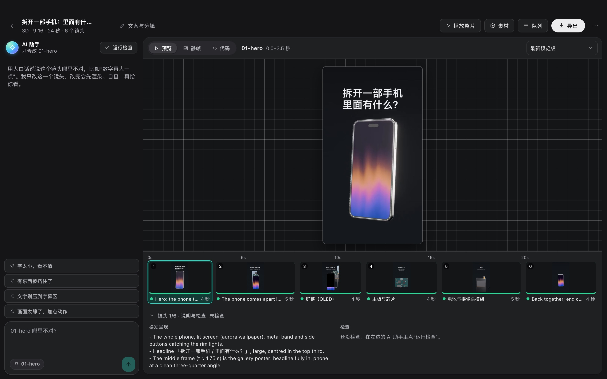
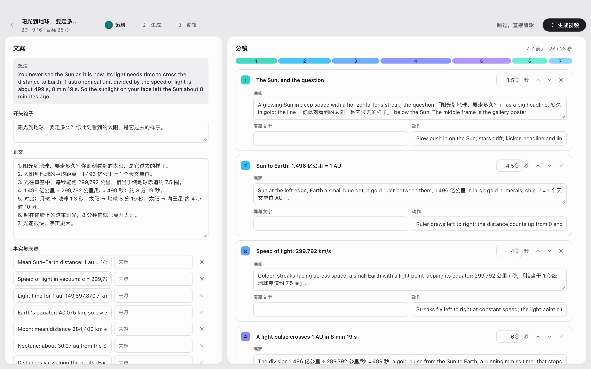
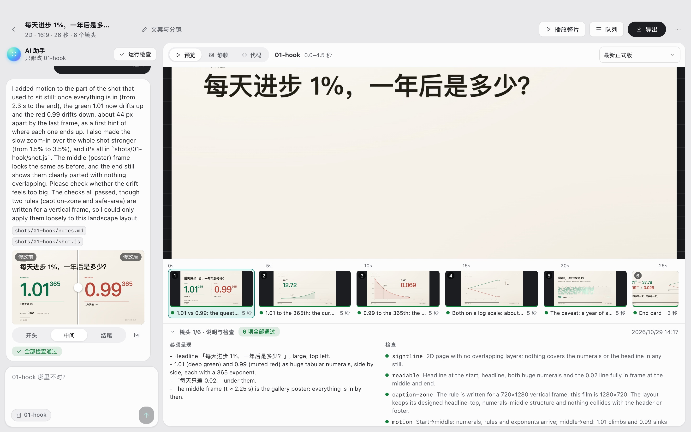
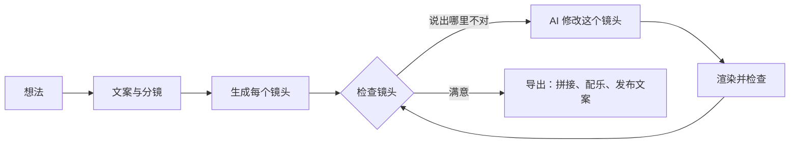

<h1 align="center">
  <br/>
  Shotloop
</h1>

<p align="center"><b>用代码做短视频，一个镜头一个镜头地做。</b><br/>
一个想法会变成文案、分镜和由多个镜头组成的成片。每个镜头都有自己的循环：AI 编写，Shotloop 渲染，你来检查，AI 来修改。修一个镜头只重新渲染这一个，不用重做整部片子。</p>

<p align="center">
  
</p>

<p align="center">
  <a href="https://github.com/chihyungchang/Shotloop/releases/latest"><b>下载 macOS 版</b></a> ·
  <a href="https://github.com/chihyungchang/Shotloop/releases">所有版本</a> ·
  <a href="#从源码运行">从源码运行</a>
</p>

<p align="center">
  <a href="https://github.com/chihyungchang/Shotloop/releases/latest"></a>
  
  <a href="LICENSE"></a>
  
</p>

<p align="center"><a href="README.md">English</a> · <b>简体中文</b> · <a href="README.zh-TW.md">繁體中文</a> · <a href="README.ja.md">日本語</a> · <a href="README.ko.md">한국어</a> · <a href="README.es.md">Español</a> · <a href="README.pt-BR.md">Português</a> · <a href="README.fr.md">Français</a> · <a href="README.de.md">Deutsch</a> · <a href="README.it.md">Italiano</a> · <a href="README.ru.md">Русский</a> · <a href="README.tr.md">Türkçe</a> · <a href="README.vi.md">Tiếng Việt</a> · <a href="README.id.md">Bahasa Indonesia</a></p>

---

## Shotloop 是什么

Shotloop 是一个桌面应用，用代码"画"短视频，适合做产品宣传、科普视频、数据可视化和 PPT 式动画。有两种做法：2D 是逐帧渲染的网页，3D 是 Blender 场景；画面方式共有七种。

你只需要写一句话。AI 会根据题目选择画面方式（电影感场景、信息图、地图、界面演示、剖面图纸、动态排版或 3D）和主题色，你也可以自己选。接着它写好开头钩子、文案和带来源的事实，再拆成分镜。你改好分镜后，AI 生成每个镜头。在工作室里逐个看镜头，有问题就用大白话说出来，比如"字太小了""太静了，加点动效"。AI 只改这一个镜头，渲染后对照说明检查，再给你看改动前后的对比。整片满意后点导出：镜头拼接成片，配上音乐；AI 按视频的风格设计封面（也可以套用你的系列模版），并为各个平台写好发布文案，全部放进一个单独的文件夹。

驱动它的 AI 就用你已有的：已登录的 Claude Code 等命令行工具、自带 key 的模型 API，或者本地模型。

界面支持 14 种语言：English、简体中文、繁體中文、日本語、한국어、Español、Português、Français、Deutsch、Italiano、Русский、Türkçe、Tiếng Việt 和 Bahasa Indonesia。默认跟随 Mac 的系统语言；AI 的回复和发布文案也用你选的语言。

## 用 Shotloop 做的片子

下面每一帧都是 Shotloop 用自带的[示例](examples/)渲染出来的。

<table>
<tr>
<td width="25%" valign="top"><br/><sub><b>3D</b>：用 Blender 做的手机拆解。</sub></td>
<td width="25%" valign="top"><br/><sub><b>2D</b>：阳光到地球要走多久。</sub></td>
<td width="50%" valign="top"><br/><sub><b>2D 数据</b>：每天进步 1%，用图表讲复利（16:9）。</sub></td>
</tr>
</table>

## 七种画面方式

AI 会按题目挑选最合适的画面方式并说明理由；你可以在策划页切换，也可以在首页直接指定。每张图都来自它链接的示例。

<table>
<tr>
<td width="25%" valign="top"><a href="examples/sunlight-en/"></a><br/><sub><b>电影感场景</b>： 有光、有纵深、镜头在动，适合能“拍到”的东西：宇宙、自然、物理。</sub></td>
<td width="25%" valign="top"><a href="examples/solar-share-en/"></a><br/><sub><b>信息图</b>： 图表和会动的数字，适合统计、对比、金钱。</sub></td>
<td width="25%" valign="top"><a href="examples/coffee-map-en/"></a><br/><sub><b>地图</b>： 世界地图、航线、国家被点亮，适合地点、路线、传播与分布。</sub></td>
<td width="25%" valign="top"><a href="examples/fake-parcel-text-en/"></a><br/><sub><b>界面演示</b>： 手机或浏览器上一步步演示，适合 App 技巧、设置、诈骗手法。</sub></td>
</tr>
<tr>
<td width="25%" valign="top"><a href="examples/zipper-blueprint-en/"></a><br/><sub><b>剖面图纸</b>： 网格上的线稿、拆解、标注，适合讲机器和装置怎么运作。</sub></td>
<td width="25%" valign="top"><a href="examples/chinese-words-en/"></a><br/><sub><b>动态排版</b>： 会动的大字，适合名言、词语、辟谣。</sub></td>
<td width="25%" valign="top"><a href="examples/watch-3d-en/"></a><br/><sub><b>3D</b>： Blender 场景，真实的光影，镜头在空间里移动。</sub></td>
</tr>
</table>

2D 视频遵循一套固定原则：画面优先；每个镜头一句概括字幕；每句字幕都停留到读得完；每个数字都会动；如实呈现；来源以小字放在画面上。完整规则见 [engine/video/explainers/2d/README.md](engine/video/explainers/2d/README.md)，每个 2D 提示词里也都带着。

## 功能一览

<table>
<tr>
<td width="50%" valign="top">
<a href="docs/screenshots/home-zh.jpg"></a><br/>
<sub><b>首页</b>：一句话。2D/3D、时长、画面方式和主题色都可以交给“自动”，也可以从示例画廊开始。</sub>
</td>
<td width="50%" valign="top">
<a href="docs/screenshots/plan-zh.jpg"></a><br/>
<sub><b>文案与分镜</b>：开头钩子、文案、带来源的事实，以及每个镜头要呈现的内容。渲染之前都可以修改。</sub>
</td>
</tr>
<tr>
<td width="50%" valign="top">
<a href="docs/screenshots/studio.jpg"></a><br/>
<sub><b>工作室</b>：深色舞台上的镜头、镜头条，以及每个镜头的说明与检查。</sub>
</td>
<td width="50%" valign="top">
<a href="docs/screenshots/agent-zh.jpg"></a><br/>
<sub><b>AI 助手</b>：说出哪里不对，AI 就修改这个镜头。拖动分割线可以对比改动前后。</sub>
</td>
</tr>
<tr>
<td width="50%" valign="top">
<a href="docs/screenshots/export.jpg"></a><br/>
<sub><b>导出</b>：勾选要导出的视频（竖屏、横屏）、封面和发布文案，导出前可以先编辑封面和文案。每次导出都放进一个单独的文件夹。</sub>
</td>
<td width="50%" valign="top">
<a href="docs/screenshots/settings.jpg"></a><br/>
<sub><b>模型与服务商</b>：已登录的命令行工具、自带 key 的模型 API，或本地模型。</sub>
</td>
</tr>
</table>

## 工作原理



- **按镜头做，不是一次渲染整片。** 一部片子由多个镜头组成，每个镜头都是一小段程序：2D 是 `shot.js`，3D 是 Blender 里的 `shot.py` 运镜。每个镜头按输入内容缓存，修一个镜头只需几秒（2D）到一分钟（3D），导出时只是把片段拼起来。
- **用大白话修改。** AI 只改你当前选中的镜头，除非修改必须动到共享场景。改完会渲染静帧，按检查清单逐条检查（文字能否看清、有没有被遮挡、有没有压到字幕区等），再告诉你改了什么。
- **七种画面方式。** 电影感场景、信息图、地图、界面演示、剖面图纸、动态排版和 3D，各有一套工具和样片，AI 选择和生成之前都会先看样片（[`engine/shotloop/styles.mjs`](engine/shotloop/styles.mjs)）。主题色只管背景和文字，画面里的物体和数据按含义取色。
- **策划会按规则检查。** 生成之前，先检查每句字幕的长度和停留时间。在多个镜头里反复出现的画面只画一次、各镜头共用，保证每次长得一样。
- **事实都有来源。** 文案里每条事实都附带来源，发布文案也只能使用文案里的事实。
- **封面。** AI 按视频的风格设计封面，并自己检查渲染效果。可以存为模版让同一系列统一，也可以上传一张喜欢的封面，让 AI 照它的版式设计。
- **配乐贴合剪辑。** 合成的配乐会调整节拍，让剪切点落在拍子上；音乐一直响到最后一帧，再平滑淡出。
- **编辑时快，导出时好。** 3D 编辑时用快速预览，导出时才按完整画质渲染；2D 全程都是高清。
- **3D 素材库。** 用你自己的 key 在 [Poly Pizza](https://poly.pizza) 和 [Smithsonian 开放资源](https://www.si.edu/openaccess)中搜索免费模型。每个模型只下载一次，任何 3D 项目都能用。

## 支持的 AI

| 方式 | 需要什么 |
| --- | --- |
| **本地命令行工具** | 在这台 Mac 上登录过的 [Claude Code](https://docs.anthropic.com/en/docs/claude-code)（Codex CLI、Gemini CLI 为实验支持）。运行时它自带的工具都关闭，只能使用 Shotloop 提供的工具。 |
| **模型 API** | 你自己的 key。内置 Anthropic、OpenAI、Google Gemini、OpenRouter、xAI、Mistral、Together、DeepSeek、通义千问、Kimi、智谱 GLM、MiniMax、豆包、硅基流动，也支持任意兼容 Anthropic 或 OpenAI 接口的服务。key 只保存在你的 Mac 上。 |
| **本地模型** | Ollama、LM Studio、vLLM、llama.cpp，或任何兼容 OpenAI 接口的服务。 |

模型需要支持工具调用；做检查时还需要能看图片的模型。AI 只能使用一小组工具：读写当前镜头的文件、渲染静帧、提交检查结果，不能执行命令行。

## 安装

1. 从[最新版本](https://github.com/chihyungchang/Shotloop/releases/latest)下载 `Shotloop_<版本>_aarch64.dmg`，打开后把 Shotloop 拖进"应用程序"。
2. 需要安装 **Google Chrome**，2D 镜头用它渲染。第一次新建 3D 项目时，Shotloop 会引导你安装 **Blender**。
3. 在"设置 → 模型与服务商"里选择 AI。如果你的 Mac 上已经有 Claude Code，会自动选好。

> **第一次打开**：Shotloop 还没有经过 Apple 公证，macOS 会提示"无法验证开发者"。请在 **系统设置 → 隐私与安全性 → 仍要打开** 里打开一次，或者在终端运行 `xattr -dr com.apple.quarantine /Applications/Shotloop.app`。之后就能正常打开，自动更新也不会再弹这个提示。

Node.js 和 ffmpeg 已经内置在应用里。Shotloop 会自动从 GitHub 检查并安装更新。支持 Apple 芯片（M1 及以后）的 Mac。

## 从源码运行

```bash
nvm use                      # Node 22.18+（AI 助手直接运行 TypeScript）
corepack enable              # 只需一次：启用锁定版本的 pnpm
pnpm install
pnpm app                     # tauri dev，需要 Rust 工具链
pnpm app:build               # 生成 Shotloop.app 和 dmg，内置 Node 和 ffmpeg
```

`pnpm app` 使用你 Mac 上已有的 Node 和 ffmpeg，所有代码都从仓库里直接运行。发布版本带有更新签名，由 [`app/scripts/release.mjs`](app/scripts/release.mjs) 发布。

<details>
<summary><b>在终端里使用引擎</b></summary>

```bash
pnpm shotloop status   fixtures/hello-3d
pnpm shotloop render   fixtures/hello-3d --shot 02-close --stills   # 开头/中间/结尾三帧
pnpm shotloop render   fixtures/hello-3d --shot 02-close            # 按编辑画质渲染片段
pnpm shotloop export   fixtures/hello-3d                            # 只渲染改过的镜头
pnpm shotloop new      my-short --idea "手机电池为什么会老化？" --track auto --duration auto
pnpm shotloop new      coffee --idea "咖啡从哪里来？" --track 2d --style map --duration 30
pnpm shotloop export   fixtures/hello-3d --to ~/Movies/Shotloop --name "Hello"   # 导出到那里的新文件夹
pnpm shotloop covers   list                                         # 封面模版
pnpm shotloop doctor
```

加上 `--json` 会逐行输出事件（app 读取的就是这个）。AI 助手也可以这样运行：

```bash
node agent/src/main.ts detect                                         # 检测本机的命令行工具和本地模型服务
SHOTLOOP_PROVIDER=cli SHOTLOOP_CLI=claude node agent/src/main.ts check fixtures/hello-3d --shot 01-wide
pnpm test                                                             # 用脚本化的替身测试每种 AI 方式
```

</details>

<details>
<summary><b>项目格式</b></summary>

```
my-video/
  shotloop.json        标题、2d|3d、画面方式、尺寸、帧率、镜头列表 [{ id, title, duration }]
  storyboard.json      策划：文案（钩子、文案、带来源的事实）和镜头
  world/               3D：world.py（+ screen.html）；2D：page.html（画面方式的工具包）、parts.js（反复出现的画面，
                       只画一次）、geo.data.js（地图方式的国家数据）
  shots/<id>/          shot.py | shot.js、notes.md（必须呈现、屏幕文字、动作）
  assets/<id>/         从素材库加入的 3D 模型
  copy.md  script.md  captions.html  music.json  thumb.html  publish.json
  .shotloop/           缓存：按镜头和输入哈希保存的渲染、记录、检查、修改
  out/                 引擎的导出文件（带时间戳）；App 会把每次导出复制到你选的位置，新建一个文件夹
```

</details>

<details>
<summary><b>仓库结构</b></summary>

| 路径 | 内容 |
| --- | --- |
| [`app/`](app/) | 桌面应用：Tauri 2（Rust）外壳，负责渲染队列、自动更新和进程管理；React + TypeScript 界面。 |
| [`engine/shotloop/`](engine/shotloop/) | 镜头引擎：项目格式、按镜头缓存、2D（Chrome）和 3D（Blender）渲染、成片拼接、MP4 导出、配乐、素材库。app 通过它的命令行调用。 |
| [`agent/`](agent/) | AI 助手：策划、生成、按要求修改、按检查清单检查、发布文案。支持 API、命令行工具（通过 MCP）和本地模型。 |
| [`examples/`](examples/) | 首页提供的示例，统一为英文，每种画面方式至少一个（2D 和 3D，竖屏和横屏）。 |
| [`fixtures/`](fixtures/) | 测试和终端演示用的项目。 |

</details>

## 许可证

[Apache License 2.0](LICENSE)，另见 [NOTICE](NOTICE)。素材库里的模型保留各自的许可（CC0 或 CC-BY，署名会写进项目里）。
