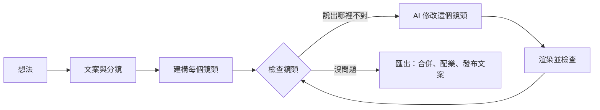

<h1 align="center">
  <br/>
  Shotloop
</h1>

<p align="center"><b>用程式碼做短影片，一個鏡頭一個鏡頭來。</b><br/>
一個想法會變成文案、分鏡，再變成由多個鏡頭組成的成片。每個鏡頭都有自己的循環：AI 撰寫，Shotloop 渲染，你來檢查，AI 再修改。修一個鏡頭只會重新渲染那一個，不必整支重做。</p>

<p align="center">
  
</p>

<p align="center">
  <a href="https://github.com/chihyungchang/Shotloop/releases/latest"><b>下載 macOS 版</b></a> ·
  <a href="https://github.com/chihyungchang/Shotloop/releases">所有版本</a> ·
  <a href="#從原始碼建置">從原始碼建置</a>
</p>

<p align="center">
  <a href="https://github.com/chihyungchang/Shotloop/releases/latest"></a>
  
  <a href="LICENSE"></a>
  
</p>

<p align="center"><a href="README.md">English</a> · <a href="README.zh-CN.md">简体中文</a> · <b>繁體中文</b> · <a href="README.ja.md">日本語</a> · <a href="README.ko.md">한국어</a> · <a href="README.es.md">Español</a> · <a href="README.pt-BR.md">Português</a> · <a href="README.fr.md">Français</a> · <a href="README.de.md">Deutsch</a> · <a href="README.it.md">Italiano</a> · <a href="README.ru.md">Русский</a> · <a href="README.tr.md">Türkçe</a> · <a href="README.vi.md">Tiếng Việt</a> · <a href="README.id.md">Bahasa Indonesia</a></p>

---

## Shotloop 是什麼

Shotloop 是一款桌面應用程式，用程式碼「畫」出短影片：產品宣傳、科普解說、數據故事和簡報式動畫都適用。可以做 2D（逐格渲染的網頁）或 3D（Blender 場景），共有七種視覺風格。

你只要寫一句話。AI 會挑選呈現方式（電影感場景、資訊圖表、地圖、介面示範、藍圖、動態文字或 3D）和主題，你也可以自己選。接著它寫好開場鉤子、腳本和附來源的事實，再拆成分鏡。你修改分鏡後，AI 建構每個鏡頭。在編輯器裡逐一檢視鏡頭，哪裡不對就用白話說，例如「字太小了」或「太靜了，加點動態」。AI 只改那個鏡頭，渲染後對照說明檢查，再給你看修改前後的對比。整支影片順了之後按「匯出」：鏡頭合併成片並配上音樂，AI 依影片風格設計封面（或套用你的系列範本），並為各平台寫好發布文案，全部放進專屬的資料夾。

驅動它的 AI 就用你手上現有的：已登入的 Claude Code 或其他程式開發代理、用你自己金鑰的模型 API，或本機模型。

介面支援 14 種語言：English、简体中文、繁體中文、日本語、한국어、Español、Português、Français、Deutsch、Italiano、Русский、Türkçe、Tiếng Việt 和 Bahasa Indonesia。預設跟隨 Mac 的系統語言，AI 的回覆和發布文案也會使用你選的語言。

## 用 Shotloop 做的影片

下面每一格畫面，都是 Shotloop 用內建的[範例](examples/)渲染出來的。

<table>
<tr>
<td width="25%" valign="top"><br/><sub><b>3D</b>：用 Blender 做的手機拆解。</sub></td>
<td width="25%" valign="top"><br/><sub><b>2D</b>：陽光要多久才會到達地球。</sub></td>
<td width="50%" valign="top"><br/><sub><b>2D 數據</b>：每天進步 1%，用圖表說明（16:9）。</sub></td>
</tr>
</table>

## 七種呈現想法的方式

AI 會依題材挑選合適的風格並說明理由；你可以在規劃頁切換，也可以在首頁直接指定。每張圖都是它所連結範例中的一格畫面。

<table>
<tr>
<td width="25%" valign="top"><a href="examples/sunlight-en/"></a><br/><sub><b>電影感場景</b>：光影、景深和移動的鏡頭，適合拍得到的東西：太空、自然、物理。</sub></td>
<td width="25%" valign="top"><a href="examples/solar-share-en/"></a><br/><sub><b>資訊圖表</b>：圖表和跳動的數字，適合統計、比較、金錢。</sub></td>
<td width="25%" valign="top"><a href="examples/coffee-map-en/"></a><br/><sub><b>地圖</b>：世界地圖、路線和逐一亮起的國家，適合地點與傳播路徑。</sub></td>
<td width="25%" valign="top"><a href="examples/fake-parcel-text-en/"></a><br/><sub><b>介面示範</b>：手機或瀏覽器上一步步操作，適合 App、設定和詐騙手法。</sub></td>
</tr>
<tr>
<td width="25%" valign="top"><a href="examples/zipper-blueprint-en/"></a><br/><sub><b>藍圖</b>：格線上的線稿、爆炸圖和標註，適合說明機器怎麼運作。</sub></td>
<td width="25%" valign="top"><a href="examples/chinese-words-en/"></a><br/><sub><b>動態文字</b>：會動的超大字，適合名言、詞語和破解迷思。</sub></td>
<td width="25%" valign="top"><a href="examples/watch-3d-en/"></a><br/><sub><b>3D</b>：Blender 場景，真實光影，鏡頭在空間中穿梭。</sub></td>
</tr>
</table>

2D 影片遵循一套固定原則：畫面優先；每個鏡頭一句精簡字幕；每句字幕停留到讀得完；每個數字都會動；如實呈現；來源以小字標在畫面上。完整內容見 [engine/video/explainers/2d/README.md](engine/video/explainers/2d/README.md)，每個 2D 提示詞裡也都有。

## 功能導覽

<table>
<tr>
<td width="50%" valign="top">
<a href="docs/screenshots/home.jpg"></a><br/>
<sub><b>首頁</b>：一句話就好。2D 或 3D、長度、風格和主題都可以維持「自動」，也可以從範例開始。</sub>
</td>
<td width="50%" valign="top">
<a href="docs/screenshots/plan.jpg"></a><br/>
<sub><b>文案與分鏡</b>：開場鉤子、腳本、附來源的事實，以及每個鏡頭要呈現的內容，渲染前都能修改。</sub>
</td>
</tr>
<tr>
<td width="50%" valign="top">
<a href="docs/screenshots/studio.jpg"></a><br/>
<sub><b>編輯器</b>：深色舞台上的鏡頭、鏡頭列，以及每個鏡頭的說明與檢查。</sub>
</td>
<td width="50%" valign="top">
<a href="docs/screenshots/agent.jpg"></a><br/>
<sub><b>AI 助理</b>：說出哪裡不對，AI 就修好那個鏡頭。拖動分隔線即可對比修改前後。</sub>
</td>
</tr>
<tr>
<td width="50%" valign="top">
<a href="docs/screenshots/export.jpg"></a><br/>
<sub><b>匯出</b>：勾選影片（直式、橫式）、封面和發布文案，匯出前可先編輯封面和文案。每次匯出都放進各自的資料夾。</sub>
</td>
<td width="50%" valign="top">
<a href="docs/screenshots/settings.jpg"></a><br/>
<sub><b>模型與供應商</b>：已登入的 CLI 代理、用你金鑰的模型 API，或本機模型。</sub>
</td>
</tr>
</table>

## 運作原理



- **以鏡頭為單位，而不是整支一次渲染。** 一支影片就是一串鏡頭，每個鏡頭是一小段程式：2D 頁面用 `shot.js`，Blender 運鏡用 `shot.py`。每個鏡頭依輸入的雜湊值快取，所以修一個鏡頭只要幾秒（2D）或一分鐘（3D），匯出時只是把片段接起來。
- **用白話修改。** AI 只動你目前所在的鏡頭，除非修改必須改到共用的場景。它會渲染靜態畫面，依檢查清單核對（看得清楚、沒被遮住、避開字幕區等），再回報改了什麼。
- **七種視覺風格。** 電影感場景、資訊圖表、地圖、介面示範、藍圖、動態文字和 3D，各有自己的工具組和參考畫面，AI 在選擇與建構前都會先看過（[`engine/shotloop/styles.mjs`](engine/shotloop/styles.mjs)）。主題只決定背景和字體；圖像和數據保留題材所需的顏色。
- **規劃會依規則檢查。** 建構之前，先檢查每句字幕的長度和停留時間。在多個鏡頭中重複出現的圖像只畫一次、共用，確保每次看起來都一樣。
- **事實附來源。** 文案中每條事實都緊跟著來源，發布文案也只能使用文案裡的事實。
- **封面。** AI 依影片風格設計封面，並自行檢查渲染結果。可以存成範本讓系列保持一致，也可以上傳一張喜歡的封面，讓 AI 照著它的設計做。
- **配樂貼合剪接。** 合成的配樂會調整節拍，讓剪接點落在拍子上，一路播到最後一格再淡出。
- **編輯時快，匯出時高畫質。** 3D 編輯時顯示快速預覽，匯出時才渲染完整畫質；2D 全程都是完整畫質。
- **3D 素材庫。** 用你自己的金鑰在 [Poly Pizza](https://poly.pizza) 和 [Smithsonian Open Access](https://www.si.edu/openaccess) 搜尋 CC0 模型。每個模型只下載一次，任何 3D 專案都能加入。

## 驅動它的 AI

| 模式 | 需要什麼 |
| --- | --- |
| **本機 CLI 代理** | 在這台 Mac 上已登入的 [Claude Code](https://docs.anthropic.com/en/docs/claude-code)（Codex CLI 和 Gemini CLI 為實驗性支援）。它以無介面模式執行，自帶的工具全部關閉，只透過 Shotloop 提供的工具工作。 |
| **模型 API** | 你自己的金鑰。內建 Anthropic、OpenAI、Google Gemini、OpenRouter、xAI、Mistral、Together、DeepSeek、Qwen、Kimi、GLM、MiniMax、Doubao 和 SiliconFlow 預設，也支援任何相容 Anthropic 或 OpenAI 的端點。金鑰只存在你的 Mac 上。 |
| **本機模型** | Ollama、LM Studio、vLLM、llama.cpp，或任何相容 OpenAI 的伺服器。 |

模型需要支援工具呼叫，檢查則需要能看圖的模型。代理只能使用一小組工具：讀寫鏡頭檔案、渲染靜態畫面、回報檢查結果，無法執行 shell 指令。

## 安裝

1. 從[最新版本](https://github.com/chihyungchang/Shotloop/releases/latest)下載 `Shotloop_<version>_aarch64.dmg`，打開後把 Shotloop 拖進「應用程式」。
2. 需要安裝 **Google Chrome**（2D 鏡頭用它渲染）。第一次建立 3D 專案時，Shotloop 會請你安裝 **Blender**。
3. 在「設定 → 模型與供應商」選擇 AI。如果 Mac 上已經有 Claude Code，會自動幫你選好。

> **第一次開啟：** Shotloop 尚未經過 Apple 公證，macOS 會顯示無法驗證開發者。請從 **系統設定 → 隱私權與安全性 → 強制打開** 開啟一次，或在終端機執行 `xattr -dr com.apple.quarantine /Applications/Shotloop.app`。之後就能正常開啟，更新也不會再詢問。

Node.js 和 ffmpeg 已內建在 App 中。Shotloop 會從 GitHub 檢查更新並直接安裝。支援 Apple 晶片（M1 以後）的 Mac。

## 從原始碼建置

```bash
nvm use                      # Node 22.18+ (the agent runs TypeScript directly)
corepack enable              # once: provides the pinned pnpm
pnpm install
pnpm app                     # tauri dev; needs the Rust toolchain
pnpm app:build               # Shotloop.app and a dmg, with Node and ffmpeg inside
```

`pnpm app` 使用你 Mac 上的 Node 和 ffmpeg，所有東西都直接從程式碼目錄執行。發布版本會為自動更新簽署，並透過 [`app/scripts/release.mjs`](app/scripts/release.mjs) 發布。

<details>
<summary><b>在終端機使用引擎</b></summary>

```bash
pnpm shotloop status   fixtures/hello-3d
pnpm shotloop render   fixtures/hello-3d --shot 02-close --stills   # start/middle/end
pnpm shotloop render   fixtures/hello-3d --shot 02-close            # a clip, in the editor's quality
pnpm shotloop export   fixtures/hello-3d                            # only changed shots render
pnpm shotloop new      my-short --idea "手機電池為什麼會老化？" --track auto --duration auto
pnpm shotloop new      coffee --idea "咖啡從哪裡來？" --track 2d --style map --duration 30
pnpm shotloop export   fixtures/hello-3d --to ~/Movies/Shotloop --name "Hello"   # into a new folder there
pnpm shotloop covers   list                                         # cover templates
pnpm shotloop doctor
```

加上 `--json` 會逐行輸出事件（App 讀取的就是這個）。代理也用同樣方式執行：

```bash
node agent/src/main.ts detect                                         # CLI agents and local servers on this Mac
SHOTLOOP_PROVIDER=cli SHOTLOOP_CLI=claude node agent/src/main.ts check fixtures/hello-3d --shot 01-wide
pnpm test                                                             # every backend against scripted stand-ins
```

</details>

<details>
<summary><b>專案格式</b></summary>

```
my-video/
  shotloop.json        title, track (2d|3d), style, size, fps, shots [{ id, title, duration }]
  storyboard.json      the plan: copy (hook, script, facts with sources) and shots
  world/               3D: world.py (+ screen.html); 2D: page.html (the style's kit), parts.js (pictures
                       that recur, drawn once), geo.data.js (the map style's countries)
  shots/<id>/          shot.py | shot.js, notes.md (must show, on screen, motion)
  assets/<id>/         3D models from the asset library
  copy.md  script.md  captions.html  music.json  thumb.html  publish.json
  .shotloop/           cache: per shot and input hash, takes, checks, fixes
  out/                 the engine's exports (timestamped); the app copies each into a new folder where you choose
```

- **3D**：`world.py` 用 `kit`（[`engine/video/explainers/3d/lib/kit.py`](engine/video/explainers/3d/lib/kit.py)）建構共用場景。`shot.py` 在場景的命名空間中執行並建立一台攝影機；`at(t)` 把鏡頭內的秒數換算成影片時間。
- **2D**：`shot.js` 預設匯出 `render(t, ctx)`，在鏡頭內時間 `t` 繪製 `world/page.html`。
- **快取**：鏡頭的鍵值由場景、程式碼、字幕、素材、渲染器和設定雜湊而成。沒變動的鏡頭會直接重用。

</details>

<details>
<summary><b>儲存庫結構</b></summary>

| 路徑 | 內容 |
| --- | --- |
| [`app/`](app/) | 桌面應用程式：Tauri 2（Rust）外殼，負責渲染佇列、自動更新和行程監管；React + TypeScript 介面。 |
| [`engine/shotloop/`](engine/shotloop/) | 鏡頭引擎：專案格式、逐鏡頭渲染快取、2D（Chrome）與 3D（Blender）渲染、成片組裝、MP4 匯出、配樂、素材庫。App 透過它的 CLI 呼叫。 |
| [`agent/`](agent/) | 代理：規劃、建構、白話修改、依檢查清單檢查、發布文案。支援 API、CLI（透過 MCP）和本機模型。 |
| [`examples/`](examples/) | 首頁提供的範例，皆為英文：每種視覺風格至少一個（2D 和 3D，9:16 和 16:9）。 |
| [`fixtures/`](fixtures/) | 測試和終端機示範用的專案。 |

</details>

## 授權

[Apache License 2.0](LICENSE)；另見 [NOTICE](NOTICE)。素材庫中的模型保留各自的授權（CC0 或 CC-BY，署名會寫進專案）。
