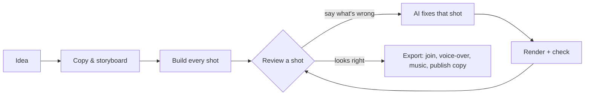

# Shotloop: the product in its makers' words

Read from github.com/chihyungchang/Shotloop on 2026-11-04. Facts for the story come from here: quote them, add none.

## About

Short videos with AI. Fix one shot, not the whole film: an idea becomes copy, a storyboard and shots in 2D (web) or 3D (three.js), each fixed by an AI agent in plain words. macOS desktop app.
Home page: https://oliverz.dev/products/shotloop
Topics: ai-agent, claude-code, code-to-video, desktop-app, explainer-video, local-first, macos, motion-graphics, ollama, programmatic-video, react, remotion-alternative, storyboard, tauri, threejs, typescript, video, video-generation
License: Apache-2.0

## README

Shotloop

Short videos with AI. Fix one shot, not the whole film.
An idea becomes copy, a storyboard and a film made of shots. Each shot has its own loop: the AI writes it, Shotloop renders it, you review it and the AI fixes it. A fix re-renders that shot only, not the whole film.

  

  Download for macOS ·
  Releases ·
  Build from source

  
  
  
  

English · 简体中文 · 繁體中文 · 日本語 · 한국어 · Español · Português · Français · Deutsch · Italiano · Русский · Türkçe · Tiếng Việt · Bahasa Indonesia

---

## What is Shotloop

Shotloop is a desktop app for short videos that are drawn with code: product promos, science explainers, data stories and slide-style animation, made in 2D (web pages rendered frame by frame) or 3D (three.js worlds rendered like an offline renderer), in eight visual styles.

You start with one sentence. The AI picks how to show it (a cinematic scene, an infographic, a map, an interface demo, a blueprint, kinetic type, a news story or 3D) and a theme, unless you choose them. It writes the hook, the script and the facts with their sources, then splits them into a storyboard, with the line a voice-over says over each shot. You edit the storyboard, and the AI builds every shot. In the Studio you look at each shot and say what is wrong in plain words, such as "the text is too small" or "it's too still: add some motion". The AI looks first and offers a few ways to change that shot; you pick one (or say your own), and it changes the shot and shows you a before/after. When the film reads right, Export joins the shots, lays the voice-over with its subtitles and the music under them, the AI designs a cover in the film's look (or fills your series' template) and writes the post for each platform, all into a folder of its own.

The AI is the one you already use: Claude Code or another coding agent you're signed in to, a model API with your own key, or a local model.

The app speaks 14 languages: English, 简体中文, 繁體中文, 日本語, 한국어, Español, Português, Français, Deutsch, Italiano, Русский, Türkçe, Tiếng Việt and Bahasa Indonesia. It follows your Mac's language, and the AI replies and writes the publish posts in the one you pick.

## Made with Shotloop

Every frame below was rendered by Shotloop from the [examples](examples/) it ships with.

3D: a mechanical watch in WebGL.
2D: how long sunlight takes to reach Earth.
2D data: 1% better every day, in charts (16:9).

## Eight ways to show an idea

The AI picks the style that fits the subject and tells you why; you can switch on the plan, or choose one on Home. Each picture is a frame of the example it links to.

Cinematic scene: light, depth and a moving camera, for things you could film: space, nature, physics.
Infographic: charts and moving numbers, for statistics, comparisons, money.
Map: the world map, routes and countries lighting up, for places and how things spread.
Interface demo: a phone or a browser, step by step, for apps, settings and scams.

Blueprint: line art on a grid, exploded views and callouts, for how a machine works.
Kinetic type: huge type that moves, for quotes, words and myths.
News story: breaking events told with tension: a running clock, the money trail, the timeline, who said what.
3D: three.js worlds with studio light, soft shadows and a camera through space.

2D videos follow a set of rules: fixed ones that keep every frame clean and the video true (nothing covered, no broken frames, time to read every line, honest, sourced), and a house taste you can reword, switch off or add to in Settings → Rules, together with a toolbox of animation devices you can extend with your own. They live in [engine/shotloop/rules.mjs](engine/shotloop/rules.mjs) and reach every 2D prompt. Run checks reviews a shot against them, and every failed check links to its rule.

## Product tour

Home: one sentence. 2D or 3D, the length, the style and the theme can stay on Auto. Or start from an example in the gallery.

Copy &amp; storyboard: the hook, the script and sourced facts, and the shots with what each one shows, all editable before anything renders.

Studio: the shot on a dark stage, the filmstrip with the sound tracks under it, and each shot's notes and checks.

AI shot assistant: say what's wrong, pick one of the ways the AI offers (or say your own), and it fixes that shot. Drag the divider to compare before and after.

Export: tick the video (vertical, horizontal), the cover and the publish copy; edit the cover and the copy first. Every export goes into its own folder.

Models &amp; providers: a CLI agent you're signed in to, a model API with your key, or a local model.

## How it works



- **Shots, not one long render.** A film is a list of shots. Each shot is a small program, `shot.js`, that draws its page at a time t: a 2D page, or a three.js world for 3D. Each one is cached by a hash of its inputs, so a fix re-renders one shot in seconds, and Export only joins clips.
- **Plain-language fixes.** The AI only touches the shot you're on, unless the fix needs the shared world. It first offers a few concrete ways to make your change; the one you pick (or your own) is the fix, done in well under a minute, and the shot's clip renders right after so it plays at once. Run checks reviews the shot against the checklist (readable, nothing covered, out of the caption zone and so on) without changing anything, and fixes what it found in one click.
- **Eight visual styles.** A cinematic scene, an infographic, a map, an interface demo, a blueprint, kinetic type, a news story or 3D, each with its own kit and reference stills the AI looks at before it chooses and builds ([`engine/shotloop/styles.mjs`](engine/shotloop/styles.mjs)). A theme sets only the ground and the type; pictures and data keep the colors their subject needs.
- **Rules a plan is measured against.** Captions are checked for length and for the time they stay up before anything is built. A picture that recurs across shots is drawn once and shared, so it looks the same in each.
- **Facts with sources.** The copy keeps each fact next to its source, and the publish copy may only use facts from the copy.
- **Covers.** The AI designs a cover in the film's look and checks its own renders. Save one as a template to keep a series consistent, or upload a cover you like and the AI follows its design.
- **A voice-over, spoken on your Mac, when you want one.** Off by default: the picture sets the timing, with captions on screen. Turn it on and each shot has a line that leads the cut: a shot lasts as long as its line, and the picture lands on the words. Or add a narration once the shots are done: the lines are written to fit the shots, which keep their lengths, and a line a little too long runs on over the cut. Kokoro speaks English, CosyVoice 2 Chinese and Supertonic the other languages, all offline. Subtitles of the spoken words are added automatically, and a check lists anything they would cover (text and the marked subject), so a covered film is never exported.
- **Sound once the picture is right.** The sound sits under the filmstrip as coloured tracks, each with its waveform: voice, music, ambience and effects. Play from anywhere and the picture follows. Each track's volume is in its header and is heard at once while you drag; its settings open beside it, and any effect switches off with a click. AI sound asks which parts to make (effects on the picture's beats, read from each shot's code, an ambience, and narration when there is no voice-over) and goes through the whole film at once.
- **Music that fits the cut.** The synthesized bed is tuned so the cuts land on its beats, runs to the last frame and fades out. Under a voice-over it sits lower and dips while a line is spoken.
- **3D that renders like an offline renderer, in minutes.** Each 3D frame averages several sub-frames (antialiasing, soft shadows, ambient occlusion, depth of field, motion blur) in about half a second, so a 30-second film renders in a few minutes, with nothing to install.
- **Asset library: models and sounds.** Search CC0 models on [Poly Pizza](https://poly.pizza) and [Smithsonian Open Access](https://www.si.edu/openaccess) with your own key, and sound effects, ambiences and music on [Openverse](https://openverse.org) (Freesound, Wikimedia, Jamendo) with no key; listen before you download. Each one is downloaded once and can be added to any project: a model to a 3D world, a sound to a beat or as the ambience under the film. Downloads wait in the Queue for your approval.

## The AI that drives it

| Mode | What you need |
| --- | --- |
| **Local CLI agent** | [Claude Code](https://docs.anthropic.com/en/docs/claude-code), signed in on this Mac (Codex CLI and Gemini CLI are experimental). It runs headless with its own tools switched off and works only through Shotloop's tools. |
| **Model API** | Your own key. Presets for Anthropic, OpenAI, Google Gemini, OpenRouter, xAI, Mistral, Together, DeepSeek, Qwen, Kimi, GLM, MiniMax, Doubao and SiliconFlow, or any Anthropic- or OpenAI-compatible endpoint. Keys stay on your Mac. |
| **Local model** | Ollama, LM Studio, vLLM, llama.cpp or any OpenAI-compatible server. |

The model needs tool calling, and checks need one that can see images. The agent works through a narrow set of tools: it can read and write the shot's files, render stills and report checks. It can't run shell commands.

## Install

1. Download `Shotloop__aarch64.dmg` from the [latest release](https://github.com/chihyungchang/Shotloop/releases/latest), open it and drag Shotloop into Applications.
2. Shots render in a Chromium browser already on your Mac (Chrome, Edge, Brave, Arc…). Without one, Shotloop downloads a headless one (about 100 MB) the first time it renders, or ahead of time in Settings → Dependencies.
3. Pick the AI in Settings → Models & providers. Claude Code is picked for you if it's already on your Mac.

> **First launch:** Shotloop isn't notarized by Apple yet, so macOS says it can't verify the developer. Open it once from **System Settings → Privacy & Security → Open Anyway**, or run `xattr -dr com.apple.quarantine /Applications/Shotloop.app` in Terminal. After that it opens normally, and updates install without asking again.

Node.js, ffmpeg and the voice-over's speech engines are inside the app. The voice models are not: each downloads the first time a film speaks its languages (Kokoro for English 132 MB; CosyVoice 2 for Chinese about 5 GB, with the Python it runs on; Supertonic for the other languages 400 MB), with a progress bar, or ahead of time in Settings → Dependencies. Settings → About lists every third-party component with its license. Shotloop checks GitHub for updates and installs them in place. It runs on Macs with Apple silicon (M1 and later).

## Build from source

```bash
nvm use                      # Node 22.18+ (the agent runs TypeScript directly)
corepack enable              # once: provides the pinned pnpm
pnpm install
pnpm app                     # tauri dev; needs the Rust toolchain
pnpm app:build               # Shotloop.app and a dmg, with Node and ffmpeg inside
```

`pnpm app` uses the Node and ffmpeg on your Mac and runs everything from the checkout. Releases are signed for the updater and published with [`app/scripts/release.mjs`](app/scripts/release.mjs).

The engine from a terminal

```bash
pnpm shotloop status   fixtures/ep01-password-crack-time
pnpm shotloop render   fixtures/ep01-password-crack-time --shot 02-stack-16-gpu --stills   # start/middle/end
pnpm shotloop render   fixtures/ep01-password-crack-time --shot 02-stack-16-gpu            # a clip
pnpm shotloop export   fixtures/ep01-password-crack-time                                   # only changed shots render
pnpm shotloop new      my-short --idea "Why does your phone battery age?" --track auto --duration auto
pnpm shotloop new      coffee --idea "Where does coffee come from?" --track 2d --style map --duration 30
pnpm shotloop export   fixtures/ep01-password-crack-time --to ~/Movies/Shotloop --name "Hello"   # into a new folder there
pnpm shotloop covers   list                                         # cover templates
pnpm shotloop voice    my-short --on --voice af_heart --fit        # the voice-over: speak the lines, fit the shots
pnpm shotloop check-subtitles my-short                              # what the subtitles would cover (fails if anything)
pnpm shotloop voice-models --download kokoro-en                     # a speech model, ahead of time
pnpm shotloop doctor
```

Add `--json` for line-delimited events (what the app reads). The agent runs the same way:

```bash
node agent/src/main.ts detect                                         # CLI agents and local servers on this Mac
SHOTLOOP_PROVIDER=cli SHOTLOOP_CLI=claude node agent/src/main.ts check fixtures/ep01-password-crack-time --shot 01-password-field-dots
pnpm test                                                             # every backend against scripted stand-ins
```

Project format

```
my-video/
  shotloop.json        title, track (2d|3d), style, size, fps, lang, voice { on, voice, speed },
                       shots [{ id, title, duration, say (the spoken line), cues (its sentences' times) }]
  storyboard.json      the plan: copy (hook, script, facts with sources) and shots
  world/               page.html (2D: the style's kit; 3D: the WebGL kit), 2D: parts.js (pictures that
                       recur, drawn once), geo.data.js (the map style's countries); 3D: *.js (sets, machines)
  shots//          shot.js, notes.md (must show, on screen, motion, sound), sounds.json (its sound effects)
  assets//         models and sounds from the asset library
  copy.md  script.md  music.json  thumb.html  publish.json
  .shotloop/           cache: per shot and input hash, takes, checks, fixes; voice/: spoken lines, subtitles
  out/                 the engine's exports (timestamped); the app copies each into a new folder where you choose
```

- **3D**: `world/page.html` is the engine's WebGL kit ([`engine/shotloop/webgl.mjs`](engine/shotloop/webgl.mjs)): a three.js stage with studio light, materials, shapes, glTF models, lens-based cameras and type above it. Sets and machines the shots share live in `world/*.js`; a shot builds what it shows in `setup(ctx)` and poses it for `t` in `render(t)`.
- **2D**: `shot.js` default-exports `render(t, ctx)`, which draws `world/page.html` at shot-local time `t`. `ctx.voice` holds the shot's spoken sentences with their times, so the picture can land on the words; mark the subject with `data-keep` (or `subtitles.keep()` on a canvas) so the subtitle check keeps it clear.
- **Cache**: a shot's key hashes the world, its code, its models, the renderer and the settings. Unchanged shots are reused.

Repository layout

| Path | What |
| --- | --- |
| [`app/`](app/) | The desktop app: a Tauri 2 (Rust) shell with the render queue, updater and process supervision, and the React + TypeScript UI. |
| [`engine/shotloop/`](engine/shotloop/) | The shot engine: project format, per-shot render cache, 2D and 3D (three.js) renders in Chrome, film assembly, MP4 export, voice-over timing, subtitles and their check, music, asset library. A CLI that the app calls. |
| [`voice/`](voice/) | The voice-over's text to speech, on this Mac: Kokoro through sherpa-onnx, Supertonic on ONNX Runtime, and CosyVoice 2 in a local Python server, with the models' downloads. |
| [`agent/`](agent/) | The agent: planning, building, plain-language fixes, checks against the checklist, publish copy. It supports API, CLI (through MCP) and local models. |
| [`examples/`](examples/) | The examples Home offers, in English: at least one for every visual style (2D and 3D, 9:16 and 16:9). |
| [`fixtures/`](fixtur
…(cut)

## Latest releases

### Shotloop 0.13.1 (2026-11-03)

Shotloop 0.13.1 for macOS (Apple silicon). A fix for films with subtitles, and for example posters missing on Home.

**First launch:** Shotloop isn't notarized by Apple yet, so macOS says it can't verify the developer. Open it once from System Settings → Privacy & Security → Open Anyway, or run `xattr -dr com.apple.quarantine /Applications/Shotloop.app` in Terminal. Updates after that install by themselves.

**Fixes**
- Films with subtitles froze for a moment at every cut, and the picture fell further behind the voice with each shot. In 0.13.0 each shot with subtitles burned in ran up to two seconds past its end on a held frame. Shots now keep their length, and "Watch the film" and exports stay in sync. Shots dressed with subtitles in 0.13.0 are made again the first time you watch or export.
- Some examples on Home showed an empty poster and didn't play on hover after an update. Examples now pick up the frames that come with the new version, and frames you rendered yourself are kept.

---

Shotloop 0.13.1（macOS，Apple 芯片）。修复带字幕的视频，以及首页例子封面丢失的问题。

**第一次打开**：Shotloop 还没有经过 Apple 公证，macOS 会提示"无法验证开发者"。请在 系统设置 → 隐私与安全性 → 仍要打开 里打开一次，或者在终端运行 `xattr -dr com.apple.quarantine /Applications/Shotloop.app`。之后的更新会自动安装。

**修复**
- 带字幕的视频在每个镜头切换处会卡一下，而且越往后画面越落后于配音。0.13.0 里，烧上字幕的镜头会在结尾定格，最多多出两秒。现在镜头保持原来的时长，"观看整片"和导出的视频音画同步。0.13.0 做过字幕的镜头，第一次观看或导出时会自动重做。
- 更新后首页有些例子封面是空的，鼠标悬停也不播放。现在例子会带上新版本自带的画面，你自己渲染过的画面会保留。

### Shotloop 0.13.0 (2026-11-03)

> **Update to 0.13.1:** in 0.13.0, films with subtitles freeze at every cut and the picture drifts behind the voice. 0.13.1 fixes it. / 0.13.0 中带字幕的视频在镜头切换处会卡顿、音画不同步，请更新到 0.13.1。

Shotloop 0.13.0 for macOS (Apple silicon). Subtitles you can pick, a quicker build that draws better, and a page that shows what the AI spends.

**First launch:** Shotloop isn't notarized by Apple yet, so macOS says it can't verify the developer. Open it once from System Settings → Privacy & Security → Open Anyway, or run `xattr -dr com.apple.quarantine /Applications/Shotloop.app` in Terminal. Updates after that install by themselves.

**Subtitles to pick**
- Nine looks instead of one fixed box: the word being said lit (Highlight, Pill, Reveal), one word at a time (Word pop, Sticker, One word), a line at a time (Classic, Clean), or none.
- The words follow the voice: each one is timed from the spoken line itself, so the lit word moves with the voice.
- Pick the look on Home next to the voice-over, or leave it to the AI, which picks one for the video's pace and tone; change it any time in the studio's voice-over settings. Subtitles now sit centred on the frame.

**A quicker, better build**
- Explainers of a principle (forces, pressure, flows) are planned as 2D diagrams instead of 3D: clearer pictures, and no 3D world to wait for. In our test the same idea went from about 13 minutes and a flat, empty-looking 3D film to about 10 minutes with clear blueprint diagrams.
- Shared pictures are drawn at the 
…(cut)

### Shotloop 0.12.3 (2026-11-03)

Shotloop 0.12.3 for macOS (Apple silicon). Errors that are easy to read and easy to report.

**First launch:** Shotloop isn't notarized by Apple yet, so macOS says it can't verify the developer. Open it once from System Settings → Privacy & Security → Open Anyway, or run `xattr -dr com.apple.quarantine /Applications/Shotloop.app` in Terminal. Updates after that install by themselves.

**Errors in one place**
- Where something goes wrong you now see one clear sentence instead of a wall of code, with "Details" when there is more.
- Details opens a dialog with the whole message to read and copy (with the app's version and the time), and a button that opens a GitHub issue already filled in with it.
- Errors no view caught open that dialog by themselves, and a part of the app that crashes offers a reload instead of an empty window.

---

Shotloop 0.12.3（macOS，Apple 芯片）。出错时看得懂，也方便反馈。

**第一次打开**：Shotloop 还没有经过 Apple 公证，macOS 会提示"无法验证开发者"。请在 系统设置 → 隐私与安全性 → 仍要打开 里打开一次，或者在终端运行 `xattr -dr com.apple.quarantine /Applications/Shotloop.app`。之后的更新会自动安装。

**错误集中处理**
- 出错的地方现在只显示一句清楚的话，不再是一大段代码；内容更多时有"详情"。
- "详情"会打开一个窗口：可以阅读和复制完整的错误信息（附带 app 版本和时间），还有一个按钮能直接打开已经填好内容的 GitHub 反馈页。
- 没被界面处理的错误会自动弹出这个窗口；某部分界面崩溃时会提供"重新加载"，不会只剩一片空白。

### Shotloop 0.12.2 (2026-11-03)

Shotloop 0.12.2 for macOS (Apple silicon). Small polish to the composers.

**First launch:** Shotloop isn't notarized by Apple yet, so macOS says it can't verify the developer. Open it once from System Settings → Privacy & Security → Open Anyway, or run `xattr -dr com.apple.quarantine /Applications/Shotloop.app` in Terminal. Updates after that install by themselves.

**Polish**
- The length chip on Home fits what it shows ("Auto", "30 s") instead of leaving a gap.
- Send buttons are round everywhere, including the shot assistant's.
- The model button on Home and the shot assistant's avatar show the mark of the model in use (Claude, OpenAI, Gemini, DeepSeek, Qwen…), told by the model's name or the CLI's default.

---

Shotloop 0.12.2（macOS，Apple 芯片）。输入框的小优化。

**第一次打开**：Shotloop 还没有经过 Apple 公证，macOS 会提示"无法验证开发者"。请在 系统设置 → 隐私与安全性 → 仍要打开 里打开一次，或者在终端运行 `xattr -dr com.apple.quarantine /Applications/Shotloop.app`。之后的更新会自动安装。

**优化**
- 首页的时长按钮按显示的内容（"自动"、"30 秒"）收紧，不再空出一块。
- 发送按钮统一改成圆形，包括镜头助手里的。
- 首页的模型按钮和镜头助手的头像显示当前模型的图标（Claude、OpenAI、Gemini、DeepSeek、通义千问等），按模型名或 CLI 的默认模型判断。

### Shotloop 0.12.1 (2026-11-02)

Shotloop 0.12.1 for macOS (Apple silicon). The shot assistant offers ways first, and fixes are much faster.

**First launch:** Shotloop isn't notarized by Apple yet, so macOS says it can't verify the developer. Open it once from System Settings → Privacy & Security → Open Anyway, or run `xattr -dr com.apple.quarantine /Applications/Shotloop.app` in Terminal. Updates after that install by themselves.

**Ways first, then the fix**
- Tell the shot assistant what's wrong and it looks first, then offers two to four concrete ways to change the shot, its pick first. Nothing is edited yet.
- Pick one, or write your own way, and only then does it change the shot.

**Faster fixes**
- A fix does what you picked and nothing else: it renders once to look (once more only if the change didn't land), and names other problems instead of chasing them.
- It starts right away from the shot's code and plan, without reading them again: in our test a fix went from about a minute to under 40 seconds.
- After a fix, the shot's clip renders by itself, so Preview plays the change.

**Also**
- Run checks shows no before/after (it changes nothing); only a fix does.

---

Shotloop 0.12.1（macOS，Apple 芯片）。镜头助手先给改法再动手，修改快了很多。

**第一次打开**：Shotloop 还没有经过 Apple 公证，macOS 会提示"无法验证开发者"。请在 系统设置 → 隐私与安全性 → 仍要打开 里打开一次，或者在终端运行 `xattr -dr com.apple.quarantine /Applications/Shotloop.app`。之后的更新会自动安装。

**先给改法，再修改**
- 告诉镜头助手哪里不对，它先看一遍，给出 2–4 个具体改法，第一个是它推荐的。这时还不会改任何东西。
- 你选一个，或者写下自己的想法，它才去修改这个镜头。

**修改更快**
- 修改只做你选的那件事：渲染一次看
…(cut)

## docs/PRD.md

# Shotloop — Product requirements

Status: draft · Owner: Oliver Zhang · Last updated: 2026-11-01

## 1. Summary

Shotloop is a desktop app (macOS first) for making short videos from
code: explainers, product promos, motion pieces. An idea goes through
copy, script and storyboard, and comes out as a video split into
**shots**. Every shot is its own loop: generate, render, review, fix.
When one shot is wrong, you fix and re-render that shot, not the film.

AI does the heavy lifting in every step (writing, storyboarding, scene
code, self-review against a checklist), and the person directs: they
read stills and drafts and say what is wrong in plain words.

Tagline: *Fix one shot, not the whole film.*

## 2. Problem

Shotloop grows out of the explainer pipeline built for oliverz.dev
(`engine/`, migrated from that repo). Making episode 02 in Blender showed
where the time goes:

- **Whole-film iterations.** Feedback was nearly always about one shot
  (a cable hidden behind a bookcase, a dull overview, a model scene with
  no motion), but each check meant rendering the whole 48 s: ~8 min as a
  draft, ~1 h final. Most of that time re-rendered shots that had not
  changed.
- **Mistakes a still would have caught.** The subject hidden, too small
  to see, behind the caption, under the floor; a traveller out of step
  with the camera. Each was visible on a single still, but only after a
  person looked.
- **One monolithic scene file.** Animations are written against the
  film's absolute time, so editing one shot can shift another.
- **Stale outputs.** An earlier render under the same file name was
  mistaken for the new one.

## 3. Users

1. **The maker (primary).** A developer–creator who publishes short
   explainers and product promos and is comfortable with code but does
   not want to hand-edit 3D scene code or wait on full renders.
2. **Later: small teams and indie product makers** who want promos and
   explainers without a motion designer.

## 4. Goals

- Iterate on a single shot in about a minute (draft).
- Re-render only what changed: a final render after a one-shot fix costs
  that shot, not the film.
- Catch the common visual mistakes automatically before a person looks.
- Keep every video reproducible: same project, same frames.
- Keep the person in charge of every step; AI proposes, the person
  approves.

### Non-goals (v1)

- A general timeline video editor (no clip trimming, transitions panel,
  keyframe UI).
- Live-action footage, stock footage, licensed music.
- Cloud rendering, collaboration, accounts.
- Windows and Linux (later; Tauri keeps the door open).
- Publishing to platforms from the app.

## 5. Core concepts

| Term | Meaning |
| --- | --- |
| Project | One video. A folder on disk (§8), versioned with git if the user wants. |
| Track | How the video is made: **2D** (an HTML page drawing `render(t)`, recorded in Chrome) or **3D** (a three.js world drawing `render(t)`, recorded the same way). |
| World | What the shots share: for
…(cut)

## myslop.txt

myslop-verify-f92a71fca8be2bae3fd367c847e750fc

## voice/py/build-constraints.txt

# Build-time pins for the packages that build from source (pure Python):
# openai-whisper's setup.py imports pkg_resources, gone from setuptools 81
setuptools<70

## voice/py/requirements.txt

# CosyVoice 2's Python packages for Shotloop's Chinese voice, pinned to a set
# known to work on Apple silicon (installed with uv pip sync by models.mjs).
aiohappyeyeballs==2.7.1
aiohttp==3.14.5
aiosignal==1.4.0
annotated-types==0.8.0
antlr4-python3-runtime==4.9.3
async-timeout==5.0.1
attrs==26.1.0
audioread==3.1.0
beautifulsoup4==4.15.0
certifi==2026.10.23
cffi==2.1.1
charset-normalizer==3.5.2
cloudpickle==3.1.2
coloredlogs==15.0.1
conformer==0.3.2
contourpy==1.3.2
cycler==0.12.1
cython==3.3.0
decorator==5.3.1
diffusers==0.29.0
einops==0.8.2
einx==0.4.3
filelock==4.1.0
flatbuffers==25.12.19
fonttools==4.65.0
frozendict==2.5.1
frozenlist==1.8.0
fsspec==2024.12.0
gdown==5.1.0
hf-xet==1.8.0
huggingface-hub==0.36.2
humanfriendly==10.0
hydra-core==1.3.2
hyperpyyaml==1.2.3
idna==3.20
importlib-metadata==9.0.1
inflect==7.3.1
jinja2==3.1.6
joblib==1.6.0
kaldifst==1.8.3
kiwisolver==1.5.1
lazy-loader==0.6
librosa==0.10.2
lightning==2.2.4
lightning-utilities==0.15.3
llvmlite==0.50.0
loguru==0.7.3
markdown-it-py==4.2.0
markupsafe==3.0.4
matplotlib==3.7.5
mdurl==0.1.2
modelscope==1.20.0
more-itertools==11.1.0
mpmath==1.3.0
msgpack==1.2.4
multidict==7.1.0
networkx==3.1
numba==0.68.1
numpy==1.26.4
omegaconf==2.3.0
onnx==1.16.0
onnxruntime==1.18.0
openai-whisper==20231117
packaging==24.2
pillow==12.3.0
platformdirs==4.12.4
pooch==1.9.0
propcache==0.5.4
protobuf==4.25.0
pyarrow==18.1.0
pycparser==3.11
pydantic==2.7.0
pydantic-core==2.18.1
pygments==2.21.0
pyparsing==3.3.3
pysocks==1.7.1
python-dateutil==3.0.0
pytorch-lightning==2.6.6
pyyaml==6.0.3
regex==2026.9.29
requests==2.34.2
rich==13.7.1
ruamel-yaml==0.18.17
ruamel-yaml-clib==0.2.15
safetensors==0.8.0
scikit-learn==1.7.2
scipy==1.15.3
setuptools==69.5.1
six==1.17.0
soundfile==0.12.1
soupsieve==2.10
soxr==1.1.0
sympy==1.14.0
threadpoolctl==3.7.0
tiktoken==0.14.0
tokenizers==0.21.4
torch==2.3.1
torchaudio==2.3.1
torchmetrics==1.9.0
tqdm==4.70.1
transformers==4.51.3
typeguard==4.6.0
typing-extensions==4.16.0
tzdata==2026.6
urllib3==2.8.0
wetext==0.0.4
wget==3.2
wheel==0.48.0
x-transformers==2.11.24
yarl==1.25.1
zipp==4.1.2

## Logo

repo/logo.png (824×834 px): the product's real logo, from design/logo/icon-1024.png

## Pictures

- repo/pictures/01-plan.jpg (2880×1800 px): docs/screenshots/plan.jpg
- repo/pictures/02-plan-zh.jpg (2880×1800 px): docs/screenshots/plan-zh.jpg
- repo/pictures/03-agent.jpg (2880×1800 px): docs/screenshots/agent.jpg
- repo/pictures/04-agent-zh.jpg (2880×1800 px): docs/screenshots/agent-zh.jpg
- repo/pictures/05-hero.jpg (2880×1800 px): docs/screenshots/hero.jpg
- repo/pictures/06-studio.jpg (2880×1800 px): docs/screenshots/studio.jpg
- repo/pictures/07-hero-zh.jpg (2880×1800 px): docs/screenshots/hero-zh.jpg
- repo/pictures/08-export.jpg (2880×1800 px): docs/screenshots/export.jpg
- repo/pictures/09-home.jpg (2880×1800 px): docs/screenshots/home.jpg
- repo/pictures/10-home-zh.jpg (2880×1800 px): docs/screenshots/home-zh.jpg
- repo/pictures/11-settings.jpg (2880×1800 px): docs/screenshots/settings.jpg
